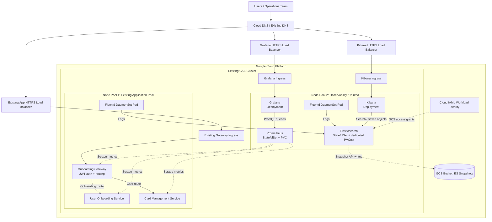

# GKE Observability Platform — EFK, Prometheus and Grafana

> **Project reconstruction / architecture README**  
> **Platform:** Google Cloud Platform (GCP), Google Kubernetes Engine (GKE)  
> **Provisioning:** Terraform  
> **Kubernetes deployment:** Helm  
> **Logging:** Elasticsearch, Fluentd, Kibana (EFK)  
> **Metrics / dashboards:** Prometheus, Grafana

## 1. Purpose and evidence status

The project added a centralized logging and monitoring stack to an **existing GKE application environment**. The primary implementation goals were to deploy EFK, collect logs from application and observability nodes, run observability workloads on an isolated node pool, and enable log exploration through Kibana. Prometheus and Grafana also formed part of the recalled observability architecture.

This README is a **reconstruction of the work**, not an exported Terraform plan or live-cluster audit. Keep the following distinctions in mind:

- **Confirmed from the project description:** three application services and a GKE deployment already existed; the task involved Elasticsearch, Fluentd and Kibana; a second node pool was allocated for observability; Fluentd was intended to run across both pools; Elasticsearch used persistent storage, a GCS bucket, and lifecycle/snapshot policies; Terraform and Helm were both used.
- **Previously discussed EFK deployment details:** Helm release `efk` in namespace `logging`, an earlier Elasticsearch configuration with one replica and a 30 GiB PVC, Fluentd as a DaemonSet, and a Kibana Deployment/Ingress. An earlier chart path was `bobcard-infra-terraform/helm-charts/efk/non-prod`. These reflect a **historical configuration**, not necessarily the final environment.
- **Likely, but requiring repository/state verification:** the exact Google IAM bindings, reserved IPs, monitoring chart, storage classes, replica counts, database backend for Grafana, and whether ILM/SLM were installed by API scripts or jobs.

The diagrams and inventories below intentionally distinguish **declared resources** from resources **created automatically by GKE/Kubernetes controllers**.

---

## 2. Environment before this project

The following infrastructure/application stack already existed before the observability work:

| Existing item | Purpose | Ownership before this project |
| --- | --- | --- |
| GCP project, VPC/subnetwork, firewall baseline | Cloud networking and access controls | Existing infrastructure |
| GKE cluster | Container orchestration | Existing infrastructure |
| **Node Pool 1 — Applications** | Runs the application services | Existing infrastructure |
| **Onboarding Gateway** | JWT authentication/authorization and API routing | Existing application |
| **User Onboarding Service** | User onboarding business logic | Existing application |
| **Card Management Service** | Card management business logic | Existing application |
| Database and application networking | Backing data access and inter-service communication | Existing infrastructure |
| Gateway Service/Ingress/load-balancer path | External access to the gateway | Existing infrastructure |

The remembered wider system also referenced Cloud SQL, Memorystore/Redis, Pub/Sub, Cloud DNS and Artifact Registry. **Verify which of those were actually present** before treating them as required dependencies of this observability project.

### Application request path

`User → DNS → existing gateway load balancer → GKE gateway Ingress/Service → Onboarding Gateway → User Onboarding or Card Management`

The observability work was designed to integrate with these workloads, **not recreate their infrastructure or business services**.

---

## 3. Requirements

### 3.1 Functional requirements

1. **Centralized application logs:** Collect stdout/stderr container logs from the three application services in GKE.
2. **Cluster-wide Fluentd coverage:** Run Fluentd agents on all *eligible worker nodes*, including application and observability node pools; handle taints/tolerations appropriately.
3. **Log transport and parsing:** Tail Kubernetes container log files, enrich records with Kubernetes metadata as configured, buffer/retry log delivery, and send documents to Elasticsearch.
4. **Persistent search storage:** Run Elasticsearch with persistent data volumes and an internal Kubernetes Service.
5. **Log discovery:** Deploy Kibana, connect it to Elasticsearch, and expose it through the approved HTTPS Ingress path.
6. **Metrics collection:** Run Prometheus to scrape instrumented application/cluster metrics endpoints, subject to the actual scrape configuration.
7. **Metrics visualization:** Deploy Grafana connected to Prometheus for dashboards and queries.
8. **Backup/retention:** Configure Elasticsearch log index lifecycle management (ILM), register a GCS snapshot repository, and configure scheduled snapshots (SLM) if present in the final deployment.
9. **Authentication/authorization:** Protect Elasticsearch/Kibana access, securely store credentials, and grant only necessary GCS permissions to the snapshot workload identity.
10. **Reproducibility:** Make cloud resources declarative with Terraform and Kubernetes workloads/configuration reproducible with Helm.

### 3.2 Non-functional requirements

| Area | Requirement / design intent |
| --- | --- |
| Resource isolation | Keep Elasticsearch, Kibana, Prometheus and Grafana on a dedicated observability node pool. |
| Log availability | Fluentd should tolerate transient Elasticsearch outages using buffered retries. |
| Persistence | Elasticsearch and Prometheus data survive individual pod restarts through PVCs. |
| Controlled growth | Set CPU/memory requests/limits, storage sizes, retention, and appropriately designed scaling policies. |
| Security | Internal-only Elasticsearch/Prometheus endpoints by default; restricted HTTPS access to Kibana/Grafana. |
| Least privilege | Scope storage IAM permissions to the snapshot bucket; avoid long-lived GCP credential key files. |
| Recoverability | Take and periodically test Elasticsearch snapshots; remember a snapshot policy is not itself a restore test. |
| Node scheduling | Use both **node affinity/selectors** and **tolerations** for targeted observability components. |

---

## 4. High-level architecture

The diagram shows a **likely final topology**. It intentionally places Kubernetes Ingress objects at the **cluster level**, not inside a node pool: Ingress is an API object processed by the GKE Ingress controller, not a pod running in that pool.



**Diagram notes**

- The three external load balancers are **GCP-managed resources**, ordinarily reconciled from the corresponding Kubernetes Ingress objects. The gateway path existed before this project; Kibana/Grafana routes were part of the observability exposure as remembered.
- `Fluentd DaemonSet Pod` is drawn once per node pool to simplify the picture. A DaemonSet schedules a pod on **each eligible node**, rather than exactly one pod per pool.
- The Elasticsearch/PVC representation supports one replica *or* multiple stateful replicas; the final replica count must be checked.
- Data stores used by the applications are omitted to keep this an observability architecture diagram.

---

## 5. Provisioning boundary: who created what?

| Layer / trigger | Explicit declaration or action | What actually gets created |
| --- | --- | --- |
| **Terraform → GCP API** | `google_container_node_pool` | New GKE node pool definition and its desired compute configuration. |
| **GKE / Compute Engine controllers** | Respond to node-pool provisioning/autoscaling | Underlying VM instances, managed instance group activity and node registration. |
| **Terraform → GCP API** | GCS bucket and IAM resources | Bucket, GCP identity/role grants for Elasticsearch snapshot access. |
| **Terraform or pre-existing setup** | Reserved public IP / DNS / Secret Manager, if configured | Corresponding GCP resources; ownership must be checked in Terraform state. |
| **Helm → Kubernetes API** | StatefulSet, Deployment, DaemonSet, Service, PVC, ConfigMap, Secret, Ingress, etc. | Kubernetes **declared objects** for EFK and monitoring. |
| **Kubernetes workload controllers / scheduler** | Reconcile StatefulSet/Deployment/DaemonSet | Pods, ReplicaSets, StatefulSet pod identities, placement and restarts. |
| **Kubernetes PVC + CSI controller** | PVC or StatefulSet `volumeClaimTemplates` | Bound PV and, with dynamic provisioning, the underlying GCE Persistent Disk. |
| **GKE Ingress controller** | Ingress + referenced Service (optionally BackendConfig/ManagedCertificate) | Google Cloud HTTPS load balancer, forwarding rule, proxies, URL map, backends, health checks and applicable NEG/firewall integration. |
| **Certificate controller** | Supported managed-certificate configuration | Managed certificate provisioning and attachment, subject to DNS and validation. |
| **Elasticsearch configuration/API** | Register repository; put ILM and SLM policies | Elasticsearch repository metadata and lifecycle policies; SLM later writes snapshots to GCS. |

**Key principle:** A resource automatically provisioned by a controller is not necessarily present as an explicit `terraform resource` or a separate Helm template.

---

## 6. Terraform-managed resources

### 6.1 New node pool — confirmed project scope

**Likely resource:** `google_container_node_pool` (assuming the existing cluster used Terraform-managed GKE Standard node pools).

Configuration likely included:

- Target existing GKE cluster and location.
- Node machine type, boot disk type/size, number of nodes or min/max autoscaling settings.
- Node labels (example: `workload=observability`).
- Taint (example: `dedicated=observability:NoSchedule`).
- Node service-account, metadata/Workload Identity settings, management/upgrade options as applicable.

Helm workloads would then use compatible scheduling rules; for example, Elasticsearch/Prometheus must have **both** a matching `nodeSelector`/affinity and a taint toleration. Fluentd needs tolerations for both pools while **not being pinned** solely to the new pool.

### 6.2 Storage and permissions

| Possible Terraform resource | Reason | Confidence |
| --- | --- | --- |
| `google_storage_bucket` | Bucket used by Elasticsearch snapshots | **High — explicitly remembered** |
| `google_service_account` | GCP identity for Elasticsearch snapshot access | Likely, depending on Workload Identity method |
| `google_storage_bucket_iam_member` or equivalent | Least-privilege bucket permissions for snapshots | Likely |
| `google_service_account_iam_member` | KSA-to-GSA impersonation authorization in the linked-service-account model | Conditional |
| `google_project_iam_member` / other IAM bindings | If project-level permissions were used (broader than preferred) | Unverified |
| `google_compute_global_address` | Reserved public IP for a global external Kibana/Grafana Ingress | Possible |
| `google_dns_record_set` | Custom domains for observability UIs | Possible; may have pre-existed |
| `google_secret_manager_secret` and versions | Password/credential storage if Secret Manager was used | Unverified |
| `random_password` | Password generation if Terraform handled credentials | Unverified |

#### Kubernetes identity versus GCP identity

- **KSA:** Kubernetes ServiceAccount, created by Helm/Kubernetes templates or another Kubernetes provisioning mechanism.
- **GSA:** Google Cloud IAM service account, usually created by Terraform or GCP tooling.
- **IAM binding:** Gives the workload identity or impersonated GSA access to the GCS bucket.
- In the KSA-to-GSA impersonation model, a KSA annotation and matching GCP IAM binding work together. Other Workload Identity Federation configurations may grant IAM directly to a Kubernetes principal and need no separate GSA.
- **Prometheus normally does not need GCS permissions just to scrape metrics.** A Prometheus-related GCP identity is relevant only if a specific integration requires it (such as Thanos/remote object storage or GCP APIs).

### 6.3 Passwords and secrets — ownership not yet certain

You recall generating credentials for Elasticsearch and Kibana. The earlier EFK chart also included `elasticsearch-secret.yaml`, `elasticsearch-init-job.yaml` and password/setup scripts. So credentials may have been initialized **through Helm and scripts**, not through Terraform.

Do not assume that Terraform owned passwords unless `terraform state list` and the Terraform source show `random_password`, Secret Manager or the relevant Kubernetes Secret resources. Do not commit real passwords or secret-bearing state files to the repository.

---

## 7. Helm-deployed components and Kubernetes resources

### 7.1 Component inventory

| Component | Typical Helm-created declarations | Role |
| --- | --- | --- |
| **Elasticsearch** | StatefulSet, headless/ClusterIP Service(s), `volumeClaimTemplates`, ConfigMap, Secret, ServiceAccount | Index/store/search log documents; allocate persistent storage per StatefulSet replica. |
| **Fluentd** | DaemonSet, ConfigMap, ServiceAccount, ClusterRole/ClusterRoleBinding as needed | Collect and forward node/pod container logs. |
| **Kibana** | Deployment, ClusterIP Service, ConfigMap/Secret, Ingress, possibly BackendConfig and managed certificate | Search and explore logs through HTTPS UI. |
| **Prometheus** | StatefulSet + PVC + Service + ConfigMap/RBAC, **or** Prometheus Operator custom resources | Scrape and retain time-series metrics. |
| **Grafana** | Deployment, Service, ConfigMaps/Secrets, Ingress, optionally PVC or external SQL settings | Dashboards and metrics visualization. |
| **Monitoring support** | ServiceMonitor/PodMonitor, PrometheusRule, exporters, Kube State Metrics, node exporters, if used | Discovery, metrics coverage and alerting configuration. |
| **Shared Kubernetes configuration** | Namespaces, NetworkPolicy, service accounts, RBAC, PodDisruptionBudget, etc., if templated | Isolation, access control and reliability. |

**Important:** Helm creates Kubernetes API objects by installing chart templates. It does *not* itself spawn pods, build the GCP load balancer or create a GCE disk. Kubernetes/GKE controllers reconcile those objects.

### 7.2 Elasticsearch

Expected configuration:

- StatefulSet for stable pod identity.
- PVCs generated by `volumeClaimTemplates` (one claim per StatefulSet replica).
- Elasticsearch discovery and cluster membership settings, appropriate for replica count.
- HTTP API Service, conventionally port **9200**; transport commonly **9300**.
- CPU/memory requests/limits and JVM heap settings.
- Authentication secrets and possibly an initialization job.
- Index templates, ILM, repository/SLM configured separately through the Elasticsearch API, unless your chart/setup job explicitly called those APIs.

**Scaling clarification:** Elasticsearch distributes **shards**, not raw PVC contents. Each Elasticsearch pod mounts its own disk; the Elasticsearch cluster coordinates queries across nodes/shards. Merely increasing replicas does not automatically change the number of *primary index shards*. One replica with a 30 GiB PVC was an earlier recorded configuration; the final architecture may have evolved.

### 7.3 Fluentd

Expected configuration:

- DaemonSet (one pod per eligible worker node).
- HostPath mounts to read node container log files; actual paths depend on GKE/runtime version.
- ConfigMap for input sources, metadata enrichment, filters, buffering, and Elasticsearch output.
- Tolerations so observability-node taints do not exclude Fluentd.
- RBAC and a ServiceAccount if Kubernetes metadata filters query the Kubernetes API.

**Log path:** `Application stdout/stderr → node container log files → Fluentd → Elasticsearch index → Kibana search`.

Fluentd was recalled as covering *both* Node Pool 1 and Node Pool 2. It does not normally run on the GKE-managed control plane.

### 7.4 Kibana

Expected configuration:

- Deployment and ClusterIP Service, commonly port **5601**.
- Connection settings for Elasticsearch.
- Authentication/encryption credentials as appropriate.
- GKE `Ingress`, and in the earlier chart, `BackendConfig` and `ManagedCertificate` resources.
- Optional higher replica count with shared/consistent encryption, authentication and session settings.

Kibana saved objects live in Elasticsearch; a dedicated Kibana data PVC is not usually the scaling mechanism.

### 7.5 Prometheus

Likely configuration:

- A StatefulSet with local TSDB storage on a PVC; deployed directly or through an operator/chart.
- Prometheus Service (commonly port **9090**).
- Scrape targets for applications and optional Kubernetes exporters/service monitors.
- Recording/alert rules and retention/compaction settings where configured.

**Scaling caveat:** Two Prometheus replicas can each have separate PVCs for **high availability**, but that does not automatically form one distributed TSDB. Distributed querying/storage requires an additional design such as sharding plus Thanos or another compatible query/remote-storage layer. Confirm whether you implemented HA replicas, scrape sharding, Thanos, or only one Prometheus instance.

### 7.6 Grafana

Likely configuration:

- Deployment, Service (commonly port **3000**), and GKE Ingress.
- Prometheus as a datasource.
- Dashboards provisioned by ConfigMaps, files, the Grafana API, or stored in Grafana's database.
- Optional PVC for a **single-instance SQLite-backed Grafana** deployment.

**Scaling caveat:** Increasing Grafana replica count is not sufficient if each pod has its own SQLite database or if multiple pods rely on an ordinary single-writer volume. For proper multi-replica/high-availability deployments, Grafana typically uses a shared external PostgreSQL/MySQL database and consistent application configuration. The final project database choice is **not verified**.

### 7.7 Known earlier EFK chart artifacts

An earlier project discussion identified the following path and filenames. Verify in Git before assuming they remain in the current checkout:

```text
bobcard-infra-terraform/
└── helm-charts/
    └── efk/
        └── non-prod/
            ├── values.yaml
            ├── ... Elasticsearch StatefulSet/Service/ConfigMap templates
            ├── ... Fluentd DaemonSet/ConfigMap templates
            ├── ... Kibana Deployment/Service templates
            ├── elasticsearch-secret.yaml
            ├── elasticsearch-init-job.yaml
            ├── kibana-ingress.yaml
            ├── kibana-backendconfig.yaml
            ├── kibana-managed-cert.yaml
            ├── setup-auth.sh
            ├── setup-password.sh
            └── setup-static-ip.sh
```

The earlier recorded release was `efk` in namespace `logging`, with Elasticsearch/Kibana **7.17.3**, Elasticsearch **1 replica / 30 GiB PVC**, and Fluentd **2 pods across 2 worker nodes** at the time. These are **historical observations**, not guaranteed final production settings.

---

## 8. Resources generated automatically by Kubernetes/GCP controllers

| Trigger from Helm or Terraform | Controller / platform | Automatically created or maintained | Terraform/Helm ownership implication |
| --- | --- | --- | --- |
| New Terraform GKE node pool | GKE / Compute Engine | Worker VMs, autoscaling infrastructure, node registration | Define the **node pool** in Terraform; avoid manually modifying GKE-managed VMs. |
| Kubernetes `Deployment` | Deployment and ReplicaSet controllers | ReplicaSet and pods | Helm owns the Deployment declaration; controllers manage replicas. |
| Kubernetes `StatefulSet` | StatefulSet controller | Stateful pods and per-replica claims from templates | Helm owns StatefulSet specification. |
| Kubernetes `DaemonSet` | DaemonSet controller | Pod per eligible matching node | Helm owns DaemonSet specification. |
| PVC + supported StorageClass | Kubernetes CSI external provisioner / GCE PD CSI | Bound PersistentVolume and underlying Compute Engine Persistent Disk | Usually **do not create each disk explicitly in Terraform**. |
| GCE `Ingress` + Service | GKE Ingress controller | Application Load Balancer components: forwarding rules, frontend IP if not pre-reserved, target proxy, URL map, backend services, health checks, and applicable firewall/NEG resources | Manage the **Ingress** via Helm; do not independently Terraform-manage the controller-created load balancer. |
| Ingress reference to a pre-reserved IP | GKE Ingress controller | Load balancer using that reserved IP | The IP **may** be Terraform-managed; the LB can still be controller-managed. |
| `ManagedCertificate` configuration | GKE certificate integration | Certificate lifecycle after domain/DNS validation | Certificate intent can be Helm-managed; cert issuance is asynchronous and GCP-managed. |
| Kubernetes `Service` | Kubernetes networking/control-plane components | ClusterIP allocation, endpoints/EndpointSlices, service routing behavior | Service declared by Helm, runtime network state generated by Kubernetes. |
| SLM policy + registered GCS repository | Elasticsearch scheduler/runtime | Snapshot objects written into the bucket | Bucket comes from Terraform; snapshot *contents* come from Elasticsearch. |

**Do not conflate GKE-generated firewall rules with the application's pre-existing network firewall policy.** The project may have used both existing rules and additional controller-generated ingress/health-check rules.

---

## 9. Elasticsearch lifecycle and backups

These are **three separate things**:

| Feature | Operates on | Purpose | Typical configuration location |
| --- | --- | --- | --- |
| **ILM** — Index Lifecycle Management | Elasticsearch indices | Rollover, warm/cold transition if supported/configured, retention and deletion | Elasticsearch APIs / Kibana Dev Tools / setup script |
| **Snapshot repository** | Elasticsearch snapshots | Connect Elasticsearch to a GCS bucket | Elasticsearch repository API + GCS access permissions |
| **SLM** — Snapshot Lifecycle Management | Snapshot schedule and retention | Run scheduled snapshots and manage old snapshot retention | Elasticsearch APIs / Kibana Dev Tools / setup script |

Likely setup flow:

1. Terraform provisioned the GCS bucket and granted the Elasticsearch identity appropriate access.
2. Helm deployed Elasticsearch, the PVC-backed StatefulSet and credentials/workload identity configuration.
3. An operator or initialization script/job registered the GCS snapshot repository in Elasticsearch.
4. ILM and SLM policies were applied through Elasticsearch APIs or Kibana.
5. Elasticsearch wrote snapshots into GCS based on the SLM schedule.

**The GCS snapshot bucket is not the live Elasticsearch data volume.** Indices live on Elasticsearch-managed disks/PVCs; GCS contains snapshot data for recovery. Fluentd-to-GCS direct archiving should **not** be claimed unless a Fluentd GCS output plugin/configuration is found.

---

## 10. Deployment sequence (reconstructed)

1. **Inspect the existing GCP/GKE environment:** cluster, app node pool, services, subnets/firewall, ingress, storage classes.
2. **Apply Terraform changes:** second node pool; GCS bucket; required IAM permissions/identities; optionally static IPs, DNS and credential resources.
3. **Configure placement:** taints/labels on the new pool and corresponding Helm values (`nodeSelector`, affinity, tolerations, requests/limits).
4. **Install Elasticsearch via Helm:** persistent storage, internal Service, authentication and init job as needed.
5. **Install Fluentd via Helm:** all eligible nodes, mount log paths, configure filters/buffers/Elasticsearch output.
6. **Install Kibana via Helm:** connect to Elasticsearch; create Ingress and certificate/BackendConfig configuration where applicable.
7. **Configure log management:** index templates/ILM; GCS snapshot repository; SLM policy; test snapshot and restore behavior.
8. **Install/configure Prometheus and Grafana via Helm:** scrape targets, datasource, dashboards, retention and storage.
9. **Verify generated cloud resources:** GKE Ingress load balancers, managed certificates, health checks, and dynamically provisioned disks.
10. **Validate observability:** logs from each application/pool, Prometheus target health, Kibana/Grafana access, restart behavior, and backup recovery.

This sequence illustrates a plausible deployment order; it is not an audit log of the original execution.

---

## 11. Verification checklist and commands

Run the following against the **correct project, Terraform workspace and Kubernetes context**. Commands show inventory/configuration; they do not recover deleted resources or guarantee the old environment still exists.

### Terraform — find what was explicitly provisioned

```bash
terraform workspace show
terraform state list
terraform state show <resource-address>
```

Look for `google_container_node_pool`, `google_storage_bucket`, IAM bindings, reserved addresses, DNS records, Secret Manager resources, and any Terraform `kubernetes_*` resources.

### Helm — identify releases and their rendered resources

```bash
helm list -A
helm get values efk -n logging --all
helm get manifest efk -n logging
helm history efk -n logging
```

For a separate monitoring release, substitute its actual release name and namespace (for example, look for `prometheus`, `kube-prometheus-stack`, or `grafana` via `helm list -A`).

### Kubernetes — compare desired and actual state

```bash
kubectl config current-context
kubectl get nodes -L workload
kubectl get deployments,statefulsets,daemonsets -A
kubectl get pods -A -o wide
kubectl get svc,ingress -A
kubectl get pvc,pv -A
kubectl get serviceaccounts -A
kubectl get backendconfigs,managedcertificates -A
kubectl get storageclass
```

Inspect a specific Deployment/StatefulSet/DaemonSet with `kubectl get ... -o yaml` and verify scheduling rules, service-account annotations, storage, resource requests, replicas, and actual pod locations.

### Elasticsearch — verify real lifecycle, shards and snapshots

Run in authenticated Kibana Dev Tools or through an authorized Elasticsearch API client:

```http
GET _cat/nodes?v
GET _cat/shards?v
GET _ilm/policy
GET _slm/policy
GET _snapshot/_all
```

Inspect the policies and repository definitions **before** describing exact retention periods, replica counts, snapshot intervals or a multi-node cluster.

### Confirm these project-specific unknowns

- [ ] Final Elasticsearch version, replicas, shard settings and PVC sizes.
- [ ] Fluentd buffer configuration, node tolerations and actual pod count.
- [ ] Terraform resource address/name for Node Pool 2 and its node sizing/autoscaling.
- [ ] Workload Identity scheme: direct KSA principal or KSA-to-GSA impersonation.
- [ ] GCS bucket, exact bucket-level IAM grants, and snapshot repository name.
- [ ] How Elasticsearch/Kibana passwords were generated and where secrets were stored.
- [ ] ILM and SLM policy names, creation method and retention settings.
- [ ] Whether Prometheus used a basic StatefulSet or Prometheus Operator and which scrape targets existed.
- [ ] Whether Prometheus was HA, sharded, or integrated with Thanos/remote storage.
- [ ] Whether Grafana persisted SQLite on a PVC or used shared PostgreSQL/MySQL.
- [ ] Static IPs, HTTPS managed certificates, BackendConfigs and DNS ownership.

---

## 12. Common interview / handover explanation

> We had an existing GKE application deployment with an API gateway, user-onboarding service and card-management service. I worked on adding a centralized observability layer. I used Terraform to extend the cluster with a dedicated, isolated monitoring node pool and supporting cloud resources such as storage and IAM permissions. I used Helm to deploy Elasticsearch, Fluentd and Kibana, with Fluentd running as a DaemonSet across the worker nodes and Elasticsearch using persistent volumes. Kibana was exposed through a GKE Ingress, which caused GKE to provision the underlying Google Cloud HTTP(S) load balancer resources. We also had Prometheus and Grafana in the observability architecture. Elasticsearch log retention, snapshot repository and backup scheduling were handled separately from the raw GCS bucket provisioning. The exact HA/scaling and policy configuration should be confirmed from the original chart and Terraform state.

This description intentionally avoids claiming unverified scaling or backup details.

---

## 13. Technical references

- [GKE Ingress and automatically created load balancers](https://docs.cloud.google.com/kubernetes-engine/docs/concepts/ingress)
- [GKE Ingress backend configuration and health checks](https://docs.cloud.google.com/kubernetes-engine/docs/concepts/ingress-routing-security)
- [GKE persistent volumes and dynamic provisioning](https://docs.cloud.google.com/kubernetes-engine/docs/concepts/persistent-volumes)
- [Workload Identity Federation for GKE](https://docs.cloud.google.com/kubernetes-engine/docs/concepts/workload-identity)
- [Elasticsearch Google Cloud Storage snapshot repository](https://www.elastic.co/guide/en/elasticsearch/reference/current/repository-gcs.html)
- [Elasticsearch Index Lifecycle Management](https://www.elastic.co/docs/manage-data/lifecycle/index-lifecycle-management)
- [Elasticsearch Snapshot Lifecycle Management](https://www.elastic.co/docs/deploy-manage/tools/snapshot-and-restore/create-snapshots)
- [Prometheus storage and operational considerations](https://prometheus.io/docs/prometheus/latest/storage/)
- [Grafana high availability](https://grafana.com/docs/grafana/latest/setup-grafana/set-up-for-high-availability/)

**Document status:** Reconstructed from project recollection and earlier EFK details. Update confirmed specifics from Git, Terraform state, Helm release manifests and Elasticsearch APIs before using as an authoritative as-built document.
