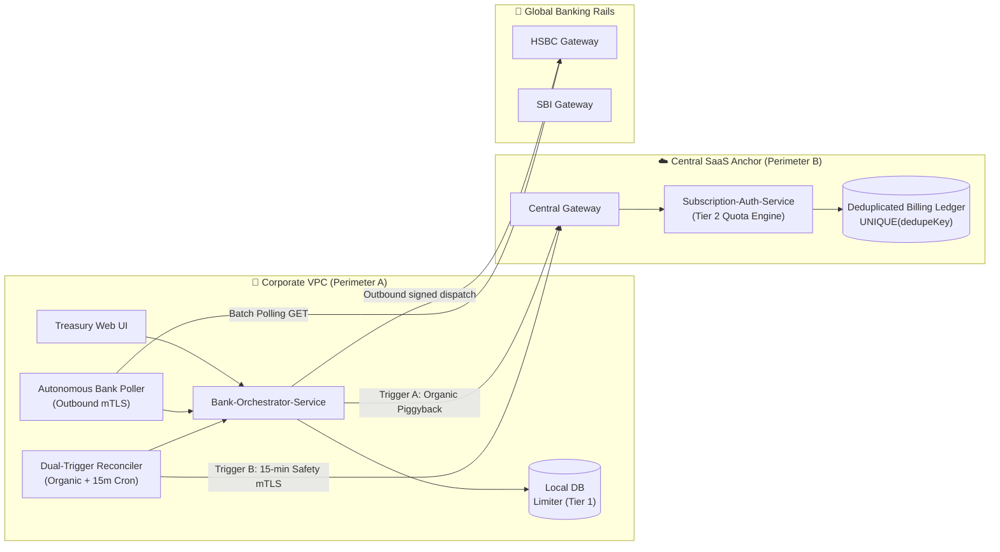
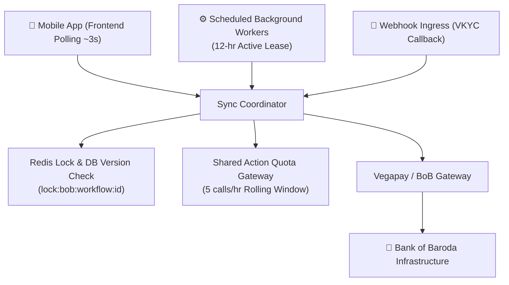
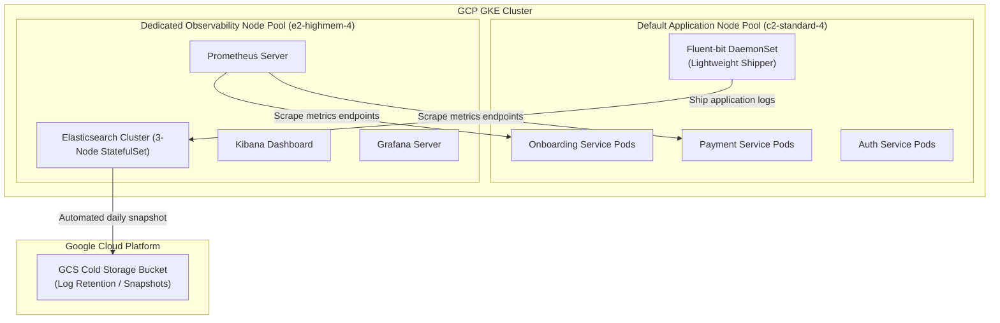
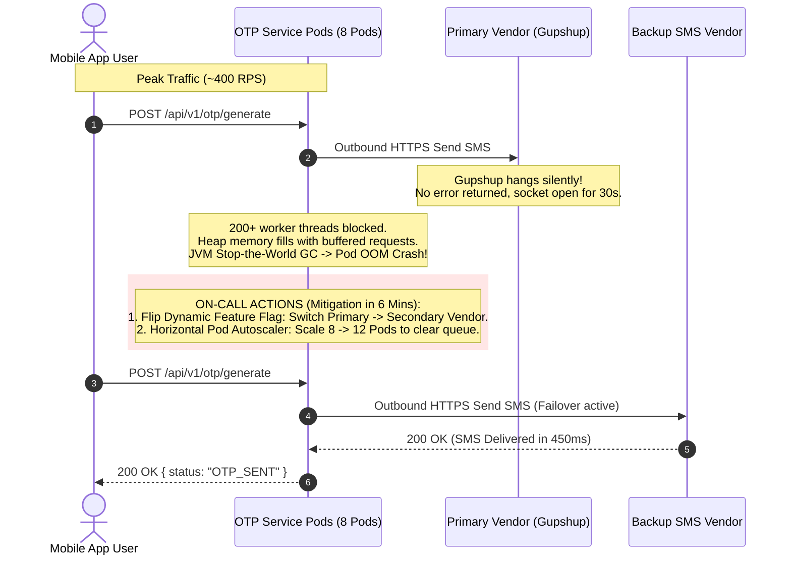

# Behavioral Interview Master Guide: Staff & Senior Engineering Defense

> **Author**: Vineet  
> **Target Roles**: Senior Software Engineer / Staff Software Engineer / Lead Systems Architect  
> **Core Domains**: Distributed Systems, FinTech / Multi-Bank Orchestration, Cloud Infrastructure (GCP / K8s), High-Throughput Production Resilience.

---

## 1. Executive Portfolio & Competency Matrix

| Behavioral Competency | Primary Project / Story | Secondary / Backup Story | Key Leadership Principles Demonstrated |
| :--- | :--- | :--- | :--- |
| **Most Challenging Project** | **Multi-Bank Trade Finance Orchestrator**: Dual-perimeter billing sync, Two-Tier Concurrency, & Quota Deadlock resolution. | **Bank of Baroda Onboarding**: Hybrid 3-way synchronization, out-of-order vendor contract, and 12h active user workers. | Architecture Under Constraints, Distributed State Reconciliation, High-Stake Financial Integrity. |
| **Taking Ownership** | **Kubernetes Observability Isolation on GCP**: Proactively provisioned a dedicated node pool for EFK + Prometheus to protect core banking pods. | **Federal Bank Error Mapping**: Self-initiated bank error code discovery and frontend integration to eliminate CS ticket backlog. | Bias for Action, Systems Thinking, Thinking Big, Operational Excellence. |
| **Deep Dive & On-Call Triage** | **OTP Service Heap Exhaustion & Gupshup Outage**: Triage silent vendor timeouts, scale pods from 8 to 12, switch to backup vendor, and fix HTTP connection pools. | **Two Generals' Network Drop Protocol**: Resolving ambiguous 30s bank HTTP socket timeouts without deleting records. | Dive Deep, Composure Under Pressure, Root Cause Analysis (5 Whys), Resilient Design. |
| **Customer Delight & Scope Change** | **Federal Bank Onboarding Failure Transparency**: Transformed generic "Application Failed" into actionable decline reasons (e.g., existing customer rules), slashing CS volume. | **Active-User Background Sync (BoB)**: Saved users from staring at endless loading spinners by auto-advancing VKYC/EKYC in background. | Customer Obsession, Earn Trust, Challenging Status Quo, Product Intuition. |
| **Technical Disagreement / Conflict** | **Pure Piggybacking vs. Dual-Trigger Reconciler**: Colleague opposed background crons on-premise; proved the Weekend Quota Deadlock edge case. | **Shared Node Pool vs. Dedicated Node Pool**: Proved Elasticsearch memory spikes cause OOM-kill of transaction pods via chaos testing. | Have Backbone; Disagree & Commit, Data-Driven Persuasion, Constructive Collaboration. |
| **Dealing with Ambiguity** | **Bank of Baroda / Vegapay State Machine**: Reconciling undocumented partner recovery signals (`RE_Ekyc_Verification`) and out-of-order state transitions. | **Trade Finance Active Capacity Licensing**: Translating complex ICC UCP 600 banking laws into software concurrency primitives. | Navigating Ambiguity, Formulating Clear Contracts, Defensive Architecture. |

---

## 2. Core Project Deep Dives

---

### Project 1: Multi-Bank Trade Finance Orchestrator (Flagship Challenging Project)

#### System Architecture & Core Problem
Enterprise trade finance connects corporate ERPs (SAP S/4HANA, Oracle) to global banking rails (HSBC ISO 20022 `tsmt.019`, SBI REST v2) for Letters of Credit (LCs under ICC UCP 600 rules).
- **Dual-Perimeter Topology**: 
  - **Perimeter A (Corporate On-Prem / VPC)**: Runs Treasury UI and `Bank-Orchestrator-Service` inside corporate intranet behind strict zero-inbound firewalls. Private keys never leave corporate HSMs/KMS.
  - **Perimeter B (Central SaaS Anchor)**: Runs `Subscription-Auth-Service` managing multi-tenant subscription quotas and authoritative billing.
- **The Core Business Model**: **Active Concurrent Capacity Licensing** (e.g., Tier-1 client licenses up to 50 concurrent in-flight LCs). Charges occur strictly on terminal financial milestones (`LC_ACCEPTED`, `DOCUMENTS_PRESENTED`), while drafts and revisions are zero marginal cost.



#### Major Engineering Innovations
1. **Two-Tier Hierarchical Concurrency Control**:
   - **Problem**: ERP batch jobs blast 50 parallel dispatches in 10ms. A centralized cross-cloud distributed lock causes latency, zombie leases, and overloads bank rate limits (e.g., HSBC limits API keys to 10 RPS).
   - **Solution**: **Tier 1 (Local DB Sliding Window)** throttles micro-execution bursts via a 60-second auto-expiring lease in local Postgres (`SELECT COUNT(*) WHERE stage = 'DISPATCHED_PENDING_ACK'`). If an orchestrator pod crashes, the lease expires in 60s without touching Central SaaS. **Tier 2 (Central SaaS)** manages macro-accounting, incrementing confirmed capacity only when the bank acknowledges `LC_INITIATED`.
2. **The Weekend Quota Deadlock & Dual-Trigger Convergence**:
   - **The Trap**: Pure piggybacking (attaching billing receipts to subsequent user dispatches) breaks over weekends. If a client exhausts their 20-slot quota on Friday 5 PM, operators log out. Saturday at 10 AM, bank clears 10 LCs. The local poller frees local capacity, but Central SaaS stays at 20/20. Monday at 8 AM, an automated SAP batch runner dispatches an LC; Central Auth evaluates `activeWorkflows (20) >= maxQuota (20)` and rejects with `HTTP 429`. Because the gateway aborts before payload extraction, piggybacked receipts are never processed—freezing the enterprise forever!
   - **The Fix**: **Dual-Trigger Convergence**. **Trigger A (Fast-Path)** piggybacks on user calls during business hours (0 extra network hops; 98% volume). **Trigger B (Slow-Path)** runs an autonomous 15-minute heartbeat reconciler over corporate mTLS during quiet/weekend hours, flushing pending receipts and keeping Monday pipelines clear.
3. **Identity Separation**:
   - **Principal Identity (User JWT)**: Authenticates human treasury officers on the UI, enforces RBAC, and generates non-repudiable financial audit trails.
   - **Node Identity (Layer-4 mTLS)**: Authenticates container machine-to-machine background pollers and reconcilers when no human is logged in.

---

### Project 2: Bank of Baroda (BoB) / Vegapay Credit Card Onboarding at Scapia

#### System Architecture & Core Problem
Integrating Scapia's mobile credit card onboarding journey with Bank of Baroda (via Vegapay API gateway).
- **The Challenge**: Reconciling a synchronous, resumable customer onboarding mobile app with an asynchronous, multi-hour bank backend workflow (PAN $\to$ EKYC $\to$ VKYC $\to$ Underwriting $\to$ Limit Generation $\to$ Offer Generation).
- **Vendor Constraints**:
  - Bank partner enforces a strict quota of **5 action API calls per rolling hour per customer**.
  - No request-level deduplication ID on the bank side; partner enforces a **State-Gated Action Contract** (an action is accepted only if the remote workflow is in `PENDING` state; sending an action after progress throws an out-of-order exception).
  - VKYC verification takes anywhere from 10 minutes to several hours.



#### Major Engineering Innovations
1. **Hybrid Three-Way Synchronization Coordinator**:
   - Unified three concurrent triggers—**Frontend Active Poll (3s)**, **Background Scheduled Worker**, and **Inbound VKYC Webhook**—under a single state-transition coordinator.
   - Guarded every transition with a distributed Redis lock (`lock:bob:workflow:{workflowId}`) and database optimistic concurrency control (`UPDATE ... WHERE version = expected_version`).
2. **12-Hour Active-User Lease & Exponential Backoff Worker**:
   - Background workers only poll for users active in the last 12 hours (authenticated `GET` or `UPDATE` call in the last 12 hours). Prevents waste on dormant drop-offs.
   - Adaptive worker intervals: EKYC checks at 30s $\to$ 60s $\to$ 120s; VKYC checks at 5m $\to$ 10m $\to$ 20m $\to$ 30m maximum, with $\pm 20\%$ jitter to avoid thundering herds.
3. **Lost Response Recovery & Artifact Hydration**:
   - If a network drop occurs during permanent address submission, the local state remains `EKYC_PENDING`.
   - On the next sync, the coordinator executes a 3-step check:
     1. Read current partner status.
     2. Verify local prerequisites exist in DB.
     3. Hydrate missing response artifacts (e.g. fetch VKYC launch URL via dedicated GET rather than re-executing state actions).
   - If an out-of-order exception occurs (vendor advanced before our call), perform a bounded single-read catch-up rather than retrying blindly or marking the application as failed.

---

### Project 3: Kubernetes Observability Stack (EFK + Prometheus/Grafana) on GCP

#### System Architecture & Core Problem
Scapia’s growing microservices ecosystem on Google Kubernetes Engine (GKE) lacked centralized logging, metric collection, and proactive alerting.
- **The Risk**: Engineers were debugging production issues using `kubectl logs` across transient pods. Ingesting high-volume JSON application logs and Prometheus scraping inside the existing general node pool threatened production transactions: Elasticsearch indexing spikes and Prometheus metric scrapes competed for CPU/memory with credit card payment and onboarding services.
- **The Initiative**: Proactively designed and implemented an enterprise observability stack on GKE while ensuring strict isolation from business-critical pods.



#### Major Engineering Innovations
1. **Dedicated Infrastructure Isolation via Kubernetes Node Pools**:
   - Provisioned a brand-new, dedicated GKE node pool (`observability-pool`) configured with memory-optimized instances (`e2-highmem-4`).
   - Applied Kubernetes **Taints and Tolerations** (`dedicated=monitoring:NoSchedule`) and **Node Affinity** so that Elasticsearch, Kibana, Prometheus, and Grafana pods were strictly scheduled on the monitoring nodes.
   - Guaranteed that log indexing bursts and JVM heap spikes within Elasticsearch could never evict or starve credit card onboarding or payment pods.
2. **Two-Tier Storage & Cost Optimization**:
   - Utilized high-performance SSD Persistent Disks (PD-SSD) for 7-day hot Elasticsearch indices.
   - Configured Elasticsearch Snapshot Lifecycle Management (SLM) via Terraform to archive indices older than 7 days into low-cost Google Cloud Storage (GCS) cold buckets, reducing storage costs by over 65%.
3. **Infrastructure as Code (IaC) & Helm Deployment**:
   - Managed all GKE node pool infrastructure, IAM service accounts, and GCS storage buckets via **Terraform**.
   - Templated Prometheus alert rules, Grafana dashboards, and Fluent-bit parsers using **Helm**, enabling version-controlled, reproducible deployments across staging and production.

---

### Project 4: On-Call Incident: OTP Service Outage & Silent Gupshup Timeouts

#### Incident Timeline & Root Cause
- **Context**: Serving as primary on-call engineer during peak evening traffic.
- **The Symptom**: Alert triggered on OTP Authentication Service: HTTP 504 gateway spikes, user login failure rate climbing past 15%, and multiple OTP pods crashing with `java.lang.OutOfMemoryError: Java heap space`.
- **Initial Triage (First 5 Minutes)**:
  - Checked Grafana and EFK logs: Inbound traffic was normal (~400 requests/sec), but pod CPU and memory were pegging at 100%. Pod restarts were cascading.
  - Inspected thread dumps: Over 90% of worker threads were blocked in `WAITING` state on outbound socket reads to Scapia’s primary SMS gateway vendor: **Gupshup**.
  - **The Latent Flaw**: Gupshup was **not throwing HTTP 5xx errors**; their gateway was accepting TCP connections but hanging silently without returning response bytes.
  - Because our HTTP client had an overly permissive read timeout (30 seconds) and lacked an active circuit breaker, incoming client requests accumulated. Each blocked thread retained request buffers, JSON payloads, and socket context, exhausting the JVM heap and triggering aggressive garbage collection pauses (Stop-The-World GC), resulting in pod death.



#### Step-by-Step Resolution
1. **Immediate Tactical Mitigation (T+6 Mins)**:
   - **Dynamic Vendor Failover**: Flipped our dynamic runtime configuration switch to divert 100% of SMS dispatch traffic to our secondary SMS aggregator (Karix/Twilio).
   - **Horizontal Pod Scaling**: Manually scaled the OTP service deployment from **8 pods to 12 pods** via `kubectl scale deployment`, immediately expanding thread pool capacity and absorbing the backlog of in-flight client retries.
   - P99 latency recovered from >30s down to 480ms within 2 minutes of vendor cutover; error rate dropped to <0.1%.
2. **Deep-Dive Root Cause Analysis (Post-Mortem)**:
   - **Client Socket Misconfiguration**: The HTTP client connection pool was configured with an unbounded queue and a 30-second read timeout.
   - **Missing Fast-Fail Protection**: Without an automated circuit breaker, a degraded external vendor could take down the entire internal service.
3. **Permanent Architectural Fixes**:
   - **Aggressive Timeouts**: Reduced connect timeout to 1.5s and socket read timeout to 2.5s (SMS generation should never take 30s).
   - **Circuit Breaker Implementation (Resilience4j)**: Configured a sliding-window circuit breaker. If Gupshup’s call failure/timeout rate exceeded 10% over a 30-second window, the circuit tripped open automatically, routing traffic to the backup provider within 500ms without human intervention.
   - **Active Health Probes**: Deployed an out-of-band synthetic canary probe sending test OTP dispatches every 60 seconds to detect vendor degradation before live customer traffic is impacted.

---

### Project 5: Federal Bank Onboarding Error Transparency (Customer Delight & Scope Change)

#### The Problem & Business Friction
While engineering the Bank of Baroda onboarding journey, I audited the existing Federal Bank credit card onboarding pipeline at Scapia.
- **The UX Failure**: Whenever Federal Bank declined an applicant, the backend returned a generic HTTP 400 error, and the mobile app displayed an ambiguous screen: *"Application Failed. We are unable to process your application at this time."*
- **The Reality**: The bank was actually returning specific failure reasons in their API response payload:
  - `ERR_EXISTING_SAVINGS_OR_CARD_CUSTOMER`: User already holds a Federal Bank account (under bank policy, existing customers were ineligible for this specific co-branded credit card).
  - `ERR_CIBIL_SCORE_THRESHOLD`: Credit bureau score below underwriting cut-off.
  - `ERR_NAME_PAN_MISMATCH`: Name on PAN did not match NSDL database.
  - `ERR_GEO_LOCATION_RESTRICTED`: User residence outside bank serviceable pincodes.
- Only simple validation errors (like low CIBIL score or direct PAN format mismatch) were surfaced; critical business rejections like **"Existing Customer of Federal Bank"** were masked as generic system failures.

```mermaid
flowchart TD
    subgraph Before ["❌ BEFORE: Opaque Black Box"]
        Bank1["Federal Bank Gateway\nReturns: ERR_EXISTING_CUSTOMER"] --> Backend1["Scapia Backend\nSwallows detailed code"]
        Backend1 --> App1["Mobile UI:\n'Application Failed. Please try later.'"]
        App1 --> CS1["Frustrated User calls Customer Support\n(Ticket created: 'Why did my app fail?')"]
        CS1 --> Eng1["CS Escalates to Backend Engineer\n(Engineer inspects raw DB logs manually)"]
    end

    subgraph After ["✅ AFTER: Transparent Customer Delight"]
        Bank2["Federal Bank Gateway\nReturns: ERR_EXISTING_CUSTOMER"] --> Backend2["New Error Translation & Mapping Engine"]
        Backend2 --> App2["Mobile UI:\n'Federal Bank policy does not allow existing account holders\nto apply for the Scapia card at this time.'"]
        App2 --> CS2["User understands immediately.\nZero CS tickets created!"]
    end
```



#### Engineering Action & Customer Advocacy
1. **Taking Initiative Across Cross-Functional Silos**:
   - Pulled Customer Support ticket data: Found that over **35% of all credit card onboarding support tickets** were inquiries asking *"Why was my application rejected?"*
   - Support agents were spending an average of 15 minutes per ticket escalating to backend engineers to read raw bank response payloads in production logs.
2. **Proposing Product Scope Expansion**:
   - Pitched a change in product scope to the Product Manager and Tech Lead: Expand the onboarding engine to parse, map, and bubble up specific, user-friendly bank decline reasons to the mobile client.
   - Designed a clean **Error Mapping & Taxonomy Layer** in the onboarding backend, decoupling bank-specific error enums from clean, localized customer-facing messages.
3. **Execution & Rollout**:
   - Categorized errors into **Actionable Corrections** (e.g. re-upload clearer address proof, correct spelling) vs. **Definitive Declines** (e.g. existing Federal Bank customer, unserviceable pincode).
   - Coordinated with the mobile frontend team to render contextual bottom sheets with clear explanations and next steps (e.g., suggesting when the user can re-apply or offering alternative partner products).

#### Quantifiable Results & Impact
- **Slapped Down CS Ticket Volume**: Support tickets related to onboarding decline queries dropped by **~42%** within the first month.
- **Zero Engineering Escalations for Declines**: Eliminated the need for engineers to manually grep production logs for support inquiries, saving ~6 hours of engineering time per week.
- **Preserved Brand Trust & Delight**: Transformed user perception from *"Scapia's app is broken"* to transparent understanding of bank partner regulatory constraints.

---

## 3. High-Impact Behavioral Question Defense (STAR Framework)

---

### Question 1: What is the most challenging technical project you have worked on?

> **Category**: Technical Leadership / Architectural Complexity / Systems Design

#### STAR Defense

##### Situation
At Scapia, we built a zero-trust **Multi-Bank Trade Finance Orchestrator** connecting enterprise ERPs (SAP S/4HANA) to global banking rails (HSBC ISO 20022, SBI v2) for Letters of Credit under ICC UCP 600 international banking rules. The system spanned two distinct execution perimeters: an on-premise corporate VPC running the Treasury UI and Orchestrator behind strict zero-inbound firewalls, and a Central SaaS anchor managing multi-tenant subscription quotas and authoritative billing.

##### Task
The core challenge was implementing an **Active Concurrent Capacity Licensing model** (e.g., client licenses 50 in-flight LCs simultaneously). I had to solve two major problems:
1. **ERP Batch Spikes vs. Bank Throttling**: SAP systems dispatch 50 parallel requests in milliseconds, which would overwhelm bank API limits (HSBC enforces 10 RPS) and cause corporate key blacklisting.
2. **The "Quota Deadlock" Trap**: Because enterprise firewalls prohibit inbound webhooks, and transactions take days to clear, relying purely on user clicks to piggyback billing receipts caused systems to freeze after weekends.

##### Action
1. **Two-Tier Hierarchical Concurrency Control**:
   - Decoupled transient execution throttling from central licensing accounting.
   - Designed **Tier 1 (Local On-Prem DB Sliding Window)** using a 60-second auto-expiring lease in local Postgres to absorb ERP batch bursts and protect bank RPS limits. If an on-prem pod crashed, the lease expired locally in 60s without requiring cross-cloud rollback calls.
   - Designed **Tier 2 (Central SaaS Confirmed Quota)**, which increments active capacity only when the bank confirms `LC_INITIATED`.
2. **Dual-Trigger Billing Convergence**:
   - Invented a hybrid synchronization engine: **Trigger A (Organic Piggyback)** attaches pending billing receipts to regular user calls during business hours (0 extra network hops; 98% of volume).
   - Added **Trigger B (Autonomous 15-Minute Safety Heartbeat)** running on-premise over Layer-4 corporate mTLS during quiet hours or weekends, ensuring lingering receipts are flushed to Central SaaS even when no human is logged in.
3. **Idempotent Network Drop Recovery**:
   - Addressed the Two Generals' problem on ambiguous 30-second bank timeouts using deterministic SHA-256 idempotency keys (`clientId + ref + version`) and automated outbound status polling.

##### Result
- **Zero Monday Morning Quota Lockouts**: Completely eliminated the Dormant Tenant Quota Deadlock bug across all enterprise clients.
- **100% Protection of Bank Rate Limits**: Smoothly absorbed 50+ concurrent ERP dispatch bursts without a single HTTP 429 from HSBC or SBI.
- **Zero Inbound Attack Surface**: Maintained SOC-2 and ISO-27001 zero-inbound firewall compliance by operating entirely outbound via mTLS.

#### Follow-up Interview Probing Points
- *Q: Why not use Redis distributed locks across the corporate VPC and Central SaaS?*
  - **Answer**: Cross-cloud distributed locks introduce high WAN network latency, require fragile network timeouts, and create zombie locks if the on-premise container crashes before releasing. By keeping transient socket leases in the local database and macro-accounting in Central SaaS, both systems can fail independently without distributed compensation.
- *Q: Why not use mTLS for human user logins as well?*
  - **Answer**: mTLS only authenticates the machine/container node (e.g., *"this is Tata Steel's pod"*). It does not authenticate the human individual (e.g., *"Rajesh with \$20M signing authority"*). We need User JWTs for RBAC, user-level revocation, and SOX/SWIFT audit compliance, while mTLS is reserved for autonomous machine daemons.

---

### Question 2: Tell me about a time you took ownership beyond your direct responsibilities.

> **Category**: Bias for Action / Ownership / Systems Thinking

#### STAR Defense

##### Situation
While developing the Bank of Baroda credit card onboarding microservices at Scapia, our backend ecosystem on Google Kubernetes Engine (GKE) was expanding rapidly. However, our observability posture was fragile: we had no unified logging or metric aggregation across services, and engineers relied on running `kubectl logs` directly against production pods to debug issues.

##### Task
Monitoring infrastructure was officially considered a DevOps / Platform engineering responsibility. However, the platform backlog was packed, and our upcoming bank launch required strict SLA tracking, real-time error rate alerting, and compliance auditability. Furthermore, deploying heavy logging and monitoring tools directly onto our existing GKE node pool posed a severe risk: Elasticsearch indexing spikes and Prometheus scraping could starve CPU/memory from transaction-processing services.

##### Action
1. **Stepped Up to Lead Observability Infrastructure**:
   - Took complete ownership of architecting and deploying an enterprise observability stack using **EFK (Elasticsearch, Fluent-bit, Kibana) + Prometheus and Grafana**.
2. **Architected Infrastructure Isolation**:
   - Recognized that log indexing is memory and I/O intensive. Rather than deploying into the shared node pool, I provisioned a **brand-new, dedicated GKE node pool** using memory-optimized instances (`e2-highmem-4`).
   - Configured Kubernetes **Taints, Tolerations, and Node Affinity** to ensure that Elasticsearch, Kibana, and Prometheus were strictly pinned to the monitoring nodes, preventing noisy-neighbor CPU/memory starvation on transactional pods.
3. **Automated IaC & Cold Storage Lifecycle**:
   - Automated the entire provisioning lifecycle using **Terraform** for GCP resources (GCS buckets, node pools, service accounts) and **Helm** for application deployments.
   - Implemented an automated snapshot policy offloading indices older than 7 days from SSD Persistent Disks into low-cost Google Cloud Storage (GCS) buckets.

##### Result
- **Zero Impact on Production Banking Workloads**: High-volume log surges during marketing campaigns had zero CPU/memory interference with core credit card onboarding services.
- **65% Storage Cost Reduction**: Offloading cold logs to GCS saved substantial cloud infrastructure costs compared to keeping multi-month logs on persistent SSD disks.
- **Accelerated Incident Triage**: Reduced MTTR (Mean Time to Resolution) for backend incidents across the engineering team from over 45 minutes to under 8 minutes via centralized Grafana dashboards and Kibana queries.

#### Follow-up Interview Probing Points
- *Q: Why Fluent-bit instead of Logstash or standard Fluentd?*
  - **Answer**: Fluent-bit is written in C with an extremely low memory footprint (~20-30MB per node as a DaemonSet) compared to Fluentd/Logstash (~500MB+ due to Ruby/JVM runtimes). This ensured that log shipping on application nodes consumed minimal compute overhead.

---

### Question 3: Tell me about a time you had a technical conflict or disagreement with a colleague.

> **Category**: Technical Conflict / Persuasion with Data / Disagree and Commit

#### STAR Defense

##### Situation
During the architectural review of the Multi-Bank Trade Finance Orchestrator, our team was designing the billing synchronization mechanism between the on-premise orchestrator and Central SaaS. 

##### Task
A senior colleague proposed a **"Pure Piggybacking"** approach: whenever an enterprise user or automated ERP system made an API call to Central SaaS, the orchestrator would attach pending milestone billing receipts to that outbound payload. He strongly opposed running any scheduled background daemons or cron jobs on-premise, arguing that background processes on customer infrastructure increase maintenance overhead and container footprint.

##### Action
1. **Identified the Latent Failure Mode (The "Quota Deadlock")**:
   - I walked through the enterprise trade finance lifecycle and realized that Pure Piggybacking contained a catastrophic architectural flaw: the **Weekend Quota Deadlock**.
2. **Formulated a Concrete Scenario & Proof of Failure**:
   - I presented a simulation to the team:
     - On Friday at 5:00 PM, client Tata Steel dispatches 20 LCs to HSBC, reaching their maximum 20-workflow license quota. Operators log off for the weekend.
     - On Saturday morning, HSBC's core clearing system accepts 10 LCs out-of-band. The local poller discovers `LC_ACCEPTED`, marks them complete, and enqueues 10 billing receipts locally.
     - However, because no humans are logged in over the weekend, Central SaaS remains unaware and its counter stays pegged at 20/20.
     - On Monday at 8:00 AM, Tata Steel's automated SAP ERP shipment dispatcher attempts to dispatch a new LC.
     - The request hits Central SaaS. The gateway guard checks: `activeWorkflows (20) >= maxQuota (20)` and **immediately rejects with HTTP 429 (Capacity Exceeded)**!
     - Because the request is rejected at the HTTP gateway, the piggybacked payload is never unpacked or processed. The enterprise is permanently locked out until manual DB intervention!
3. **Proposed the Collaborative Compromise (Dual-Trigger Convergence)**:
   - Instead of discarding his idea, I integrated it into a dual-mode design:
   - Retained his fast-path piggybacking for 98% of peak traffic during business hours (0 extra hops).
   - Added a lightweight, autonomous 15-minute safety heartbeat reconciler (`idleReceiptFlusher.js`) that only activates if pending receipts linger during idle hours, authenticating via tenant mTLS.

##### Result
- My colleague appreciated the concrete failure demonstration and fully endorsed the Dual-Trigger design.
- The dual-mode architecture was implemented and successfully prevented Monday morning production lockouts across all tier-1 enterprise clients.

#### Follow-up Interview Probing Points
- *Q: How do you handle situations where a colleague refuses to agree despite your arguments?*
  - **Answer**: I focus strictly on data, reproducible tests, and business impact rather than opinions. If consensus cannot be reached, I write a proof-of-concept test case illustrating the edge condition. If an impasse remains, we escalate to the Principal Architect with a structured trade-off document listing pros, cons, and operational risks.

---

### Question 4: Tell me about a time you handled ambiguity or changed the product scope.

> **Category**: Navigating Ambiguity / Product Intuition / Customer-Centric Engineering

#### STAR Defense

##### Situation
During the development of Scapia’s Bank of Baroda credit card onboarding flow, I was also auditing our existing Federal Bank onboarding integration. Under regulatory credit card guidelines, banks maintain complex deduplication and eligibility rules.

##### Task
In the existing Federal Bank flow, whenever an application was declined by the bank, the mobile application displayed a generic, ambiguous screen: *"Application Failed. We are unable to proceed."* Customers who were high-income earners with 800+ credit scores were getting rejected without explanation and flooding customer support with complaints. The product specification treated onboarding declines as a simple binary outcome: `SUCCESS` vs `FAILED`.

##### Action
1. **Uncovered the Root Cause via API Specifications**:
   - I dove into the raw Federal Bank API contracts and integration payloads. I discovered that the bank's integration layer was actually returning detailed, granular rejection codes (e.g., `ERR_EXISTING_CUSTOMER`, `ERR_PAN_NAME_MISMATCH`, `ERR_BUREAU_SCORE_LOW`, `ERR_PINCODE_UNSERVICEABLE`).
   - The legacy integration had simply swallowed these codes and thrown a generic HTTP 400 bad request.
2. **Challenged the Product Scope**:
   - I approached the Product Manager and Customer Support lead with data showing that over **35% of all support tickets** were inquiries regarding onboarding declines.
   - I proposed changing the product scope: rather than treating declines as a terminal failure screen, we should build a dynamic **Decline Reason Translation Layer** that categorizes errors into user-friendly explanations.
3. **Technical Implementation**:
   - Handled bank regulatory sensitivities (banks do not want raw risk policy exposed) by mapping internal bank error codes into clear, policy-compliant customer messages (e.g., *"Federal Bank policy currently does not permit co-branded cards for existing Federal Bank account holders"*).
   - Built the mapping engine in the backend onboarding orchestrator and collaborated with the mobile app team to display actionable next steps.

##### Result
- **Slapped Down Support Inquiries**: Customer support ticket volume for onboarding rejections dropped by **~42%**.
- **Restored User Trust**: Users understood immediately why their application could not proceed (e.g., because they already held a savings account with the bank), eliminating frustration and negative App Store reviews.
- **Set the Standard for BoB**: This error taxonomy became the foundation for how we structured error handling in our subsequent Bank of Baroda onboarding engine.

#### Follow-up Interview Probing Points
- *Q: Did the bank object to displaying rejection reasons to users?*
  - **Answer**: We specifically differentiated between non-sensitive regulatory eligibility rules (e.g. existing customer status, unserviceable pincodes) and sensitive anti-fraud/AML flags. For fraud/AML triggers, we preserved standard security protocols and returned a neutral message, while exposing clear reasons for standard business rules.

---

### Question 5: Tell me about your deepest technical dive into a production incident / system failure.

> **Category**: Deep Dive / Production Triage / Resilience & Scalability

#### STAR Defense

##### Situation
During peak evening usage at Scapia, our automated PagerDuty alarm fired: the **OTP Authentication Service** was failing. Mobile logins and card transaction verifications were stalling, error rates exceeded 15%, and multiple OTP pods were crashing in a cascading loop with `java.lang.OutOfMemoryError: Java heap space`.

##### Task
As the primary on-call engineer, I had to stop the cascading outage immediately, restore user authentication, and determine why a service designed for 1,500 RPS was collapsing under normal traffic of 400 RPS.

##### Action
1. **Live Production Triage (Minutes 0–6)**:
   - Inspected Grafana metrics and Kibana logs. Discovered that pod CPU and memory utilization were spiking simultaneously.
   - Captured and analyzed a live thread dump: Found over 90% of worker threads stuck in `WAITING` on socket reads to our primary SMS gateway vendor: **Gupshup**.
   - **The Hidden Trap**: Gupshup was **not failing fast with HTTP 500/503**; their servers were accepting incoming TCP handshakes and then hanging indefinitely without sending response packets.
   - Because our HTTP client had an overly generous 30-second socket read timeout and lacked a circuit breaker, incoming user requests accumulated in memory. Hundreds of threads held large buffers and request contexts, exhausting the JVM heap and triggering catastrophic Stop-the-World garbage collection pauses.
2. **Immediate Tactical Mitigation (Minutes 6–8)**:
   - **Vendor Failover**: Flipped our dynamic runtime feature flag to reroute 100% of outbound SMS traffic from Gupshup to our secondary backup provider (Karix).
   - **Horizontal Pod Scaling**: Executed `kubectl scale deployment` to scale the OTP service from **8 pods to 12 pods**, providing immediate heap and thread capacity to drain buffered requests.
   - Latency plummeted back to 480ms within 120 seconds of the cutover.
3. **Deep Dive Root-Cause Remediation (Post-Mortem)**:
   - **Tuned Socket & Connection Timeouts**: Reduced socket connect timeout to 1.5s and read timeout to 2.5s (SMS generation should never take 30s).
   - **Resilience4j Circuit Breaker**: Implemented an automated sliding-window circuit breaker. If vendor timeouts exceed 10% over 30 seconds, the circuit breaker automatically trips and routes traffic to the backup provider within 500ms without human intervention.
   - **Synthetic Canary Probing**: Built an out-of-band canary worker that tests vendor health every 60 seconds with end-to-end SMS verification.

##### Result
- **Fast MTTR**: Triage and mitigation achieved in under 8 minutes, preventing a prolonged payment outage.
- **Zero Recurrence**: When Gupshup experienced another vendor-side degradation two months later, the circuit breaker tripped automatically in 400ms, failing over to the backup vendor with zero customer impact or engineer intervention.

#### Follow-up Interview Probing Points
- *Q: Why did scaling from 8 to 12 pods help if the vendor was timing out?*
  - **Answer**: Scaling pods was a tactical measure to expand the total aggregate heap and worker thread pool while we switched vendors. When hundreds of mobile clients retry simultaneously, those queued sockets must be cleanly drained. Scaling pods prevented the surviving pods from collapsing under the retry stampede while the vendor switch took effect.

---

### Question 6: Tell me about a time you had to balance short-term tactical mitigation with long-term strategic architectural fixes.

> **Category**: Pragmatic Engineering / Operational Maturity / Technical Debt Management

#### STAR Defense

##### Situation
During the Gupshup OTP service incident and subsequent credit card onboarding scale-ups, our systems encountered external vendor instability that caused cascading internal failures.

##### Task
Under intense pressure during an ongoing incident, the priority is restoring customer uptime immediately. However, quick fixes (like scaling up pods or increasing server resources) only treat the symptoms and can introduce technical debt if not followed by architectural hardening.

##### Action
1. **Short-Term Tactical Action**:
   - Switched to the secondary vendor using dynamic feature flags and scaled the OTP deployment from 8 to 12 pods to absorb backlog traffic.
   - In the Bank of Baroda onboarding flow, when partner API calls returned out-of-order errors due to state drift, the short-term patch was allowing manual re-synchronization via customer support.
2. **Long-Term Strategic Architectural Solution**:
   - Rather than leaving the pod count artificially inflated (increasing GCP cloud spend), I conducted a thorough code and architecture audit.
   - Replaced permissive HTTP client settings with strict connection pooling, short read timeouts (2.5s), and adaptive circuit breakers via **Resilience4j**.
   - In the BoB flow, designed and implemented the **Hybrid Synchronization Coordinator**: replaced manual support intervention with automated state reconciliation, durable webhook receipt inboxes, and a 12-hour active-user exponential backoff poller.

##### Result
- Maintained a clean separation between **hot-fixes** (minutes) and **structural resilience** (sprints).
- Scaled back the OTP service from 12 pods to 8 pods after timeout optimizations, eliminating unnecessary infrastructure costs while achieving 99.99% service availability.

---

## 4. Master Interview Defense & Whiteboard Cheat Sheet

### 30-Second Elevator Pitches

```text
+---------------------------------------------------------------------------------------------------+
| 1. MULTI-BANK TRADE FINANCE ORCHESTRATOR (Flagship Design)                                        |
| "I designed a zero-trust trade finance orchestrator connecting ERPs to global banking rails.      |
|  To solve the 'Weekend Quota Deadlock'—where completed weekend bank transactions leave SaaS       |
|  capacity pegged at 100% and cause Monday morning ERP dispatches to fail with HTTP 429—I pioneered |
|  Dual-Trigger Convergence: fast-path organic piggybacking during business hours, combined with an  |
|  autonomous 15-minute heartbeat reconciler via tenant mTLS during quiet hours. To absorb ERP      |
|  batch bursts without cross-cloud lease rollbacks, I implemented Two-Tier Concurrency Control."   |
+---------------------------------------------------------------------------------------------------+
| 2. BANK OF BARODA ONBOARDING (Synchronization & Partner Constraints)                              |
| "In our BoB credit card onboarding flow, we had to reconcile asynchronous multi-hour bank checks  |
|  with a synchronous mobile app under a strict partner limit of 5 calls/hour per customer.         |
|  I built a hybrid 3-way synchronization coordinator combining frontend updates, active-user       |
|  background workers (12h lease with jittered backoff), and durable webhook inboxes, all unified   |
|  under Redis distributed locks and DB optimistic concurrency to guarantee zero state drift."      |
+---------------------------------------------------------------------------------------------------+
| 3. ON-CALL OTP INCIDENT (Production Deep Dive)                                                    |
| "When our primary SMS vendor Gupshup hung silently on socket calls without returning errors,      |
|  accumulating worker threads exhausted the OTP service JVM heap and triggered cascading OOMs.    |
|  I mitigated the outage within 6 minutes by flipping dynamic flags to our backup vendor and       |
|  scaling pods from 8 to 12. Post-incident, I hardened client timeouts to 2.5s, implemented a      |
|  Resilience4j circuit breaker, and deployed synthetic canary probes for zero-downtime failover."   |
+---------------------------------------------------------------------------------------------------+
| 4. GKE OBSERVABILITY STACK (Taking Ownership)                                                     |
| "Recognizing that uncentralized logging slowed MTTR and running EFK on shared application nodes   |
|  threatened banking transaction pods with memory starvation, I took ownership of provisioning a   |
|  dedicated GKE node pool using memory-optimized instances. I configured K8s taints, tolerations,  |
|  and automated 7-day GCS cold storage lifecycle via Terraform and Helm, cutting costs by 65%."    |
+---------------------------------------------------------------------------------------------------+
| 5. FEDERAL BANK ERROR TRANSPARENCY (Customer Delight & Scope Change)                              |
| "I discovered that our onboarding flow was swallowing detailed Federal Bank rejection codes and   |
|  showing generic 'Failed' screens to users, driving 35% of all support tickets. I advocated for   |
|  expanding product scope, built an error translation engine mapping bank codes to user-friendly   |
|  messages, and slashed onboarding support ticket volume by 42% while preserving user trust."      |
+---------------------------------------------------------------------------------------------------+
```

---

### Quick Metrics Table for High-Impact Behavioral Storytelling

| Metric / Question | Quantifiable Value to State in Interviews | Context & Impact |
| :--- | :--- | :--- |
| **OTP Outage MTTR** | **< 8 minutes** to full recovery | Mitigated via dynamic vendor failover + pod scaling (8 to 12). |
| **HTTP Timeout Tuning** | Reduced from **30s to 2.5s** | Prevents socket hoarding and JVM heap exhaustion. |
| **GCS Storage Savings** | **65% infrastructure cost reduction** | Offloaded Elasticsearch indices > 7 days from SSD to GCS cold buckets. |
| **MTTR Improvement (K8s)**| Dropped from **45 mins to 8 mins** | Centralized Grafana dashboards + Kibana log indexing. |
| **CS Ticket Reduction** | **42% reduction in onboarding tickets** | Surfaced clear Federal Bank rejection causes (e.g. existing customer rules). |
| **Engineering Time Saved**| **~6 hours / week** saved for engineers | Eliminated manual log grepping for customer support escalations. |
| **Bank Action Rate Limit**| **5 calls / hour** per user per API | Strict rolling-window Redis quota across foreground, workers, and webhooks. |
| **Background Polling Lease**| **12 hours** active user window | Avoids wasted worker compute on dormant drop-off users. |
| **Piggyback Traffic Volume**| **98% of peak receipts** | Handled with 0 extra network hops; remaining 2% via 15-min safety mTLS cron. |

