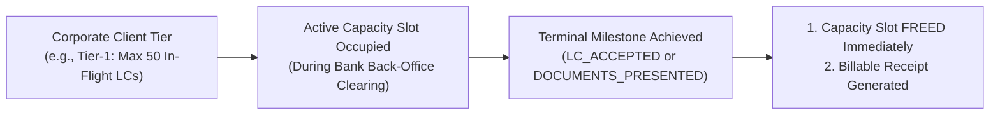
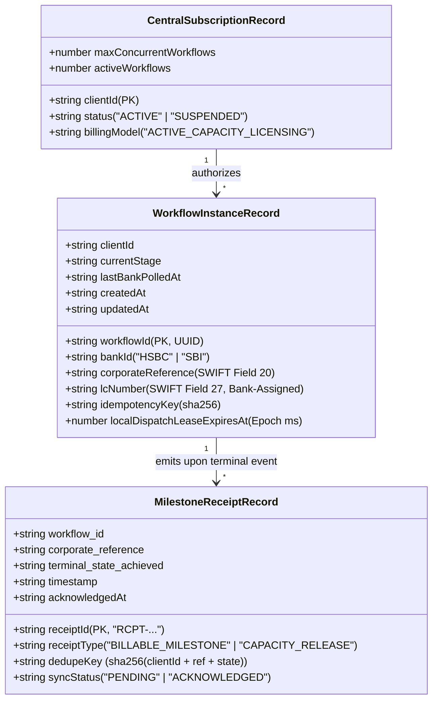
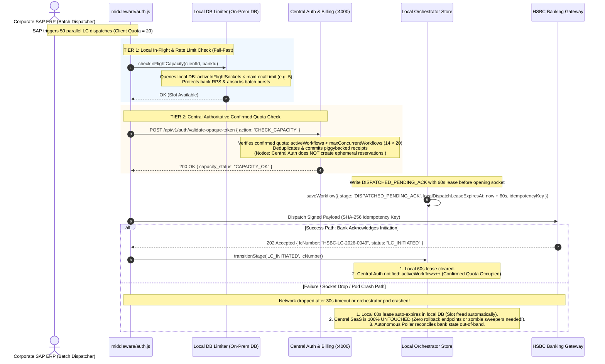
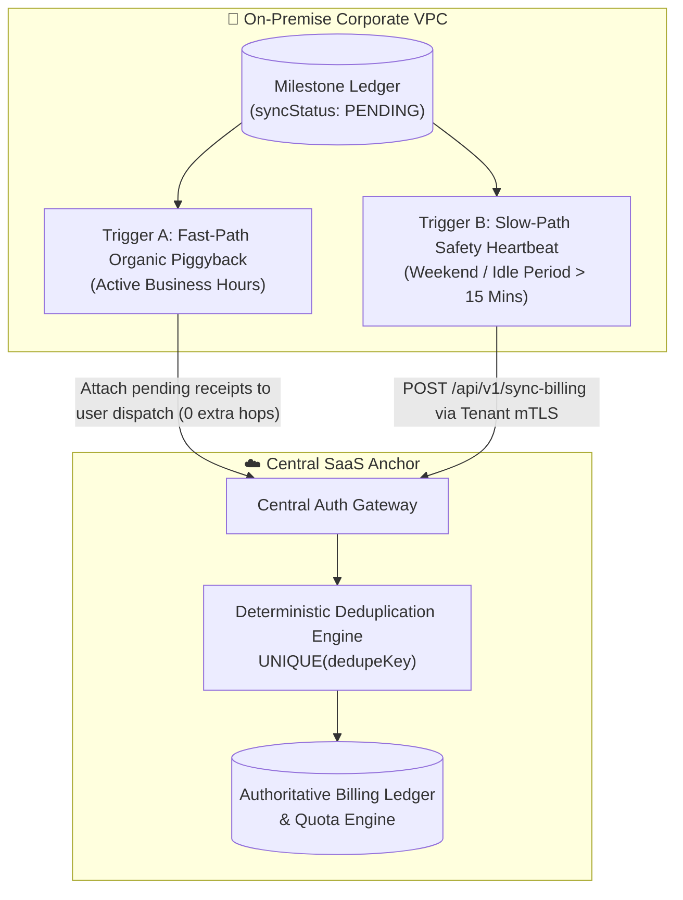
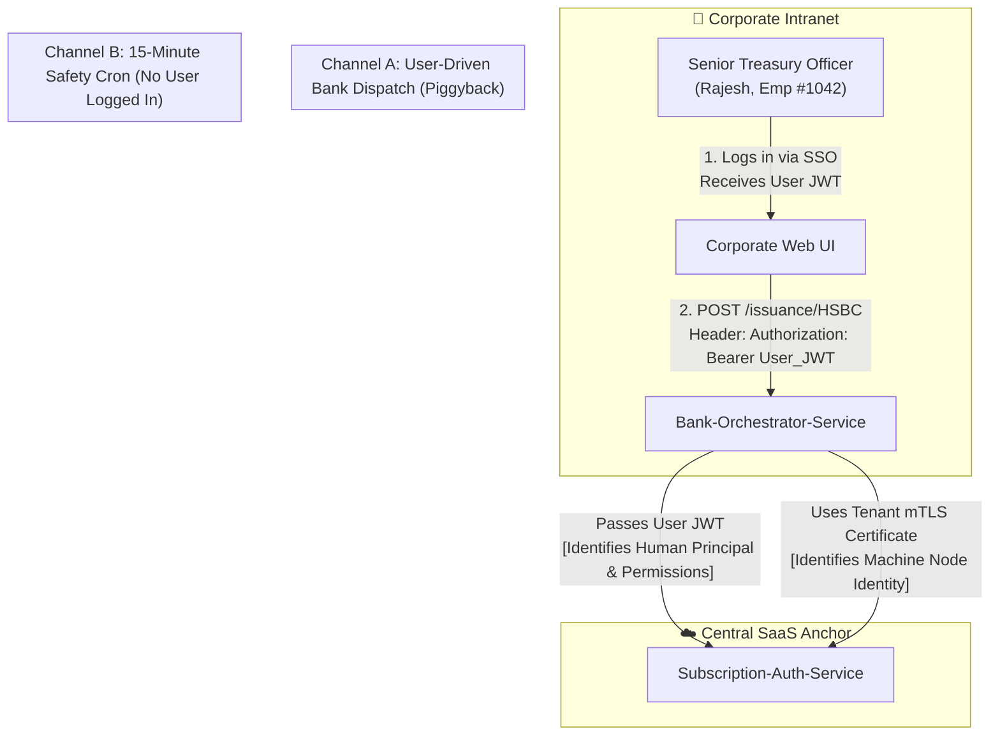
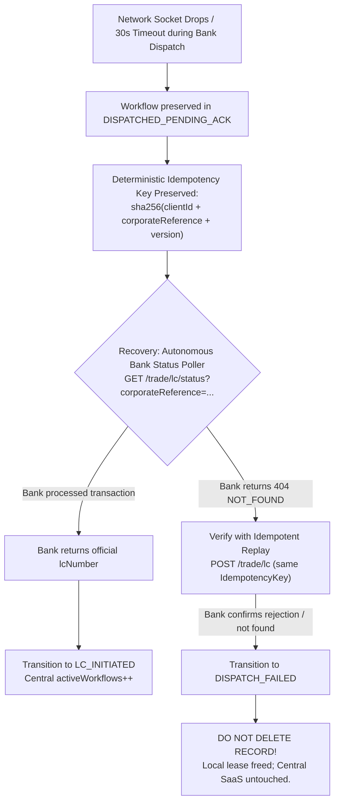

# Multi-Bank Trade Finance Orchestrator — Flagship System Design (superHld2.md)
## Deep-Dive Focus: Active Capacity Licensing, Two-Tier Concurrency & Dual-Paced Billing Sync

> **Primary Focus**: Enterprise Subscription Quotas, Billing Lifecycle, Asynchronous Ingestion & Dual-Trigger Synchronization  
> **Secondary Components**: (Drafting, Crypto, Sealed Tokens, Adapters) summarized in 1–2 punchy lines.  
> **Target Audience**: Staff / Principal Software Engineers (SDE-4 / Lead Architect Interview Defense)

---

## 1. System Overview & Core Primitives (Brief Summary)

- **Domain Vision**: A zero-trust, non-custodial multi-bank trade finance orchestrator connecting enterprise ERPs (SAP S/4HANA, Oracle) to global banking rails (HSBC ISO 20022 `tsmt.019`, SBI REST JSON v2) for Letters of Credit (ICC UCP 600 rules).
- **Dual-Perimeter & On-Prem UI Deployment**: Partitioned into **Perimeter A (Corporate On-Prem / VPC)** running both the **Corporate Treasury Web UI** and `Bank-Orchestrator-Service (:3000)` inside the enterprise intranet/VPC. Zero commercial trade terms, draft inputs, or user credentials ever traverse public internet or external CDNs. **Perimeter B (Central SaaS)** runs `Subscription-Auth-Service (:4000)` managing multi-tenant licensing and authoritative billing.
- **Non-Custodial KMS Layer**: Corporate private keys never touch orchestrator disk or memory; client signing is delegated at runtime via `CryptoProviderFactory` to on-premise AWS KMS, Azure Key Vault, or HSMs (`MessageType: 'DIGEST'`).
- **Token Options: Asymmetric JWT (RS256) vs. Sealed AEAD (`AES-256-GCM`)**:
  - *Standard RS256 JWT*: Central Auth signs with its private key; on-prem Orchestrator verifies locally in $< 0.1\text{ms}$ via Central's public key (0 central hops for drafts). Because the UI is deployed on-premise within the corporate intranet, claim exposure to external networks is non-existent.
  - *Sealed AEAD / JWE*: An encrypted variant (`xlt_opq_...`) used when strict enterprise compliance mandates zero claim exposure even to internal browser DevTools.
  - In either choice, **instant revocation** is enforced at the bank dispatch hop when the orchestrator performs its authoritative Central Auth check.
- **Real-World Banking Identifiers**: Corporates own `corporateReference` (SWIFT Field 20: *Sender's Reference*); external banking institutions own and assign official `lcNumber` (SWIFT Field 27: *Receiver's Reference*), `amendmentNumber`, and `presentationNumber`.

---

## 2. The Commercial Core: Active Capacity Licensing Model

Enterprise B2B trade finance cannot utilize consumer pay-as-you-go or per-seat billing. It operates on an **Active Concurrent Capacity Licensing** model:



1. **Active Concurrent Capacity Licensing**: Clients license in-flight workflow capacity (e.g., *"Tier 1: Up to 50 active in-flight LCs simultaneously"*). This provides predictable annual recurring revenue (ARR) while safeguarding downstream banking partner APIs from unmetered burst loads.
2. **Terminal State Milestone Billing**: Only successful, legally binding financial terminal events incur billable charges:
   - `LC_ACCEPTED` (Issuing bank approves application under UCP 600).
   - `DOCUMENTS_PRESENTED` (Shipping documents presented and settled).
   - Drafts, revisions, and uncommitted requests incur **zero marginal billing charges**.
3. **Strict Quota Enforcement**: The system must enforce that `activeWorkflows < maxConcurrentWorkflows` across all distributed orchestrator nodes in real-time without locking clients out due to network lag.

---

## 3. Multi-State Lifecycle Taxonomy & Entity Modeling

To maintain financial audit compliance (SOC-2, ISO-27001), the architecture strictly separates **Mutable Workflow Lifecycle State** (`WorkflowInstance`) from the **Immutable Billing Ledger** (`MilestoneReceipt`).



### The 6-State Lifecycle Taxonomy

| State Class | Stage Identifier | Concurrency Quota Impact | Billing Event Emitted? | Domain Meaning & Mechanics |
| :--- | :--- | :---: | :---: | :--- |
| **0. Local Draft** | `DRAFT` | **0** (Zero Consumption) | **NO** | Draft form saved locally inside corporate VPC. Zero central network hops. |
| **1. Unknown In-Flight Dispatch** | `DISPATCHED_PENDING_ACK` | **Local In-Flight Slot (60s TTL)**<br/>Central SaaS: **0** | **NO** | Pre-socket state guard. Local DB Limiter throttles burst. Auto-expires in 60s on crash. Central Auth untouched. |
| **2. Non-Billable Bank Clearing** | `LC_INITIATED` | **1 Central Slot Occupied** | **NO** | Bank accepted application and issued official `lcNumber`. Application undergoing bank back-office clearing. Not billable under UCP 600. |
| **3. Dormant / Stale In-Flight** | `DORMANT_STALE_PENDING` | **-1 Central Slot (Freed)** | **NO** | Application in `LC_INITIATED` for $> 30\text{ days}$ without bank status update. Capacity slot reclaimed for ERP; poller keeps checking. |
| **4. Billable Terminal Milestone** | `ISSUANCE_CONFIRMED`<br/>`DOCUMENTS_PRESENTED` | **-1 Central Slot (Freed)** | **YES (Receipt Generated)** | Bank clears LC or settles presentation. Reclaims execution capacity and enqueues immutable `MilestoneReceipt` (`syncStatus: PENDING`). |
| **5. Terminal Failure / Rejection** | `DISPATCH_FAILED`<br/>`LC_REJECTED` | **0 Central Slot Impact** | **NO** | Bank rejected application or confirmed 404. Local lease cleared. **Record is never deleted.** |

---

## 4. Two-Tier Hierarchical Concurrency Control Engine

### The Problem: ERP Batch Spikes & The Cross-Cloud Lease Anti-Pattern
Automated enterprise ERPs (SAP S/4HANA) fire batch dispatches of dozens of LCs concurrently (e.g., 50 parallel dispatches in 10 milliseconds). 
- If capacity is tracked solely centrally with distributed reservation leases and cross-cloud TTLs, Central SaaS gets cluttered with zombie reservations, requires complex rollback endpoints (`RELEASE_RESERVATION`), and suffers high latency during container crashes.
- If unthrottled, 50 simultaneous parallel requests overwhelm bank gateway rate limits (e.g., HSBC limits API keys to 10 requests/sec), resulting in corporate API blacklisting.

### The Solution: Two-Tier Hierarchical Control
We decouple **Micro-Execution Throttling (Local On-Premises)** from **Macro-Licensing Accounting (Central SaaS)**:



#### Tier 1: Local DB In-Flight Limiter Mechanics
- **Local DB Sliding Window Query**:
  ```sql
  -- Atomic check in local on-prem Postgres before touching bank socket
  SELECT COUNT(*) FROM workflows 
  WHERE client_id = 'tata_steel' 
    AND stage = 'DISPATCHED_PENDING_ACK' 
    AND local_dispatch_lease_expires_at > NOW();
  ```
- **Instant Crash Containment**: If the orchestrator pod crashes mid-flight, the local lease auto-expires in 60 seconds. Central SaaS was never modified for this unconfirmed request, completely avoiding cross-cloud distributed compensation.

#### Tier 2: Central Confirmed Quota Engine Mechanics
- Central Auth strictly increments `activeWorkflows++` **only when `LC_INITIATED` is confirmed**.
- The slot is held throughout bank back-office clearing and released when `LC_ACCEPTED` or `REJECTED` occurs, or when aged into `DORMANT_STALE_PENDING`.

---

## 5. The Asynchronous Bank State Ingestion Engine

### The Core Banking Reality
When an orchestrator submits an LC application to HSBC or SBI (`POST /trade/lc`), the immediate HTTP response is `202 Accepted` with initial status `LC_INITIATED`.
- **`LC_INITIATED` is NOT a billable event** and does not represent completed legal commitment; it is merely queued in the bank's core clearing system.
- Official legal acceptance (`LC_ACCEPTED_BY_ADVISING_BANK` / `ISSUANCE_CONFIRMED`) happens asynchronously hours or days later.

### Why Bank Inbound Webhooks are Prohibited
1. **Zero-Inbound Corporate Firewalls**: Multinational corporate datacenters (Tata Steel, Boeing VPCs) legally enforce strict zero-inbound open port firewall policies. Opening inbound ports to external bank networks is prohibited by enterprise InfoSec.
2. **Bank Infrastructure Constraints**: Centralized bank clearing networks (SWIFT / ISO 20022) do not maintain customer-specific dynamic webhook routing tables for thousands of customer datacenters.

### The Ingestion Subsystem: Autonomous Outbound B2B Machine Poller
- **Authentication**: Operates strictly outbound-only using corporate-level B2B credentials: **Layer-4 Mutual TLS (mTLS)** with client certificates issued directly by the bank's PKI to the corporate enterprise. Runs 24/7 with zero logged-in user sessions.
- **Batching**: Queries `GET /trade/lc/batch-status?corporateReferences=REF1,REF2,...` in batches of 50 every 5–15 minutes to stay within bank API throttling limits.
- **Immediate Local Capacity Reclamation**:
  1. Detects bank back-office transition from `LC_INITIATED` $\to$ `LC_ACCEPTED`.
  2. Updates workflow in local database to `ISSUANCE_CONFIRMED`.
  3. **Immediately decrements local in-flight counter**: Frees execution capacity on-premise instantly, enabling automated SAP ERP pipelines to dispatch new LCs without waiting for cross-cloud SaaS roundtrips.
  4. Appends a new milestone receipt to the local ledger:
     ```json
     {
       "receiptId": "RCPT-20261102-001",
       "corporate_reference": "ERP-PO-2026-001",
       "terminal_state_achieved": "LC_ACCEPTED",
       "dedupeKey": "sha256(clientId + corporateReference + terminalState)",
       "syncStatus": "PENDING",
       "createdAt": 1727889600000
     }
     ```

---

## 6. The Dual-Trigger Billing Synchronization Engine

### The "Quota Deadlock" Trap: Why Pure Piggybacking Fails

A common architectural fallacy is proposing *pure piggybacking*—relying 100% on subsequent user API calls to transport billing receipts to Central SaaS with zero background crons.

```text
=============================================================================================
THE QUOTA DEADLOCK PROOF (The Weekend Catch-22):
=============================================================================================
1. Client license: max 20 concurrent workflows.
2. Friday 5:00 PM: Client dispatches 20 LCs. Central Auth: activeWorkflows = 20 / 20.
3. Friday 5:30 PM: Operators shut laptops and leave for the weekend. ZERO human sessions.
4. Saturday 10:00 AM: Bank core clearing accepts 10 LCs out-of-band.
5. On-premise Poller discovers LC_ACCEPTED -> Frees local capacity (10 slots free on-prem).
   Enqueues 10 MilestoneReceipts (syncStatus: 'PENDING').
6. Central SaaS: STILL pegged at 20 / 20 (Unaware of bank clearance for 60+ hours).
---------------------------------------------------------------------------------------------
7. Monday 8:00 AM: Automated SAP ERP batch runner attempts to dispatch a new LC:
   - Request hits Orchestrator -> Initiates authoritative hop to Central Auth.
   - Central Auth Gateway Guard evaluates: activeWorkflows (20) >= maxQuota (20).
   - Central Auth immediately aborts with: HTTP 429 Active Capacity Exceeded!
---------------------------------------------------------------------------------------------
8. THE FATAL DEADLOCK:
   - Because the inbound request is rejected at the HTTP gateway guard, the attached
     piggybacked payload is NEVER PROCESSED by Central Auth!
   - Because no bank dispatches can proceed, no future piggyback hops can ever occur.
   - System is permanently FROZEN until manual database intervention!
=============================================================================================
```

### The Solution: Dual-Trigger Convergence



1. **Trigger A: Fast-Path (Organic Piggyback)**:
   - During active business hours, whenever an authorized operator or ERP executes an authoritative call (`POST /validate-opaque-token`), the middleware collects all receipts with `syncStatus == 'PENDING'` and attaches them to the outbound HTTPS payload.
   - Central Auth commits receipts, decrements active concurrency counters, and returns `acknowledged_receipt_ids: [...]`.
   - Local middleware marks them `ACKNOWLEDGED`. Extra network hops = **0** (handles 98% of peak volume).
2. **Trigger B: Slow-Path (Autonomous Outbound Heartbeat Reconciler)**:
   - An on-premise timer wakes up every 5 minutes.
   - If any receipt has been in `PENDING` status for longer than `MAX_PENDING_AGE_MS` (15 minutes) with zero user activity, the reconciler initiates a targeted outbound call (`POST /api/v1/sync-billing`) authenticated via the client's corporate mTLS certificate.
   - Completely eliminates the weekend dormant tenant bug and guarantees Monday morning ERP dispatch readiness.
3. **Deterministic Central Deduplication**:
   - Central Auth computes:
     $$\text{dedupeKey} = \text{SHA-256}(\text{clientId} + \text{corporateReference} + \text{terminalState})$$
   - Backed by a `UNIQUE(dedupeKey)` database constraint, Central Auth guarantees exactly-once ledgering. If Fast-Path and Slow-Path race, duplicate charges are mathematically impossible.

### 6.1 Authentication Topology: Principal Identity (User JWT) vs. Node Identity (mTLS)

A crucial architectural question arises: *Can we eliminate the JWT and use mTLS for both the piggyback call and the background cron?*

#### 1. Why Not Use mTLS for Everything? (The Disaster Scenario)
mTLS strictly authenticates the **Transport / Node Layer**:
> *"This TCP connection is coming from an authorized container inside Tata Steel's datacenter."*

mTLS **cannot** authenticate the **Human Principal**:
> *"Who is the human being sitting at the keyboard? Are they an authorized Senior Treasury Officer with $25M signing authority, an intern, or an attacker connected to the office WiFi?"*

If you eliminate the User JWT on the UI/API:
- **Zero Access Control (Anyone on the LAN can Dispatch):** Any employee or rogue script on the corporate network could send an HTTP request to the local orchestrator, and the orchestrator would blindly sign it with its mTLS certificate and dispatch a $25,000,000 Letter of Credit!
- **Zero Audit Trail (Non-Repudiation):** Under banking compliance (SWIFT CSP, SOX), every financial commitment must have an immutable audit trail: *"Who approved this transaction?"* With only mTLS, the audit log only knows: *"Tata's Docker container sent this."* You have no idea which human employee pressed the button.
- **No Individual Session Revocation:** If an employee gets fired or their laptop is stolen, you cannot revoke their access without revoking the entire corporate container's certificate!

#### 2. The Two Layers of Identity in Enterprise Architecture



#### 3. How Both Work in Harmony (The Standard Model)

##### Flow A: Active Business Hours (User-Driven Dispatch + Piggyback)
- **Who triggers it:** Human Treasury Officer or SAP ERP system.
- **Identity Mechanism:** **User JWT (Principal Identity)**.
  - The user logs in (via Okta / Azure AD / Corporate SSO) and receives a signed JWT containing `{ userId: "rajesh@tatasteel.com", role: "TREASURY_OFFICER", clientId: "tata_steel" }`.
  - The UI presents this `Bearer JWT` to the Orchestrator.
  - The Orchestrator forwards this `Bearer JWT` to Central Auth along with the piggybacked billing receipts.
- **What Central Auth validates:**
  1. *Is Rajesh's session valid or revoked?*
  2. *Does Rajesh have the role to dispatch LCs?*
  3. *Audit Log:* Records that `rajesh@tatasteel.com` initiated reference `ERP-PO-2026-001`.
  4. *Capacity:* Verifies Tata Steel's active capacity quota and ledger receipts.

##### Flow B: Weekend / Quiet Hours (15-Minute Background Cron)
- **Who triggers it:** Autonomous background scheduler (`idleReceiptFlusher.js`).
- **Identity Mechanism:** **Tenant mTLS Client Certificate (Node Identity)**.
  - No human is logged in; no user JWT exists.
  - The background daemon connects to Central SaaS presenting its X.509 client certificate (`CN=tata_steel_orchestrator_node`).
- **What Central Auth validates:**
  1. *Is this connection legitimately from Tata Steel's container?*
  2. *Action:* Commits pending milestone receipts and releases capacity for the tenant.

> [!NOTE]
> **Dual-Layer Defense-in-Depth:** During Flow A, the Orchestrator can also establish the connection over mTLS while passing the user JWT in the header. That way, mTLS authenticates the node/network boundary, while the JWT authenticates the human user.

#### 4. How to Say This in an Interview (The 30-Second Pitch)
> *"In our architecture, we strictly separate **Principal Identity** from **Node Identity**:
> 
> When a user dispatches an LC from our on-premise Treasury UI, they must authenticate with a **User JWT**. This guarantees strict Role-Based Access Control (RBAC), prevents unauthorized intranet users from triggering dispatches, and creates an immutable audit trail of which specific employee authorized the transaction.
> 
> However, for our **15-minute background reconciler cron**, no human is logged in over the weekend. That autonomous process authenticates machine-to-machine using a **tenant-scoped Layer-4 Mutual TLS (mTLS) certificate**, ensuring zero reliance on vulnerable static API keys while allowing autonomous 24/7 billing convergence."*

---

## 7. Stale LC Aging & The >30 Day Lifecycle

Under ICC UCP 600 rules (Article 14b), banks operate under a standard SLA of **5 banking business days** to examine trade documents and accept or reject Letters of Credit.

However, complex international trade disputes or customs holds can leave an application in `LC_INITIATED` for weeks:
- **The Quota Starvation Risk**: If 10 LCs remain stuck in clearing for 60 days under a 20-workflow license, 50% of the company's licensed throughput is permanently paralyzed.
- **The Daily Stale Sweeper (`staleSweeper.js`)**:
  - Runs once daily (midnight UTC) inside the on-premise container.
  - Identifies workflows in `LC_INITIATED` where `updatedAt < (Now - 30 Days)`.
  - Transitions stage to `DORMANT_STALE_PENDING` and decrements capacity counters locally and centrally via an emitted quota reclaim receipt.
  - **Zero Contract Abandonment**: The contract is **not cancelled** at the bank. The Autonomous Bank Status Poller continues querying `DORMANT_STALE_PENDING` references. When the bank eventually clears the contract, it seamlessly revives to `ISSUANCE_CONFIRMED` and emits the billable receipt.

---

## 8. Fault Tolerance & The Ambiguous Network Drop Protocol

### The Two Generals' Problem on Bank Dispatch
If an HTTP POST to HSBC times out after 30 seconds:
- You do not know if the packet dropped *before reaching HSBC*, or if HSBC processed and committed a \$20,000,000 credit line and the packet dropped *on the return trip*.
- **Strict Prohibition on Deletion**: Deleting records from the database on timeout violates international financial auditing (ICC UCP 600, SWIFT CSP) and causes catastrophic duplicate commitments upon operator retry.



1. **Deterministic Idempotency Key**:
   $$\text{IdempotencyKey} = \text{SHA-256}(\text{clientId} + \text{corporateReference} + \text{version})$$
2. **Idempotent Recovery**: If the operator or ERP retries dispatch, the identical idempotency key is transmitted. The bank recognizes the replay and returns the existing transaction reference (`HSBC-TXN-...`) without double booking.
3. **Controlled Compensation**: If the bank poller authoritatively verifies the transaction was never received, the record transitions to `DISPATCH_FAILED` (audit history fully preserved; Central SaaS remains untouched).

### Reconciliation & Retry Architecture Trade-offs

| Dilemma | Anti-Pattern | Recommended Production Design |
| :--- | :--- | :--- |
| **Retry State Storage** | Storing pending retries purely in memory (`setTimeout` / memory queue). | Persist `retry_count` and `next_retry_at` in the DB; in-memory retry used only for immediate 1-2s retries. |
| **Worker Infrastructure** | Deploying a full RabbitMQ/Kafka cluster on-prem for low-volume LCs. | Lightweight 15-30s polling query with `FOR UPDATE SKIP LOCKED` directly on Postgres. |
| **Client Socket Lifecycle** | Keeping the client HTTP connection open during a 30s exponential backoff. | Close socket fast with `202 Accepted`, let background worker retry with backoff, and let UI poll `/status` or listen on WebSocket. |

---

## 9. The Tri-Process Background Engine Summary

The background orchestration architecture partitions work into three dedicated, single-purpose processes:

| Process | Frequency | Perimeter | Network Direction & Auth | Core Responsibility |
| :--- | :--- | :--- | :--- | :--- |
| **1. Bank Status Poller** (`bankStatusPoller.js`) | Every 5–15 min | On-Prem $\to$ Bank | Outbound mTLS (Corporate Bank Cert) | Polls batch reference status (`GET /trade/lc/batch-status`). Discovers `LC_ACCEPTED`, updates DB to `ISSUANCE_CONFIRMED`, decrements local in-flight counter, and enqueues `MilestoneReceipt` (`syncStatus: PENDING`). |
| **2. Daily Stale Sweeper** (`staleSweeper.js`) | Daily (Midnight UTC) | Internal On-Prem | Internal DB query (Zero network) | Identifies workflows stuck in `LC_INITIATED` $> 30\text{ days}$. Moves them to `DORMANT_STALE_PENDING` and reclaims capacity slots to unblock corporate ERP dispatches. |
| **3. Dual-Trigger Reconciler** (`idleReceiptFlusher.js`) | Fast: On user hop<br/>Slow: Every 15 min | On-Prem $\to$ Central SaaS | Fast: User Bearer Token<br/>Slow: Tenant Corporate mTLS | Flushes pending milestone receipts to Central Auth. 98% rides organic user hops (0 extra hops); 15m slow-path heartbeat flushes dormant weekend receipts, eliminating the Quota Deadlock trap. |

---

## 10. Master Interview Defense & Whiteboard Cheat Sheet

### 10.1 The 60-Second Flagship Pitch
> *"In cross-border trade finance, Letters of Credit follow multi-week asynchronous lifecycles where initial bank responses are non-billable `LC_INITIATED`, and commercial acceptance (`LC_ACCEPTED`) occurs days later inside the bank's back office.
> 
> Because corporate enterprise firewalls strictly prohibit inbound bank webhooks, I designed an **Autonomous Outbound Status Poller using Layer-4 Corporate mTLS certificates** running 24/7. It discovers acceptance out-of-band and immediately decrements our local in-flight counter, instantly reclaiming capacity for on-premise SAP ERP pipelines without waiting for WAN roundtrips to our SaaS anchor.
> 
> To solve the **Dormant Tenant Bug and Quota Deadlock**—where completed weekend transactions leave central capacity pegged at 100% and cause Monday morning ERP dispatches to fail with HTTP 429—I pioneered **Dual-Trigger Convergence**: receipts ride along on organic user dispatches during business hours (0 extra hops), while an autonomous 15-minute heartbeat reconciler flushes lingering receipts during quiet hours using corporate mTLS.
> 
> To prevent ERP batch spikes from overwhelming bank rate limits without creating complex cross-cloud lease rollbacks, I implemented **Two-Tier Hierarchical Concurrency Control**: a local DB-backed sliding window throttles transient socket bursts with a 60-second auto-expiring lease, while Central SaaS tracks only authoritative confirmed states."*

### 10.2 The 4-Zone Whiteboard Diagram

```text
+--------------------------------------------------------------------------------------------------+
| ZONE 1: CORPORATE PERIMETER (On-Prem / Corporate VPC)                                            |
|  - Corporate Treasury Web UI (Deployed On-Prem in Intranet)                                       |
|  - SAP S/4HANA ERP                                                                               |
|  - Bank-Orchestrator-Service (:3000)                                                             |
|  - Tier 1: Local DB In-Flight Limiter (Sliding Window, 60s lease)                                 |
|  - Milestone Receipts Ledger (syncStatus: PENDING | ACK)                                         |
|  - Autonomous Bank Status Poller (Outbound B2B mTLS, every 5-15m)                                 |
|  - Autonomous Outbound Reconciler (15-min fail-safe heartbeat flush)                             |
|  - Daily Stale Sweeper (30-day dormant aging cron)                                               |
+--------------------------------------------------------------------------------------------------+
          | (Delegated Digest: 32 bytes)              | Trigger A: Organic Piggyback (0 extra hops)
          |                                           | Trigger B: 15-Min Heartbeat Flush (mTLS)
          v                                           v
+-------------------------------+   +--------------------------------------------------------------+
| ZONE 2: CRYPTO ENGINE         |   | ZONE 3: CENTRAL SAAS ANCHOR                                  |
|  - Dynamic KMS Provider       |   |  - Subscription-Auth-Service (:4000)                         |
|  - AWS KMS / Azure Vault / HSM|   |  - Token Issuer (Asymmetric RS256 JWT / Sealed AEAD)         |
|  - Corporate private keys     |   |  - Tier 2: Authoritative Confirmed Quota (activeWorkflows)   |
|    NEVER leave HSM            |   |  - Deduplicated Billing Ledger (UNIQUE dedupeKey)            |
+-------------------------------+   +--------------------------------------------------------------+
          |                                           |
          +-------------------+   +-------------------+
                              |   |
                              v   v
+--------------------------------------------------------------------------------------------------+
| ZONE 4: GLOBAL BANKING GATEWAYS                                                                  |
|  - HSBC (ISO 20022 tsmt.019 / SWIFT MT700)                                                       |
|  - SBI (REST Trade Finance JSON v2)                                                              |
|  - Batch Status Endpoint: GET /trade/lc/batch-status (Corporate mTLS Auth)                       |
|  - Deterministic Idempotency: sha256(clientId + corporateReference + version)                    |
|  - Authoritative Bank-Assigned Identifiers: lcNumber (Field 27), amendmentNumber, presentationNo |
+--------------------------------------------------------------------------------------------------+
```

### 10.3 Flagship War Story: The Dormant Tenant & Quota Deadlock Fix
- **The Incident**: On Friday at 5:00 PM, Tata Steel operators dispatched 15 LCs to HSBC, reaching their 15-workflow tier quota. Operators closed their laptops. On Saturday morning, HSBC core systems accepted all 15 LCs. Because the system initially relied purely on human user clicks to piggyback receipts, zero receipts were synced for 64 hours. On Monday at 8:00 AM, Tata Steel's automated SAP ERP shipment dispatcher attempted to send new LCs and failed with `429 Active Capacity Exceeded`—Central Auth still believed all 15 slots were occupied, and because requests were rejected at the gateway guard, piggybacked receipts were never reached, causing a total corporate operational freeze!
- **The Engineering Fix**: Implemented **Dual-Trigger Convergence** (adding the 15-minute slow-path safety heartbeat reconciler via tenant mTLS) and **Immediate Local Capacity Reclamation** via the Autonomous Bank Poller.
- **The Result**: Zero Monday morning quota lockouts; revenue recognition latency capped at $\le 15\text{ minutes}$; zero inbound open ports.

### 11 Why we can still use the authorization credentials instead of SSO 

*For our baseline implementation, we implemented Direct Credential Authentication: Central Auth acts as the Identity Provider, storing salted bcrypt hashes and issuing signed JWTs with RBAC scopes (TREASURY_OFFICER, ADMIN).

For M2M automated ERP pipelines (SAP S/4HANA), we use OAuth2 Client Credentials generated during tenant onboarding so batch runners can dispatch LCs headlessly.

For enterprise tier-1 production clients who legally mandate their own Identity Provider, our Central Auth Service supports OIDC/SAML Federation with Okta / Azure AD, where Central Auth stores the tenant's IdP metadata and acts as the SSO broker without ever storing corporate user passwords."*