# Multi-Bank Trade Finance Orchestrator — Master System Design Document (superHld.design)
## Dual-Perimeter Architecture, Non-Custodial Cryptography, Sealed AEAD Tokens & Real-World Banking Identifiers

> **Architectural Level**: Staff / Principal Software Engineer (SDE-4 / Lead Architect)  
> **Domain**: Enterprise B2B Trade Finance (Letter of Credit Lifecycle across Global Banks)  
> **Systems Covered**: `Subscription-Auth-Service` (Port 4000) & `Bank-Orchestrator-Service` (Port 3000)  
> **Deployment Topology**: Hybrid Multi-Perimeter (SaaS Central Anchor vs. Self-Hosted On-Prem inside Corporate VPC)  
> **Target Audiences**: System Architects, Security Officers, Enterprise Treasury Leads, Staff+ Interview Panels  

---

## Table of Contents
1. [Executive Summary & Product Vision](#1-executive-summary--product-vision)
2. [Initial Product Requirements & Domain Walkthrough](#2-initial-product-requirements--domain-walkthrough)
   - 2.1 [The Trade Finance Primitive: Letters of Credit (ICC UCP 600)](#21-the-trade-finance-primitive-letters-of-credit-icc-ucp-600)
   - 2.2 [The Multi-Bank Integration Nightmare](#22-the-multi-bank-integration-nightmare)
   - 2.3 [Commercial Tenancy & The Active Capacity Licensing Model](#23-commercial-tenancy--the-active-capacity-licensing-model)
3. [Initial Architectural Challenges & Non-Negotiable Constraints](#3-initial-architectural-challenges--non-negotiable-constraints)
   - 3.1 [Challenge 1: Sovereign Data Residency (GDPR / Indian DPDP / SWIFT CSP)](#31-challenge-1-sovereign-data-residency-gdpr--indian-dpdp--swift-csp)
   - 3.2 [Challenge 2: The Non-Custodial Key Boundary](#32-challenge-2-the-non-custodial-key-boundary)
   - 3.3 [Challenge 3: Financial Double-Commitment on Network Drops](#33-challenge-3-financial-double-commitment-on-network-drops)
   - 3.4 [Challenge 4: The WAN Latency vs. Instant Revocation Dilemma](#34-challenge-4-the-wan-latency-vs-instant-revocation-dilemma)
   - 3.5 [Challenge 5: Session Resilience & The "Coffee Spill" Failure Mode](#35-challenge-5-session-resilience--the-coffee-spill-failure-mode)
4. [The Evolutionary Journey: From Inception to Production-Grade](#4-the-evolutionary-journey-from-inception-to-production-grade)
   - 4.1 [Iteration 1: Baseline Prototype & Multi-Bank Gateway](#41-iteration-1-baseline-prototype--multi-bank-gateway)
   - 4.2 [Why Iteration 1 Broke Down: Architectural Gaps](#42-why-iteration-1-broke-down-architectural-gaps)
   - 4.3 [Iteration 2: Hybrid Perimeter, Cryptographic Partitioning & M2M Worker](#43-iteration-2-hybrid-perimeter-cryptographic-partitioning--m2m-worker)
   - 4.4 [Why Iteration 2 Needed Evolution: The Real-World Vulnerabilities](#44-why-iteration-2-needed-evolution-the-real-world-vulnerabilities)
   - 4.5 [Iteration 3: Sealed AEAD Tokens, Offline Drafting & Real-World Identifiers](#45-iteration-3-sealed-aead-tokens-offline-drafting--real-world-identifiers)
5. [High-Level Design (HLD)](#5-high-level-design-hld)
   - 5.1 [Dual-Perimeter Hybrid Topology & Trust Boundaries](#51-dual-perimeter-hybrid-topology--trust-boundaries)
   - 5.2 [Real-World Banking Identifier Progression (SWIFT Field 20 vs. 27)](#52-real-world-banking-identifier-progression-swift-field-20-vs-27)
   - 5.3 [Data Ingestion & Cross-Perimeter Communication Channels](#53-data-ingestion--cross-perimeter-communication-channels)
   - 5.4 [The Dual-Paced Reconciliation Topology: Bank Ingestion vs. Central Billing Sync](#54-the-dual-paced-reconciliation-topology-bank-ingestion-vs-central-billing-sync)
6. [Detailed Low-Level Design (LLD)](#6-detailed-low-level-design-lld)
   - 6.1 [Component Topology & Microservice Boundaries](#61-component-topology--microservice-boundaries)
   - 6.2 [Configurable On-Premise KMS Layer & Bank-Supplied Crypto Integration](#62-configurable-on-premise-kms-layer--bank-supplied-crypto-integration)
   - 6.3 [Sealed AEAD Opaque Token Specification (`AES-256-GCM`)](#63-sealed-aead-opaque-token-specification-aes-256-gcm)
   - 6.4 [In-Memory Storage Models, Multi-State Taxonomy & Schemas](#64-in-memory-storage-models-multi-state-taxonomy--schemas)
   - 6.5 [Class Diagrams & Interface Contracts](#65-class-diagrams--interface-contracts)
   - 6.6 [End-to-End Sequence Diagrams](#66-end-to-end-sequence-diagrams)
     - 6.6.1 [Flow A: Offline Local Draft Creation (Zero Central Network Hops)](#661-flow-a-offline-local-draft-creation-zero-central-network-hops)
     - 6.6.2 [Flow B: Strict Two-Step Bank Dispatch, Unknown State Guard & Bank-Assigned LC Number](#662-flow-b-strict-two-step-bank-dispatch-unknown-state-guard--bank-assigned-lc-number)
     - 6.6.3 [Flow C: Document Presentation & Batch Milestone Synchronization](#663-flow-c-document-presentation--batch-milestone-synchronization)
     - 6.6.4 [Flow D: Asynchronous Bank Status Ingestion & Dual-Trigger Milestone Synchronization](#664-flow-d-asynchronous-bank-status-ingestion--dual-trigger-milestone-synchronization)
   - 6.7 [Finite State Machine & State Transition Matrix](#67-finite-state-machine--state-transition-matrix)
   - 6.8 [Detailed Component Design: Polling, Two-Tier Concurrency Control & Tri-Process Reconciliation Engine](#68-detailed-component-design-polling-two-tier-concurrency-control--tri-process-reconciliation-engine)
     - 6.8.1 [The Tri-Process Reconciliation Topology](#681-the-tri-process-reconciliation-topology)
     - 6.8.2 [Two-Tier Hierarchical Concurrency Control (Local DB In-Flight Limiter + Central Confirmed Quota)](#682-two-tier-hierarchical-concurrency-control-local-db-in-flight-limiter--central-confirmed-quota)
     - 6.8.3 [Stale / Dormant LC Handling (The >30 Day Lifecycle & ERP Unblocking)](#683-stale--dormant-lc-handling-the-30-day-lifecycle--erp-unblocking)
     - 6.8.4 [The "Quota Deadlock" Trap & Why Pure Piggybacking Fails](#684-the-quota-deadlock-trap--why-pure-piggybacking-fails)
     - 6.8.5 [Recovery Protocol on Network Drops & Bank Timeouts (Zero Deletion Guard)](#685-recovery-protocol-on-network-drops--bank-timeouts-zero-deletion-guard)
7. [Product & Business Trade-offs Matrix](#7-product--business-trade-offs-matrix)
8. [Engineering & Architectural Trade-offs Deep-Dive](#8-engineering--architectural-trade-offs-deep-dive)
   - 8.1 [Token Architecture: Sealed AEAD vs. Redis Opaque vs. Stateless JWT](#81-token-architecture-sealed-aead-vs-redis-opaque-vs-stateless-jwt)
   - 8.2 [Key Management Architecture: DB-Driven Dynamic KMS Layer vs. Hardcoded SDKs vs. Custodial Keys](#82-key-management-architecture-db-driven-dynamic-kms-layer-vs-hardcoded-sdks-vs-custodial-keys)
   - 8.3 [Bank Communication Protocols: Bank-Supplied Specifications/SDKs vs. Custom Cryptography](#83-bank-communication-protocols-bank-supplied-specificationssdks-vs-custom-cryptography)
   - 8.4 [Billing & Status Synchronization: Dual-Trigger Convergence vs. Naive Piggybacking vs. Kafka vs. Background Worker](#84-billing--status-synchronization-dual-trigger-convergence-vs-naive-piggybacking-vs-kafka-vs-background-worker)
   - 8.5 [Concurrency & Ordering: Deterministic Idempotency vs. Distributed 2PC](#85-concurrency--ordering-deterministic-idempotency-vs-distributed-2pc)
9. [Production Engineering Realities & War Stories](#9-production-engineering-realities--war-stories)
   - 9.1 [War Story 1: Multi-Tenant KMS Fragmentation & The DB-Driven On-Premise KMS Layer](#91-war-story-1-multi-tenant-kms-fragmentation--the-db-driven-on-premise-kms-layer)
   - 9.2 [War Story 2: The Dormant Tenant Bug & Why Pure Piggybacking Failed](#92-war-story-2-the-dormant-tenant-bug--why-pure-piggybacking-failed)
   - 9.3 [War Story 3: Financial Double-Commitment on Bank Gateway Timeout](#93-war-story-3-financial-double-commitment-on-bank-gateway-timeout)
   - 9.4 [War Story 4: Corporate Forward Proxies Breaking Layer-4 mTLS](#94-war-story-4-corporate-forward-proxies-breaking-layer-4-mtls)
10. [Master Interview Questionnaire & Bar-Raiser Defense](#10-master-interview-questionnaire--bar-raiser-defense)
    - 10.1 [The 60-Second Elevator Pitch (Flagship Synchronization Defense)](#101-the-60-second-elevator-pitch-flagship-synchronization-defense)
    - 10.2 [The 4-Zone Whiteboard Strategy](#102-the-4-zone-whiteboard-strategy)
    - 10.3 [Deep-Dive Q1: Instant Revocation across Multiple Devices with Opaque Tokens](#103-deep-dive-q1-instant-revocation-across-multiple-devices-with-opaque-tokens)
    - 10.4 [Flagship Interview Defense: Asynchronous Bank Status Ingestion, Capacity Release & Dual-Trigger Billing Sync](#104-flagship-interview-defense-asynchronous-bank-status-ingestion-capacity-release--dual-trigger-billing-sync)
    - 10.5 [Deep-Dive Q2: Why Claim Leakage in JWT Matters & How Sealed AEAD Solves It](#105-deep-dive-q2-why-claim-leakage-in-jwt-matters--how-sealed-aead-solves-it)
    - 10.6 [Deep-Dive Q3: Bank-Supplied Cryptography vs. The DB-Driven Configurable KMS Layer](#106-deep-dive-q3-bank-supplied-cryptography-vs-the-db-driven-configurable-kms-layer)
    - 10.7 [Deep-Dive Q4: Identifier Ownership: Who Generates What?](#107-deep-dive-q4-identifier-ownership-who-generates-what)
    - 10.8 [Deep-Dive Q5: What if the Orchestrator Crashes Mid-Flight?](#108-deep-dive-q5-what-if-the-orchestrator-crashes-mid-flight)
    - 10.9 [Deep-Dive Q6: The 100x Scale & Sovereign Banking Evolution Roadmap](#109-deep-dive-q6-the-100x-scale--sovereign-banking-evolution-roadmap)
11. [Complete Verification & Production Test Matrix](#11-complete-verification--production-test-matrix)
12. [Architectural Summary & Interview Cheat Sheet](#12-architectural-summary--interview-cheat-sheet)

---

## 1. Executive Summary & Product Vision

In cross-border international commerce ($10+ Trillion annually), multinational corporations (e.g., Tata Steel, Boeing, Reliance Industries) purchase bulk commodities and capital goods from international suppliers. Because buyers and sellers operate under differing legal jurisdictions with zero mutual counterparty trust, transactions rely on **Trade Finance**, governed primarily by **Letters of Credit (LC)** under the International Chamber of Commerce (ICC) **UCP 600 rules**.

A Letter of Credit is a legally binding commitment issued by a financial institution (the Issuing Bank) guaranteeing that a beneficiary (the Seller) will receive payment upon presenting strictly conforming trade documents (Bills of Lading, Commercial Invoices, Certificates of Origin, Inspection Certificates).

Historically, managing Letters of Credit across multiple global banking partners requires corporate treasury departments to:
1. Maintain separate, expensive, bespoke point-to-point SWIFT integrations with each banking partner.
2. Manually swivel-chair between banking web portals (e.g., HSBC TradeSpan, SBI Corporate Portal, CitiDirect).
3. Expose sensitive trade data, pricing schedules, and proprietary contracts to third-party SaaS middleware.

The **Multi-Bank Trade Finance Orchestrator** resolves this fragmentation by establishing an enterprise-grade, **zero-trust, non-custodial multi-bank gateway**. It presents a single unified canonical API to corporate ERP systems (SAP S/4HANA, Oracle ERP Cloud) while dynamically adapting to heterogeneous banking rails, upholding strict sovereign data residency, enforcing active capacity subscription licensing, and guaranteeing zero custody of corporate private keys.

---

## 2. Initial Product Requirements & Domain Walkthrough

### 2.1 The Trade Finance Primitive: Letters of Credit (ICC UCP 600)

A corporate trade workflow is not a simple debit/credit transfer. It is a multi-stage, multi-week asynchronous legal lifecycle consisting of three foundational milestones:

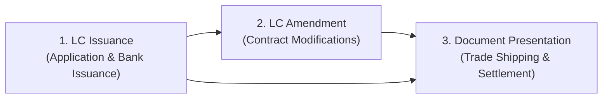

1. **`LC Issuance`**: The Buyer (Applicant, e.g., Tata Steel) requests their bank (e.g., HSBC London) to issue an irrevocable credit in favor of the Seller (Beneficiary, e.g., German Industrial supplier). The request specifies the credit amount, currency, expiration date, port of loading, port of discharge, and list of required trade documents.
2. **`LC Amendment`**: If shipping dates slip, shipping vessels change, or freight volumes adjust, the Buyer and Seller must legally amend the active credit. Every amendment must be approved by the issuing bank, assigned a monotonically increasing version, and confirmed by the advising bank.
3. **`LC Presentation`**: Once cargo is dispatched, the Seller presents physical and digital documents (Bill of Lading, Customs Manifest) to prove shipment. When documents conform to credit terms, the bank releases multi-million dollar funds. Reaching this milestone represents a billable financial terminal event.

### 2.2 The Multi-Bank Integration Nightmare

Every major global bank operates on completely disconnected, proprietary technological protocols developed over decades:

| Dimension | HSBC Gateway | SBI (State Bank of India) Gateway |
| :--- | :--- | :--- |
| **Primary Standard** | SWIFT MT700 / ISO 20022 `tsmt.019` XML | Proprietary B2B REST Trade Finance JSON v2 |
| **Payload Format** | Strict banking XML schemas (`pain.001`, `camt.053`) | Nested JSON dictionaries |
| **Transport Layer** | AS2 / MQ Series / Dedicated SWIFT FIN Gateway | Mutual TLS (mTLS) HTTPS REST endpoints |
| **Field Identifiers** | SWIFT Tag 20 (*Sender Ref*), Tag 27 (*Receiver Ref*) | `corporate_txn_id`, `sbi_lc_identifier` |
| **Cryptographic Format** | CMS / PKCS#7 signed envelopes with X.509 certs | RSA-PSS signed JSON with JWE envelope |

If an enterprise connects to 12 global banks, building 12 independent integrations inside SAP requires tens of millions of dollars in consulting fees and maintenance. The orchestrator must abstract this complexity behind a **single Canonical Trade Contract**.

### 2.3 Commercial Tenancy & The Active Capacity Licensing Model

The business model for enterprise B2B orchestration cannot follow consumer per-seat or pay-as-you-go billing:
- **Active Concurrent Capacity Licensing**: Enterprise clients license execution concurrency (e.g., "Tier 1: Maximum 50 active in-flight LCs simultaneously").
- **Terminal State Billing Ledgering**: Clients are billed for successfully settled transactions (`DOCUMENTS_PRESENTED`), while drafts and uncommitted entries incur zero marginal billing charges.
- **Authoritative Quota Enforcement**: The system must enforce that `activeWorkflows < maxConcurrentWorkflows` across all distributed orchestrator nodes in real-time, preventing clients from overwhelming bank rate limits or exceeding licensed contractual capacity.

---

## 3. Initial Architectural Challenges & Non-Negotiable Constraints

### 3.1 Challenge 1: Sovereign Data Residency (GDPR / Indian DPDP / SWIFT CSP)
Tier-1 enterprise conglomerates (Tata, Reliance) refuse to upload trade contracts, bills of lading, and financial counterparty data into a public multi-tenant SaaS cloud. Compliance mandates (European GDPR Article 28/29, Indian Digital Personal Data Protection Act, and SWIFT Customer Security Programme - CSP) dictate that sensitive commercial contracts **must never cross the corporate network boundary**.

### 3.2 Challenge 2: The Non-Custodial Key Boundary
Communicating with global banks requires digital signing using the client's corporate private key. Storing corporate private keys in the orchestrator database creates catastrophic liability:
- A compromise of the orchestrator would expose client signing keys, allowing attackers to forge multi-million dollar letters of credit.
- Custodial key storage subjects the orchestrator to PCI-DSS Level 1, SOC-2 Type II, and Federal Reserve banking audit scrutiny.
- **Constraint**: The orchestrator must operate **strictly non-custodially**. Corporate private keys must **never touch the orchestrator's disk, memory, or network packets**.

### 3.3 Challenge 3: Financial Double-Commitment on Network Drops
In consumer eCommerce, a dropped connection on checkout might cause an innocent duplicate cart charge. In trade finance, if an HTTP POST to HSBC times out after 30 seconds and the operator clicks "Retry", accidentally creating duplicate $25,000,000 Letter of Credit contracts would freeze corporate credit lines and incur hundreds of thousands of dollars in non-refundable bank commitment fees.
- **Constraint**: Strict financial idempotency and two-step state transitions are required.

### 3.4 Challenge 4: The WAN Latency vs. Instant Revocation Dilemma
To enforce subscription quotas and verify sessions, the orchestrator must interact with the central authority. However:
- A stateless JWT cannot enforce cluster-wide real-time concurrent capacity or provide zero-millisecond revocation without a shared database.
- A centralized opaque token check across cross-cloud WAN links (e.g., Tata on-prem datacenter to Xalts AWS cloud) adds 50–100ms per network hop.
- **Constraint**: Must reconcile low-latency local execution with authoritative instantaneous revocation for financial dispatches.

### 3.5 Challenge 5: Session Resilience & The "Coffee Spill" Failure Mode
Drafting an international commercial Letter of Credit is not a 5-second task. A corporate treasury officer spends 15–45 minutes entering dozens of container numbers, Harmonized System (HS) customs codes, port routing clauses, and inspection certificates.
- If the WAN connection to the central SaaS vendor drops for 30 seconds or the user takes a coffee break, an architecture that requires central validation for every keystroke or draft save will lose the operator's form state.
- **Constraint**: Form drafting must operate 100% locally with zero external network dependencies.

---

## 4. The Evolutionary Journey: From Inception to Production-Grade

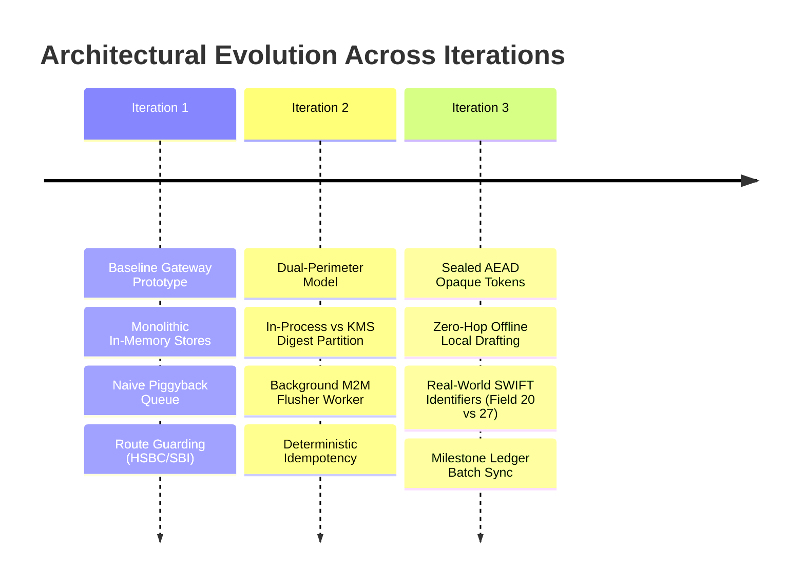

### 4.1 Iteration 1: Baseline Prototype & Multi-Bank Gateway
* **Core Idea**: Establish the initial monorepo with an Auth Service (Port 4000) and Orchestrator Service (Port 3000).
* **Key Mechanics**:
  - Unified REST API accepting a canonical LC JSON contract.
  - Strict in-memory non-custodial check: `inMemoryOrchestratorStore.js` threw an exception if `privateKey` was submitted.
  - Intentional network hop on every inbound request: Orchestrator calls `POST /api/v1/auth/validate-opaque-token` to verify session and capacity quota.
  - Naive Piggybacking: Terminal billing receipts queued in an in-memory array (`pendingReceiptsQueue = []`) and dequeued one-by-one on subsequent inbound auth hops.
  - State machine initialized: `LC_INITIATED` $\to$ returns HTTP `202 Accepted`.

### 4.2 Why Iteration 1 Broke Down: Architectural Gaps
1. **The Stale Queue Black Hole**: In Iteration 1, billing receipts relied 100% on subsequent incoming traffic. If a treasury officer presented documents on Friday at 5 PM and closed their laptop, completed billing receipts sat in the in-memory array until Monday morning. Revenue recognition and quota release were delayed by 65+ hours.
2. **KMS Payload Rejection**: Sending full 2MB trade contracts to AWS KMS for signing threw `ValidationException: Member must have length less than or equal to 4096`. AWS KMS cannot sign payloads $> 4\text{KB}$.
3. **Double-Commitment on Timeout**: A network drop after dispatching an LC caused the client to retry, which generated a new `workflowId` and attempted to create a duplicate credit contract at the bank.
4. **Data Sovereignty Violation**: Running the entire stack in SaaS meant corporate clients had to upload unencrypted trade contracts to Xalts cloud, violating data residency mandates.

### 4.3 Iteration 2: Hybrid Perimeter, Cryptographic Partitioning & M2M Worker
* **Core Idea**: Split deployment into Hybrid Perimeters (Orchestrator on-prem at client, Auth Service centralized in Xalts SaaS).
* **Key Inventions**:
  - **Asymmetric Cryptographic Operation Partitioning**:
    - In-Process Public Key compute: Hybrid Envelope Encryption (`AES-256-GCM` + Bank RSA-OAEP) and Bank signature verification run in Node.js OpenSSL in $< 0.5\text{ms}$.
    - Non-Custodial Private Key delegation: Orchestrator hashes the document locally (`SHA-256`) and dispatches only the 32-byte digest to AWS KMS (`MessageType: 'DIGEST'`).
  - **Pluggable Strategy Factory**: `CryptoProviderFactory` dynamically supporting `AWS_KMS`, `AZURE_VAULT`, `REMOTE_API`, and `LOCAL_MOCK`.
  - **Deterministic Idempotency Key**: `hash(clientId + lcNumber + version)` with intermediate state `DISPATCHED_PENDING_ACK`.
  - **Secondary M2M Channel**: An autonomous background worker (`idleReceiptFlusher.js`) waking up every 30 seconds to drain lingering receipts using platform credentials (`X-Platform-Node-Id` and `X-Platform-Secret`).

### 4.4 Why Iteration 2 Needed Evolution: The Real-World Vulnerabilities
While Iteration 2 fixed cryptography and timeouts, real-world deployment exposed critical engineering flaws:
1. **The M2M Secret Vulnerability**: Storing static platform credentials (`X-Platform-Secret`) inside the on-prem client container created a severe attack surface. Any malicious employee or intruder inside the client datacenter could dump container memory/env, steal the platform secret, and forge billing receipts or impersonate nodes against the central Auth Service.
2. **Timer Event Loop Leaks**: Running unmanaged `setInterval` timers inside Node.js containers caused event loop leaks, prevented clean SIGTERM graceful container shutdowns, and suffered from race conditions with in-flight HTTP calls.
3. **The "Coffee Spill" Drafting Block**: In Iteration 2, even saving an in-progress draft required an intentional cross-cloud WAN network hop to Auth Service. If the client’s internet link flickered or Auth Service underwent maintenance, treasury officers were completely blocked from saving form drafts.
4. **Fictitious Identifier Generation**: Iteration 2 let the client provide `lcNumber`. In real-world international banking, no bank permits a corporate client to assign an official LC number. Banks generate official LC numbers upon legal acceptance.

### 4.5 Iteration 3: Sealed AEAD Tokens, Offline Drafting & Real-World Identifiers
* **Core Idea**: Production-grade Dual-Perimeter System with cryptographic token sealing, zero-hop offline drafting, and real-world banking protocol alignment.
* **Key Inventions**:
  - **Sealed AEAD Opaque Tokens (`AES-256-GCM`)**: The Auth Service seals claims into an encrypted envelope. The token appears completely opaque to browser DevTools and proxies (Zero Claim Leakage), but any Orchestrator replica can unseal and verify it locally in $< 0.05\text{ms}$ for draft CRUD.
  - **Dual-Perimeter Routing**:
    - Draft routes (`/draft/*`): Authenticated 100% locally with 0 central network hops and 0 quota consumption.
    - Dispatch routes: Make the authoritative network hop to Auth Service to verify active subscription status, increment concurrent workflow counters, and batch-sync billing receipts.
  - **Real-World Banking Identifiers**:
    - Client provides internal ERP reference (`corporateReference` $\to$ SWIFT Field 20: *Sender's Reference*).
    - Bank generates official `lcNumber` (SWIFT Field 27: *Receiver's Reference*), `amendmentNumber`, and `presentationNumber`.
  - **Dual-Paced Reconciliation Engine with Dual-Trigger Convergence**: Replaces naive continuous background flushers and pure piggybacking with an append-only milestone ledger (`syncStatus: 'PENDING' | 'ACKNOWLEDGED'`). Discovers asynchronous bank status transitions via autonomous outbound B2B mTLS polling (freeing local execution capacity immediately), while synchronizing billable milestones to Central SaaS via fast-path organic piggybacking during active hours and a 15-minute outbound heartbeat flush during dormant periods. Eliminates static platform secrets and prevents the weekend dormant tenant lockup.

---

## 5. High-Level Design (HLD)

### 5.1 Dual-Perimeter Hybrid Topology & Trust Boundaries

The production system is partitioned into three physical perimeters:

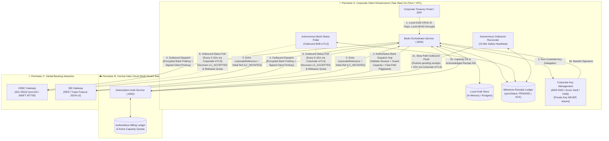

### 5.2 Real-World Banking Identifier Progression (SWIFT Field 20 vs. 27)

International trade finance requires strict separation between sender references and receiver banking identifiers:

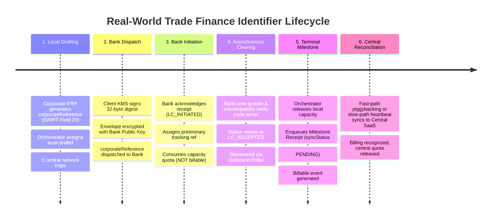

### 5.3 Data Ingestion & Cross-Perimeter Communication Channels

| Channel | Source $\to$ Destination | Protocol / Auth | Data Transferred | Trust & Compliance Rationale |
| :--- | :--- | :--- | :--- | :--- |
| **Local Draft Channel** | Corporate UI $\to$ Orchestrator | HTTP/1.1 or HTTP/2<br>`Bearer xlt_opq_...` | Form drafts, line items, supplier data | **Zero WAN traffic**. Data resides 100% within corporate firewall. |
| **Authoritative Dispatch Hop** | Orchestrator $\to$ Auth Service | TLS 1.3 HTTPS<br>`Bearer xlt_opq_...` | Token string, capacity check, batch `receiptIds` | **Zero trade content**. Only random tokens and billing receipt UUIDs cross to SaaS. |
| **Non-Custodial Sign Channel** | Orchestrator $\to$ Client KMS | AWS SDK (SigV4) / HTTPS | 32-byte SHA-256 Digest $\to$ Base64 Signature | **Zero private key custody**. Private key never leaves hardware security module. |
| **Bank Dispatch Channel** | Orchestrator $\to$ HSBC/SBI | TLS 1.3 / mTLS<br>Bank Envelope | Canonical mapped payload + Client Signature | Bank decrypts directly. Intermediate proxies cannot inspect commercial terms. |
| **Outbound Bank Polling Channel** | Orchestrator $\to$ Bank Gateway | TLS 1.3 mTLS (Corporate Client Cert) | Batch reference query (`GET /status`) $\to$ Status transitions | **Outbound only**. Operates autonomously without human session; respects enterprise zero-inbound firewall rules. |
| **Autonomous Outbound Reconciler** | Orchestrator $\to$ Auth Service | TLS 1.3 HTTPS (`X-Client-Cert` / OAuth M2M) | Pending milestone receipts batch | **Slow-path safety net**. Guarantees billing convergence during weekends/idle hours. |

### 5.4 The Dual-Paced Reconciliation Topology: Bank Ingestion vs. Central Billing Sync

Enterprise trade finance systems operate across two fundamentally disconnected cadence boundaries:

```mermaid
flowchart LR
    subgraph Boundary_1 ["Ingestion Boundary: Bank -> Orchestrator"]
        direction TB
        B1["Bank Core Clearing"] -->|"Asynchronous Back-Office Processing\n(Hours to Days)"| B2["Bank Status Gateway\n(GET /trade/lc/batch-status)"]
        B2 -->|"Outbound B2B mTLS Polling\n(Every 5-15 mins, No Human Logged In)"| B3["Orchestrator Ingestion Engine"]
        B3 -->|"Terminal Event Discovered (LC_ACCEPTED)\n1. Immediate Local Capacity Release\n2. Write to Milestone Ledger (syncStatus: PENDING)"| B4[("Local Milestone Ledger")]
    end

    subgraph Boundary_2 ["Convergence Boundary: Orchestrator -> Central SaaS"]
        direction TB
        C1[("Local Milestone Ledger")] -->|"Trigger A: Fast-Path Organic Piggyback\n(Next active user dispatch, 0 extra hops)"| C2["Central Auth & Billing Service"]
        C1 -->|"Trigger B: Slow-Path Safety Heartbeat\n(Flushes receipts pending > 15m via Tenant mTLS)"| C2
        C2 -->|"Deterministic Deduplication\nhash(clientId + ref + terminalState)"| C3[("Central Billing Ledger\n& Quota Engine")]
    end

    B4 === C1
```

#### The Two Critical Production Realities:
1. **The Bank State Ingestion Challenge**:
   - When an orchestrator submits an LC application (`POST /api/v1/letter_of_credit/issuance`), the bank returns `202 Accepted` with initial status `LC_INITIATED`. **This is NOT a billable event**, and it does not represent final legal commitment. It is merely queued in the bank's core clearing system.
   - The bank later transitions the contract to `LC_ACCEPTED_BY_ADVISING_BANK` (or `ISSUANCE_CONFIRMED`) completely out-of-band.
   - **Why Webhooks are Prohibited**: Enterprise corporate datacenters (Tata Steel, Boeing VPCs) enforce strict **zero-inbound open port** policies. A bank cannot push HTTP webhooks into a corporate intranet. Furthermore, global banks refuse to manage dynamic IP routing tables for thousands of customer datacenters.
   - **The Solution (Outbound B2B Machine Poller)**: The orchestrator uses corporate-level Host-to-Host (H2H) credentials (mutual TLS X.509 certificates issued by the bank to the corporation) to execute outbound polling batches every 5–15 minutes. This runs autonomously 24/7 without requiring any logged-in employee session.
2. **The Central Billing & Quota Convergence Challenge**:
   - Once `LC_ACCEPTED` is ingested, it is a legally billable milestone and releases concurrent execution capacity.
   - Relying *purely* on user UI actions to "piggyback" this receipt to Central Auth causes the **Dormant Tenant Bug**: over weekends or quiet weeks, receipts linger unsynced, delaying revenue recognition and locking customer quotas.
   - **The Solution (Dual-Trigger Reconciliation)**: The orchestrator uses **Dual-Trigger Convergence**:
     - **Fast-Path (Organic Piggyback)**: If a user is active, receipts ride along on outbound authoritative calls (0 extra hops).
     - **Slow-Path (Autonomous Outbound Heartbeat)**: If receipts linger beyond a 15-minute threshold without user traffic, an automated reconciler initiates a scoped outbound flush (`POST /api/v1/sync-billing`) using a tenant-scoped mTLS certificate.
     - **Central Deduplication**: Central Auth guarantees idempotent ledgering via deterministic keys, ensuring zero duplicate charges regardless of which trigger fires first.

---

## 6. Detailed Low-Level Design (LLD)

### 6.1 Component Topology & Microservice Boundaries

```mermaid
graph TD
    subgraph Central_Auth_Service ["🔐 Subscription-Auth-Service (Port 4000)"]
        AuthController["authController.js"]
        AuthStore["inMemoryAuthStore.js"]
        AuthSealer["crypto/sealedToken.js"]

        ClientsMap[("Map: clients<br/>[clientId, ClientRecord]")]
        TokensMap[("Map: opaqueTokens<br/>[token, TokenRecord]")]
        LedgerMap[("Map: billingLedger<br/>[dedupeKey, BillingReceipt]")]

        AuthController --> AuthStore
        AuthController --> AuthSealer
        AuthStore --> ClientsMap
        AuthStore --> TokensMap
        AuthStore --> LedgerMap
    end

    subgraph Bank_Orchestrator_Service ["🏦 Bank-Orchestrator-Service (Port 3000)"]
        OrchRouter["orchestrator.routes.js"]
        DualAuthMiddleware["middleware/auth.js"]
        OrchController["orchestratorController.js"]
        OrchStore["inMemoryOrchestratorStore.js"]
        OrchSealer["crypto/sealedToken.js"]

        subgraph CryptoEngine ["crypto/"]
            ProviderFactory["cryptoProviderFactory.js"]
            ProviderInterface["cryptoProvider.interface.js"]
            AwsKms["awsKmsProvider.js"]
            AzureVault["azureVaultProvider.js"]
            RemoteApi["remoteWebhookProvider.js"]
            LocalMock["localMockProvider.js"]

            ProviderFactory --> ProviderInterface
            ProviderInterface <|-- AwsKms
            ProviderInterface <|-- AzureVault
            ProviderInterface <|-- RemoteApi
            ProviderInterface <|-- LocalMock
        end

        subgraph BankAdapters ["services/bankAdapters/"]
            Connector["bankConnector.service.js"]
            Hsbc["hsbcAdapter.js"]
            Sbi["sbiAdapter.js"]

            Connector --> Hsbc
            Connector --> Sbi
        end

        OrchRouter --> DualAuthMiddleware
        DualAuthMiddleware -->|Draft Routes: Local AES-GCM Decrypt| OrchSealer
        DualAuthMiddleware -->|Dispatch Routes: POST /validate-opaque-token| AuthController
        DualAuthMiddleware --> OrchController
        OrchController --> ProviderFactory
        OrchController --> Connector
        OrchController --> OrchStore
    end
```

### 6.2 Configurable On-Premise KMS Layer & Bank-Supplied Crypto Integration

In enterprise trade finance, secure bank communication and cryptographic operations adhere to two fundamental realities:

1. **Bank-Supplied Communication & Cryptographic Protocols**:
   - The cipher suites, payload schemas, digital signature algorithms, and communication envelopes (e.g., SWIFT MT700, ISO 20022 `tsmt.019`, or bank-mandated REST JSON envelopes) are **already specified and provided by each individual bank** (via bank SDKs, APIs, and partner integration specifications).
   - The orchestrator does not create arbitrary custom cryptography for banking rails; it strictly adapts canonical trade data into each bank's prescribed communication logic.

2. **The Configurable On-Premise KMS Resolution Layer**:
   - Multinational corporations (e.g., Tata Steel) manage their master private signing and decryption keys within their own private infrastructure using diverse Key Management Services (AWS KMS, Azure Key Vault, HashiCorp Vault, or local hardware HSMs).
   - The developer's primary architectural responsibility was building a **configurable, DB-driven abstraction layer** (`CryptoProviderFactory` and `inMemoryOrchestratorStore`).
   - At request time, the orchestrator queries the database for the client's configured `cryptoMode` and connection settings, dynamically instantiates the matching on-premise KMS provider, delegates signing and decryption directly to the customer's on-premise service, and passes the resulting cryptographic outputs into the bank-provided communication pipeline.

```mermaid
graph TD
    subgraph DB_Layer ["Database Layer (inMemoryOrchestratorStore / Postgres)"]
        CredRecord["BankCredentialRecord<br/>{ clientId, bankId, cryptoMode, cryptoConfig, clientPublicKey, bankPublicKey }"]
    end

    subgraph Configurable_KMS_Layer ["Configurable On-Premise KMS Resolution Layer (cryptoProviderFactory.js)"]
        Factory["CryptoProviderFactory.create(credentialRecord)"]
        Interface["CryptoProviderInterface<br/>(signDigest, decryptPayload, getPublicKey)"]
        
        AWS["AwsKmsProvider<br/>(Client AWS KMS)"]
        Azure["AzureVaultProvider<br/>(Client Azure Key Vault)"]
        Remote["RemoteWebhookProvider<br/>(Client On-Prem HSM Webhook)"]
        Mock["LocalMockProvider<br/>(Dev / Sandbox Mock)"]

        Factory --> Interface
        Interface <|-- AWS
        Interface <|-- Azure
        Interface <|-- Remote
        Interface <|-- Mock
    end

    subgraph Bank_Communication_Pipeline ["Bank-Provided Communication Logic (services/bankAdapters/)"]
        HSBC_Adapter["HsbcBankAdapter<br/>(Bank-Supplied ISO 20022 tsmt.019 logic)"]
        SBI_Adapter["SbiBankAdapter<br/>(Bank-Supplied REST JSON v2 logic)"]
    end

    CredRecord -->|"1. Read runtime config from DB"| Factory
    Interface -->|"2. Execute delegated signing/decryption against client on-prem KMS"| Bank_Communication_Pipeline
```

#### Key Mechanics of the DB-Driven Configurable KMS Layer:
1. **Dynamic Runtime Resolution**:
   - Key configurations are decoupled from service deployments. When an operator triggers a transaction, `orchestratorStore.getBankCredentials(clientId, bankId)` retrieves the client's registered key management settings.
2. **Zero Private Key Custody**:
   - The orchestrator never stores or loads corporate private keys into memory or disk. All private key operations are delegated to the client's own on-premise KMS (`cryptoProvider.signDigest(digest)` or `decryptPayload(cipher)`).
3. **Seamless Bank Integration**:
   - Once the on-premise KMS completes the cryptographic operation, the orchestrator routes the signatures and payload directly through the bank's mandated communication adapter.

### 6.3 Sealed AEAD Opaque Token Specification (`AES-256-GCM`)

To ensure Zero Claim Leakage while enabling $< 0.05\text{ms}$ offline local validation, tokens issued by the Auth Service follow an Authenticated Encryption with Associated Data (AEAD) envelope:

$$\text{Token String} = \text{"xlt\_opq\_"} + \text{Base64URL}(IV) + \text{"."} + \text{Base64URL}(\text{Ciphertext}) + \text{"."} + \text{Base64URL}(\text{AuthTag})$$

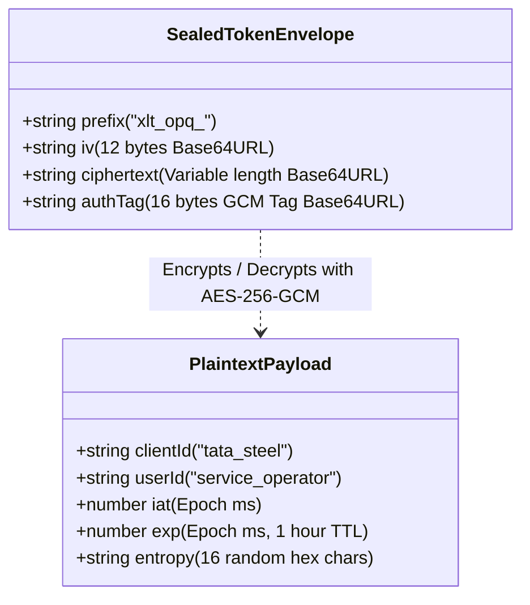

- **Algorithm**: `AES-256-GCM` using a 256-bit symmetric key (`TOKEN_ENCRYPTION_KEY`).
- **Initialization Vector (IV)**: 12 bytes (`crypto.randomBytes(12)`) uniquely generated per issuance.
- **Tamper Resistance**: Any modification to the IV, ciphertext, or authTag causes OpenSSL GCM authentication to fail (`Error: Unsupported state or unable to authenticate data`), preventing ciphertext tampering.

### 6.4 In-Memory Storage Models, Multi-State Taxonomy & Schemas

To prevent financial double-commitment, enforce active capacity licensing, and eliminate billing ledger corruption, the system enforces a strict distinction between **Workflow Lifecycle Tracking** (mutable, manages state and execution capacity) and **Milestone Billing Receipts** (immutable, append-only, registers financial/commercial events).

#### The Multi-State LC Classification Taxonomy

Every Letter of Credit transaction traverses three distinct billing and concurrency dimensions:

| State Class | Stage Identifier | Concurrency Quota Impact | Billing Event Emitted? | Real-World Domain Meaning |
| :--- | :--- | :---: | :---: | :--- |
| **0. Local Draft** | `DRAFT` | **0** (Zero Consumption) | **NO** | Form saved safely inside corporate VPC. 0 network hops to central. |
| **1. Unknown In-Flight Dispatch** | `DISPATCHED_PENDING_ACK` | **Local In-Flight Slot (60s TTL)**<br/>Central SaaS: **0** (Pending confirmation) | **NO** | Transient state while socket is active to bank. Governed by Local DB Limiter to absorb ERP batch spikes and bank RPS limits. If app crashes, slot auto-releases in 60s with zero central SaaS cleanup. |
| **2. Non-Billable Bank Processing** | `LC_INITIATED` | **1 Central Slot Occupied** | **NO** | Bank accepted payload and assigned official `lcNumber`. Application is undergoing core banking clearing. Consumes 1 active concurrency license slot. Not billable under ICC UCP 600. |
| **3. Dormant / Stale Processing** | `DORMANT_STALE_PENDING` | **-1 Slot (Capacity Released)** | **NO** | Application in `LC_INITIATED` for $> 30\text{ days}$ without bank status transition. Quota is reclaimed so corporate ERP can dispatch new transactions, but background poller continues checking. |
| **4. Billable Terminal Milestone** | `ISSUANCE_CONFIRMED` / `LC_ACCEPTED`<br/>`DOCUMENTS_PRESENTED` | **-1 Slot (Capacity Released)** | **YES (Receipt Generated)** | Bank officially clears credit or settles presentation. Releases concurrent capacity and generates immutable `MilestoneReceipt` (`syncStatus: PENDING`). |
| **5. Terminal Failure / Rejection** | `DISPATCH_FAILED`<br/>`LC_REJECTED` | **0 Central Slot Impact** | **NO** | Network failed confirmedly or bank rejected credit application. Local lease cleared; Central Auth untouched. Record is **never deleted**. |

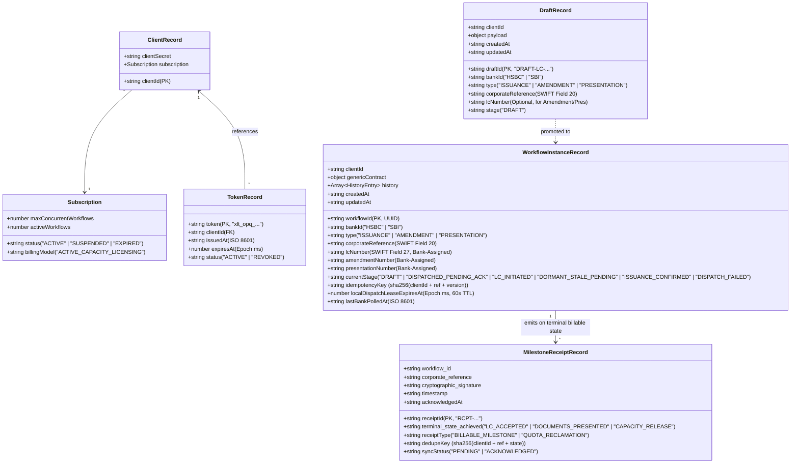

### 6.5 Class Diagrams & Interface Contracts

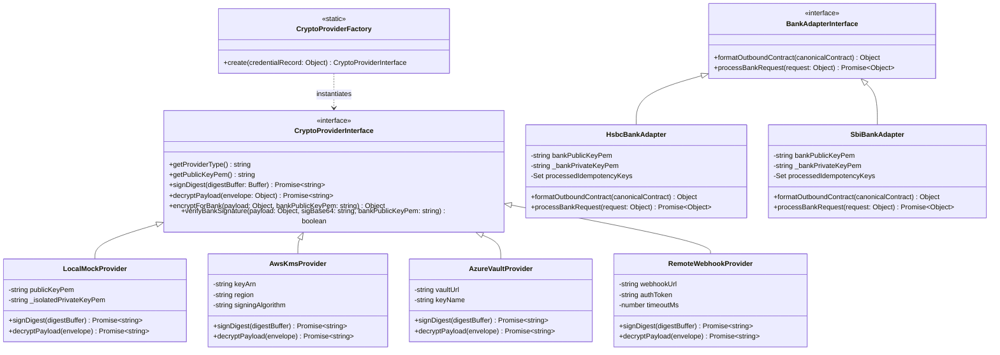

---

### 6.6 End-to-End Sequence Diagrams

#### 6.6.1 Flow A: Offline Local Draft Creation (Zero Central Network Hops)

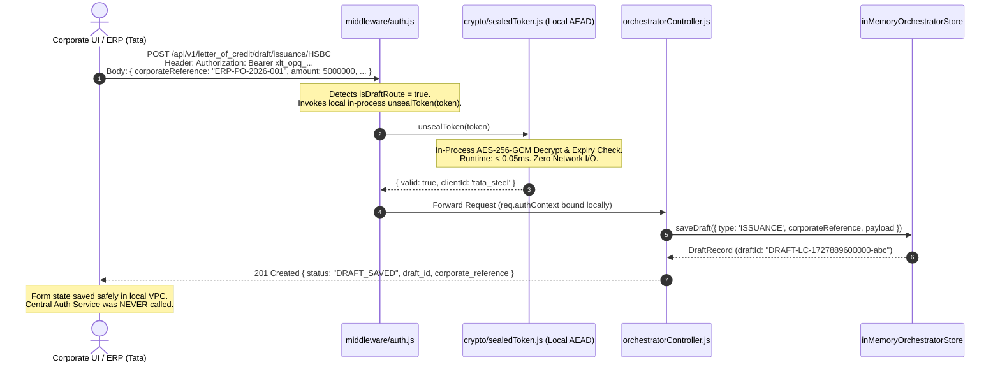

#### 6.6.2 Flow B: Strict Two-Step Bank Dispatch, Unknown State Guard & Bank-Assigned LC Number

This flow implements **Two-Tier Hierarchical Concurrency Control**: a **Local DB-backed In-Flight Concurrency Limiter** on-premise (protecting bank gateways from burst spikes and isolating crash domains) coupled with **Central SaaS Confirmed Quota Verification**. Central Auth only tracks *confirmed* states, eliminating cross-cloud lease rollbacks and zombie reservation sweepers.

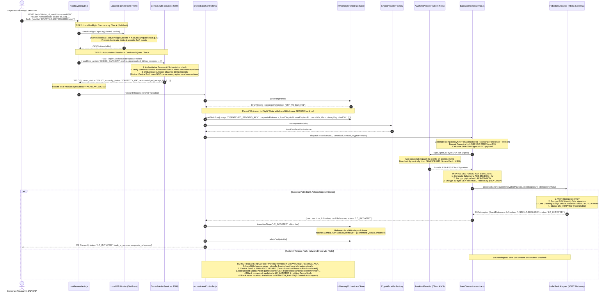

#### 6.6.3 Flow C: Document Presentation & Batch Milestone Synchronization

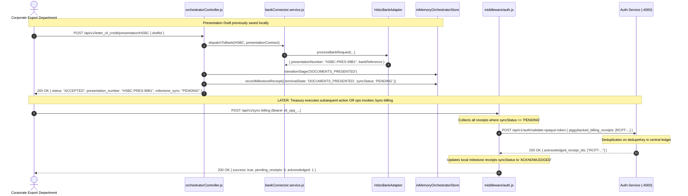

#### 6.6.4 Flow D: Asynchronous Bank Status Ingestion & Dual-Trigger Milestone Synchronization

This flow models the critical production reality: the initial bank call returns non-billable `LC_INITIATED`, the bank processes and accepts the LC asynchronously out-of-band, the orchestrator autonomously discovers this via corporate mTLS without any human logged in, releases local capacity, and synchronizes billing via the dual-trigger mechanism.

```mermaid
sequenceDiagram
    autonumber
    actor Treasury as Corporate Treasury User
    participant Orch as Bank-Orchestrator-Service (:3000)
    participant Bank as HSBC Banking Gateway
    participant Store as inMemoryOrchestratorStore
    participant Poller as Autonomous Status Poller
    participant Flusher as Autonomous Outbound Reconciler
    participant Auth as Central Auth & Billing (:4000)

    Note over Treasury,Bank: PHASE 1: Initial Dispatch (Non-Billable Initiation)
    Treasury->>Orch: POST /api/v1/letter_of_credit/issuance/HSBC { draftId }
    Orch->>Auth: Validate Token & Check Active Capacity (Count: 14 -> 15 / 50)
    Auth-->>Orch: 200 OK (Capacity Available)
    Orch->>Bank: Dispatch LC Application (Field 20: ERP-PO-2026-001)
    Bank-->>Orch: 202 Accepted { status: "LC_INITIATED", lcNumber: "HSBC-LC-2026-0049" }
    Orch->>Store: saveWorkflow(stage: 'LC_INITIATED', inFlight: true)
    Orch-->>Treasury: 201 Created (LC_INITIATED - Not billable yet)

    Note over Treasury,Bank: PHASE 2: Out-of-Band Bank Clearing (Friday Night / Weekend)
    Treasury--xOrch: Operators log off; ZERO active user sessions
    Note over Bank: HSBC Back-Office Clears Contract: Moves to LC_ACCEPTED

    Note over Poller,Bank: PHASE 3: Outbound Machine Status Ingestion (No User Logged In)
    Poller->>Bank: GET /trade/lc/batch-status?ids=HSBC-LC-2026-0049 (Corporate mTLS)
    Bank-->>Poller: 200 OK { id: "HSBC-LC-2026-0049", status: "LC_ACCEPTED", settledAt: "2026-11-06T18:30:00Z" }
    Poller->>Store: transitionStage('ISSUANCE_CONFIRMED')
    Poller->>Store: decrementInFlightCount() [Capacity Released: 15 -> 14]
    Poller->>Store: recordMilestoneReceipt({ terminalState: 'LC_ACCEPTED', syncStatus: 'PENDING' })

    alt Trigger A: Fast-Path Organic Piggybacking (Active Business Hours)
        Treasury->>Orch: Next User API Dispatch (e.g. POST /issuance/SBI)
        Note over Orch: Piggybacks pending receipt RCPT-001 on Auth Hop
        Orch->>Auth: POST /validate-opaque-token { piggybacked_receipts: [RCPT-001] }
        Auth->>Auth: Deduplicate & Record Billing Event in Central Ledger
        Auth-->>Orch: 200 OK { acknowledged_receipt_ids: [RCPT-001] }
        Orch->>Store: markMilestoneAcknowledged(RCPT-001)
    else Trigger B: Slow-Path Safety Heartbeat (Weekend / Idle Period > 15 Mins)
        Note over Flusher: Reconciler detects RCPT-001 pending > 15 mins without user traffic
        Flusher->>Auth: POST /api/v1/sync-billing (Client mTLS / Scoped Machine Token)
        Auth->>Auth: Deduplicate & Record Billing Event in Central Ledger
        Auth-->>Flusher: 200 OK { acknowledged_receipt_ids: [RCPT-001] }
        Flusher->>Store: markMilestoneAcknowledged(RCPT-001)
    end
```

---

### 6.7 Finite State Machine & State Transition Matrix

The orchestrator’s core integrity rests on a deterministic Finite State Machine (FSM). It strictly controls execution concurrency, prevents double-booking across ambiguous network partitions, isolates non-billable processing from commercial billing milestones, and prevents long-pending dormant trade contracts from blocking corporate ERP pipelines.

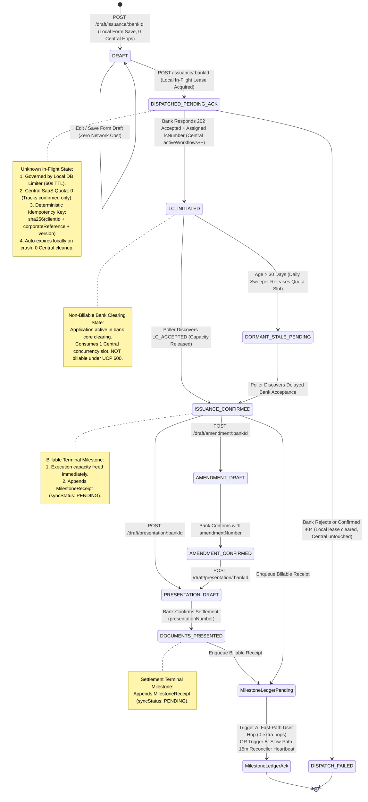

#### The Comprehensive State Transition Matrix

| From State | Trigger Event / Inbound Action | Next State | Concurrency Quota Impact | Milestone Ledger Impact | Idempotency & Fault-Tolerance Rule |
| :--- | :--- | :--- | :---: | :---: | :--- |
| `[*] (None)` | `POST /draft/*` | `DRAFT` | None ($0$) | None | Scoped strictly to local VPC. 0 network calls. |
| `DRAFT` | `POST /issuance/*` | `DISPATCHED_PENDING_ACK` | **Local In-Flight Slot (60s Lease)**<br/>Central SaaS: $0$ | None | Local DB Limiter throttles ERP bursts & bank RPS. Central Auth confirms session. IdempotencyKey generated. |
| `DISPATCHED_PENDING_ACK` | Bank returns `202 Accepted` + `lcNumber` | `LC_INITIATED` | **$+1$ Central Confirmed Slot**<br/>Local In-Flight Lease Released | None | Non-billable. Official bank-assigned `lcNumber` stored. Central Auth `activeWorkflows++`. |
| `DISPATCHED_PENDING_ACK` | Bank returns `4xx/5xx` rejection OR poller verifies 404 | `DISPATCH_FAILED` | Local Lease Cleared<br/>Central SaaS: $0$ (Untouched) | None | **Zero record deletion.** Zero Central Auth rollback calls needed. Record retained for compliance. |
| `LC_INITIATED` | Inactivity timer $> 30\text{ days}$ | `DORMANT_STALE_PENDING` | **$-1$ (Capacity Released)** | Emits Quota Reclaim | Daily Stale Sweeper frees slot to unblock corporate ERP dispatches. Poller continues monitoring. |
| `LC_INITIATED` | Bank Poller detects `LC_ACCEPTED` | `ISSUANCE_CONFIRMED` | **$-1$ (Capacity Released)** | **Enqueues Billable Receipt** | Generates `MilestoneReceipt` (`syncStatus: PENDING`, `dedupeKey: sha256(...)`). |
| `DORMANT_STALE_PENDING` | Bank Poller detects `LC_ACCEPTED` | `ISSUANCE_CONFIRMED` | Neutral (Already released) | **Enqueues Billable Receipt** | Revives workflow, generates billing receipt for central SaaS. |
| `ISSUANCE_CONFIRMED` | `POST /presentation/*` | `DOCUMENTS_PRESENTED` | Neutral (Settlement) | **Enqueues Billable Receipt** | Financial settlement achieved. Generates presentation billing receipt. |
| `MilestoneLedgerPending` | User Action (Fast) OR 15m Reconciler (Slow) | `MilestoneLedgerAck` | Central Quota decremented | Central Ledger committed | Central Auth enforces `UNIQUE(dedupeKey)`. Replays are idempotent. |

---

### 6.8 Detailed Component Design: Polling, Two-Tier Concurrency Control & Tri-Process Reconciliation Engine

The centerpiece of the orchestrator architecture is the **Tri-Process Reconciliation Engine**. It bridges the asynchronous banking clearing lifecycle with multi-tenant SaaS capacity licensing across enterprise corporate firewalls.

```mermaid
classDiagram
    class BankStatusPoller {
        +number pollIntervalMs (300000)
        +number batchSize (50)
        +CorporateMtlsCert clientCert
        +pollInFlightWorkflows() Promise~void~
        +handleBankStateTransition(workflow, bankStatus) void
    }

    class DailyStaleSweeper {
        +number maxStaleAgeMs (2592000000)
        +runDailySweep() Promise~SweepResult~
        +markStaleAndReleaseQuota(workflow) void
    }

    class DualTriggerReconciler {
        +number maxPendingAgeMs (900000)
        +CorporateMtlsCert centralMtlsCert
        +attachFastPathReceipts(authPayload) Object
        +executeSlowPathFlush() Promise~SyncResult~
    }

    class MilestoneLedgerStore {
        +Map~string, MilestoneReceipt~ receipts
        +recordMilestone(terminalState, workflowId) MilestoneReceipt
        +getPendingReceipts(maxAgeMs) MilestoneReceipt[]
        +markAcknowledged(receiptIds) void
    }

    class CentralBillingLedger {
        +Map~string, LedgerEntry~ deduplicatedLedger
        +processBatchReceipts(clientId, receipts) string[]
        +releaseCapacityQuota(clientId, workflowIds) void
    }

    BankStatusPoller --> MilestoneLedgerStore : Appends terminal billable events (syncStatus: PENDING)
    DailyStaleSweeper --> MilestoneLedgerStore : Appends capacity reclamation receipts
    DualTriggerReconciler --> MilestoneLedgerStore : Queries pending & marks ACK
    DualTriggerReconciler ..> CentralBillingLedger : Synchronizes via Fast-Path or Slow-Path
```

#### 6.8.1 The Tri-Process Reconciliation Topology

Rather than running an unmanaged, noisy background polling loop that risks event-loop starvation and socket leaks, the system partitions background orchestration into three distinct, single-purpose processes:

1. **Process 1: Autonomous Outbound Bank Status Poller (`bankStatusPoller.js`)**:
   - **Trigger & Frequency**: Outbound cron running every 5–15 minutes inside the corporate VPC.
   - **Authentication**: Layer-4 Mutual TLS (mTLS) with corporate client certificates issued directly by partner banks (HSBC, SBI) to the enterprise. Operates 24/7 with zero logged-in user sessions.
   - **Batch Mechanics**: Collects all active workflows in `stage IN ('LC_INITIATED', 'DISPATCHED_PENDING_ACK', 'DORMANT_STALE_PENDING')` in batches of 50:
     `GET /trade/lc/batch-status?corporateReferences=REF1,REF2,REF3...`
   - **Action on Transition**:
     - Detects bank transition from `LC_INITIATED` $\to$ `LC_ACCEPTED` (or `REJECTED`).
     - Updates local workflow state to `ISSUANCE_CONFIRMED`.
     - **Immediately decrements local in-flight counter**: Frees execution capacity on-premise without waiting for central SaaS WAN hops.
     - Appends billable receipt to `milestoneReceipts` ledger: `{ receiptId: "RCPT-...", terminalState: "LC_ACCEPTED", syncStatus: "PENDING" }`.

2. **Process 2: Daily Stale Sweeper (`staleSweeper.js`)**:
   - **Trigger & Frequency**: Daily cron (e.g., executing at midnight 00:00 UTC).
   - **Responsibility**: Scans for workflows that have remained in non-billable `LC_INITIATED` status for $> 30\text{ days}$ without any bank status updates.
   - **Action**: Transitions workflow stage to `DORMANT_STALE_PENDING`, decrements local capacity counters, and queues a capacity release sync for Central Auth. Prevents dormant legacy contracts from clogging licensed execution slots.

3. **Process 3: Dual-Trigger Outbound Reconciler (`idleReceiptFlusher.js`)**:
   - **Trigger & Frequency**: Fast-Path (organic user piggybacking) + Slow-Path heartbeat timer (every 5 minutes, flushing receipts older than 15 minutes).
   - **Responsibility**: Guarantees that pending milestone receipts reach Central Auth's authoritative billing ledger even during weekend/holiday periods when zero human operators are logged into the system.

---

#### 6.8.2 Two-Tier Hierarchical Concurrency Control (Local DB In-Flight Limiter + Central Confirmed Quota)

In enterprise trade finance architectures, managing transient, mid-flight execution states across cross-cloud WAN boundaries creates severe operational fragility: Central SaaS is burdened with tracking ephemeral socket timeouts, holding zombie reservations, and executing distributed lease rollback compensations.

To resolve this, the system enforces **Two-Tier Hierarchical Concurrency Control**, cleanly decoupling **Micro-Execution Throttling (On-Premises)** from **Macro-Licensing Accounting (Central SaaS)**:

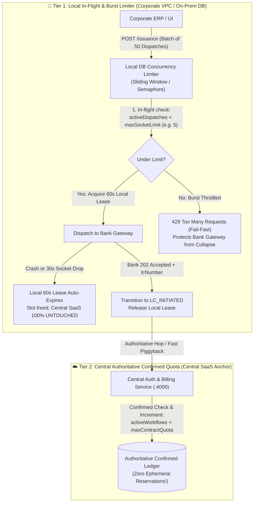

##### 1. Tier 1: Local In-Flight & Burst Limiter (On-Premise Database)
- **Scope & Responsibility**: Short-lived (seconds), handles the transient **"Unknown In-Flight"** state (`DISPATCHED_PENDING_ACK`).
- **Implementation**: Governed by an atomic sliding-window / semaphore query directly against the client's on-premise database (e.g., PostgreSQL / Redis):
  ```sql
  -- Atomic check in local on-prem DB before opening bank socket
  SELECT count(*) FROM workflows 
  WHERE client_id = 'tata_steel' 
    AND stage = 'DISPATCHED_PENDING_ACK' 
    AND local_dispatch_lease_expires_at > NOW();
  ```
- **Bank Rate-Limit & Burst Protection**: Tier-1 banks (HSBC, SBI) strictly enforce API rate limits (e.g., max 10 requests/sec per corporate client). If an automated SAP ERP batch job fires 50 dispatches in 10ms, Tier 1 buffers or throttles them to 5 concurrent sockets, preventing corporate API keys from being blacklisted by bank security.
- **Instant Crash Containment**:
  - The local record is written with `localDispatchLeaseExpiresAt = now + 60s`.
  - If the orchestrator pod crashes mid-flight or the socket times out, the lease **naturally expires in 60 seconds**, instantly freeing the local execution slot.
  - **Zero Central Complexity**: Central SaaS was never modified for this unconfirmed request, completely eliminating cross-cloud rollback calls and SaaS lease sweepers!

##### 2. Tier 2: Central Confirmed Quota Engine (Central SaaS)
- **Scope & Responsibility**: Long-lived, contractual license quota enforcement (`ACTIVE_CAPACITY_LICENSING`).
- **Clean State Discipline**: Central Auth **only tracks confirmed states**:
  1. `LC_INITIATED`: Confirmed active credit application at the bank (consumes 1 concurrency license slot).
  2. `LC_ACCEPTED` / `DOCUMENTS_PRESENTED`: Confirmed billable milestones (releases concurrency slot, records revenue receipt).
  3. `DORMANT_STALE_PENDING`: Aged pending application (releases concurrency slot).
- **Zero Ephemeral Pollution**: Central SaaS never stores transient retries, socket drops, or crash artifacts.

##### Architectural Comparison: Centralized Lease TTL vs. Two-Tier Hierarchical Control

| Dimension | Centralized Pessimistic Lease TTL | Two-Tier Hierarchical Control (Implemented) |
| :--- | :--- | :--- |
| **Central Auth State Footprint** | Complex: Tracks `reservedWorkflows`, 30m lease timers, and rollback endpoints. | **Minimal & Authoritative:** Only tracks confirmed `activeWorkflows` and billable receipts. |
| **Crash & Timeout Recovery** | High Latency: SaaS holds zombie reservation until 30m lease expires or rollback completes. | **Sub-Minute & Local:** On-prem DB lease expires in 60s. Central SaaS is 100% untouched. |
| **WAN Network Traffic** | 2 Central network hops per dispatch (Reserve $\to$ Confirm). | **1 Central network hop** (Session check & piggybacked confirm). |
| **Bank Rate-Limit Protection** | None: Central quota (e.g. 50 LCs) permits all 50 to hit the bank simultaneously. | **Strictly Enforced:** Local limiter caps parallel bank sockets to safe gateway limits. |
| **Multi-Pod Coordination** | Managed centrally across WAN. | Managed locally in client on-premise database (PostgreSQL / Redis). |

---

#### 6.8.3 Stale / Dormant LC Handling (The >30 Day Lifecycle & ERP Unblocking)

Under International Chamber of Commerce rules (**ICC UCP 600 Article 14b**), financial institutions operate under a standard SLA of **5 banking business days** to examine trade documents and accept or reject Letters of Credit.

However, in edge cases involving international sanctions screening, customs vessel delays, or bilateral bank queries, an LC application can remain in `LC_INITIATED` for several weeks:
1. **The Risk of Indefinite Quota Consumption**: If an enterprise with a 20-workflow concurrency tier has 10 LCs stuck in bank clearing for 60 days, their effective available execution capacity is cut in half, eventually halting daily corporate export operations.
2. **The Resolution (Daily Stale Aging Policy)**:
   - The on-premise **Daily Stale Sweeper** scans the database every 24 hours.
   - Any workflow remaining in `LC_INITIATED` with `updatedAt < (Now - 30 Days)` is transitioned to `DORMANT_STALE_PENDING`.
   - **Local & Central Quota Reclaim**: The sweeper decrements the active capacity count, freeing the slot for new transactions.
   - **Zero Contract Abandonment**: The contract is **not cancelled** at the bank. The Autonomous Bank Status Poller includes `DORMANT_STALE_PENDING` references in its batch query. When the bank eventually issues `LC_ACCEPTED`, the poller seamlessly transitions the workflow to `ISSUANCE_CONFIRMED` and emits the required billable milestone receipt to Central SaaS.

---

#### 6.8.4 The "Quota Deadlock" Trap & Why Pure Piggybacking Fails

A common architectural temptation is to propose *pure piggybacking*—relying 100% on subsequent user API calls to transport milestone receipts to Central Auth without any background reconciler.

```text
=============================================================================================
THE QUOTA DEADLOCK PROOF (Why Pure Piggybacking Causes System Freeze):
=============================================================================================
1. Client has licensed capacity = 20 concurrent workflows.
2. Friday 5:00 PM: Client dispatches 20 LCs. Central Auth: activeWorkflows = 20 / 20.
3. Friday 7:00 PM: Bank core clears 5 LCs out-of-band -> Transitions to LC_ACCEPTED.
4. On-premise Poller discovers LC_ACCEPTED -> Enqueues 5 MilestoneReceipts (syncStatus: PENDING).
5. Local Orchestrator marks local capacity = 15 / 20.
6. Central Auth (SaaS) STILL SEES: activeWorkflows = 20 / 20 (Unaware of bank clearance).
---------------------------------------------------------------------------------------------
7. Monday 8:00 AM: SAP ERP automated dispatcher attempts to send a new LC:
   - Request hits Orchestrator -> Routes to Central Auth for validation hop.
   - Central Auth Gateway Guard evaluates: activeWorkflows (20) >= maxQuota (20).
   - Central Auth immediately aborts with: HTTP 429 Active Capacity Exceeded!
---------------------------------------------------------------------------------------------
8. THE CATCH-22 DEADLOCK:
   - Because the inbound request is rejected at the HTTP gateway guard, the attached 
     piggybacked payload is NEVER PROCESSED by Central Auth!
   - Because no bank calls can go through, no subsequent piggyback hops can ever occur.
   - The entire corporate ERP pipeline is permanently DEADLOCKED until manual DB intervention!
=============================================================================================
```

**The Solution**: The **Dual-Trigger Convergence Model**:
- **Fast-Path (Organic Piggyback)**: Handles 98% of peak-hour volume with **0 extra network hops**.
- **Slow-Path (Autonomous Outbound Reconciler)**: Wakes up every 5 minutes. If any receipt has been pending for $> 15\text{ minutes}$ with zero user traffic, it executes a standalone flush (`POST /api/v1/sync-billing`) authenticated via corporate mTLS. This guarantees the Central Auth counter is unlocked before Monday morning business begins.

---

#### 6.8.5 Recovery Protocol on Network Drops & Bank Timeouts (Zero Deletion Guard)

When a network connection drops while dispatching to a bank (e.g., socket timeout after 30,000ms), financial compliance strictly forbids deleting database records.

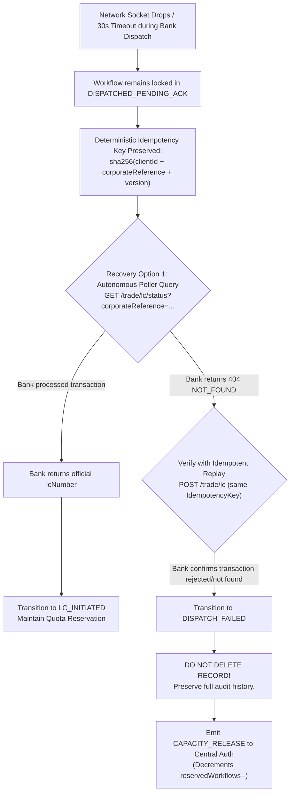

1. **Strict Prohibition on Deletions**: Deleting rows from `workflow_instances` destroys the non-repudiation audit trail mandated by ICC UCP 600 and SWIFT CSP.
2. **Ambiguous Partition Safety**: Because the workflow is held in `DISPATCHED_PENDING_ACK`, any duplicate click by a human operator or automated retry worker recomputes the exact same deterministic idempotency key. The bank detects the duplicate hash and rejects double booking.
3. **Controlled Compensation**: If and only if the bank returns an authoritative confirmation that the transaction was never received, the orchestrator moves the record to terminal `DISPATCH_FAILED` and dispatches a scoped `CAPACITY_RELEASE` to Central Auth.

---

---

## 7. Product & Business Trade-offs Matrix

| Strategic Dimension | Chosen Approach (Iteration 3) | Alternative Considered | Product / Business Rationale |
| :--- | :--- | :--- | :--- |
| **Deployment Model** | **Hybrid Multi-Perimeter** (On-Prem Orchestrator + SaaS Central Auth) | Pure Multi-Tenant SaaS | Unlocks enterprise tier-1 corporate deals (Tata, Reliance) that legally refuse to upload trade contracts to shared SaaS clouds. |
| **Drafting Workflow** | **Strict Two-Step Pipeline** (Draft Required before Dispatch) | Single-Click Direct Dispatch | Prevents multi-million dollar operator errors; protects against data loss during 45-minute commercial data entry. |
| **Monetization Model** | **Active Concurrent Capacity Licensing** | Per-Transaction Volume Metering | Provides predictable annual recurring revenue (ARR) contracts; protects downstream banking gateways from unmetered burst load. |
| **Identifier Ownership** | **Real-World Banking Protocol Alignment** (Client Ref 20 vs. Bank Ref 27) | Middleware-Generated Identifiers | Prevents clearinghouse invalidation; enables automated reconciliation against corporate SAP ERP and SWIFT FIN MT700 confirmations. |
| **State & Billing Synchronization** | **Dual-Trigger Convergence (Fast-Path Piggyback + 15m Reconciler)** | Pure Piggybacking / High-Frequency Poller | Eliminates static platform secrets, ensures zero extra hops during active hours, prevents the "Dormant Tenant Bug" over weekends, and guarantees real-time capacity reclamation. |

---

## 8. Engineering & Architectural Trade-offs Deep-Dive

### 8.1 Token Architecture: Sealed AEAD vs. Redis Opaque vs. Stateless JWT

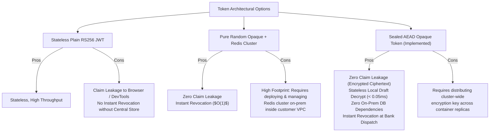

| Dimension | Stateless RS256 JWT | Pure Random Opaque + Redis | Sealed AEAD Opaque (Implemented) |
| :--- | :--- | :--- | :--- |
| **Claim Leakage to Browser / DevTools** | **Catastrophic**: Base64 decodable via `jwt.io` | **Zero Leakage**: Random 48-char hex string | **Zero Leakage**: AES-256-GCM ciphertext |
| **Local Draft Verification Latency** | $< 0.1\text{ms}$ (Public key verify) | $2\text{--}5\text{ms}$ (Network call to Redis) | **$< 0.05\text{ms}$** (In-process OpenSSL) |
| **On-Prem Infrastructure Footprint** | Low (0 external dependencies) | **High**: Requires Redis deployment/ops | **Zero Dependencies**: Single Docker container |
| **Instant Revocation Capability** | Impossible without distributed blocklist | Instantaneous ($O(1)$ delete in Redis) | **Instantaneous at Bank Dispatch** |

### 8.2 Key Management Architecture: DB-Driven Dynamic KMS Layer vs. Hardcoded SDKs vs. Custodial Keys

1. **Why Not Custodial (Storing Private Keys in Orchestrator)?**:
   - Holding corporate private keys makes the orchestrator a prime target for attackers. A breach exposes keys to sign unauthorized multi-million dollar Letters of Credit.
   - Custodial key storage subjects the orchestrator to PCI-DSS Level 1, ISO-27001, and SOC-2 Type II key management audits.
2. **Why Not Hardcoded Cloud Vendor SDKs?**:
   - Enterprise corporate treasuries utilize disparate key management infrastructures (e.g., Tata Steel uses AWS KMS, another enterprise uses Azure Key Vault or an on-premise hardware HSM).
   - Hardcoding AWS or Azure SDK clients into service binaries causes vendor lock-in, increases deployment complexity, and prevents deploying the orchestrator into air-gapped on-premise client VPCs.
3. **The Chosen Design: DB-Driven Configurable On-Premise KMS Layer**:
   - The orchestrator queries the database at runtime for `credentialRecord.cryptoMode` (`AWS_KMS`, `AZURE_VAULT`, `REMOTE_API`, `LOCAL_MOCK`) and connection parameters.
   - The `CryptoProviderFactory` dynamically instantiates the appropriate adapter, delegating signing and decryption to the client's on-premise KMS with **zero private key custody**.

### 8.3 Bank Communication Protocols: Bank-Supplied Specifications/SDKs vs. Custom Cryptography

1. **Why Adopt Bank-Supplied Communication & Cryptographic Specifications?**:
   - Tier-1 global financial institutions (HSBC, SBI, Citi, Standard Chartered) operate under rigorous regulatory frameworks and international clearing standards (SWIFT, ICC UCP 600, ISO 20022).
   - Banks mandate their own proprietary or standardized cryptographic specifications, cipher suites, payload schemas, and communication SDKs. Enterprise middleware cannot invent bespoke cryptographic messaging formats that external banking gateways will reject.
2. **The Role of the Multi-Bank Orchestrator**:
   - The orchestrator encapsulates each bank's supplied communication logic inside dedicated adapters (`hsbcAdapter.js`, `sbiAdapter.js`).
   - The core value of the orchestrator is bridging the client's internal ERP trade contracts to the bank's format while dynamically interfacing with the client's on-premise KMS for required cryptographic proofs.

### 8.4 Billing & Status Synchronization: Dual-Trigger Convergence vs. Naive Piggybacking vs. Kafka vs. Background Worker

The synchronization of billable trade events and active capacity quotas between on-premise orchestrator instances and the central SaaS Auth/Billing anchor represents the core engineering trade-off of the platform.

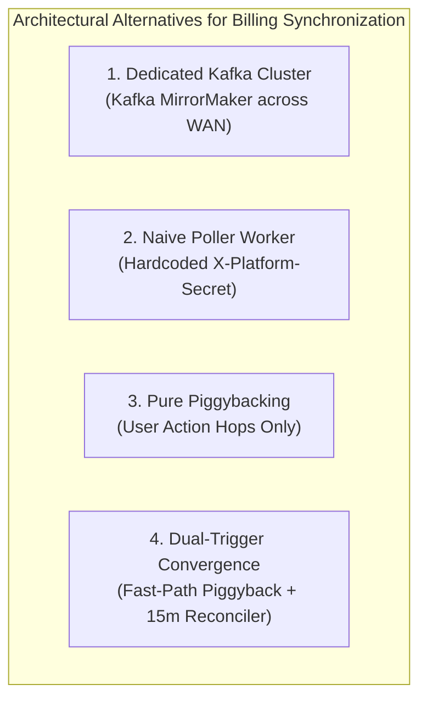

| Evaluation Dimension | Dedicated Kafka MirrorMaker | Naive Poller Worker (Iteration 2) | Pure Piggybacking (Naive Iteration 3) | Dual-Trigger Convergence (Final Production) |
| :--- | :--- | :--- | :--- | :--- |
| **On-Prem Dependency Footprint** | **Severe**: Requires Kafka broker, Zookeeper/KRaft, JVM | Low: Node.js `setInterval` | **Zero**: 100% in-process logic | **Zero**: Single lightweight Node.js container |
| **Credential Security Boundary** | Requires cross-VPC Kafka SASL credentials | **Vulnerable**: Static platform secrets in VPC env | **Secure**: Active user session token | **Hardened**: User token (Fast) + Scoped mTLS (Slow) |
| **Network Overhead during Peak Hours** | 1 produce network roundtrip per event | Constant timer hops regardless of volume | **0 Extra Hops**: Piggybacked on authoritative calls | **0 Extra Hops**: 98% of events ride organic calls |
| **Weekend / Dormant Tenant Resilience** | Event-driven (Immediate) | Periodic (30s) | **Fails (60+ hr lag)**: Frozen until user clicks | **Guaranteed**: 15-min fail-safe heartbeat flush |
| **Active Capacity Quota Lockup** | Real-time release | Near real-time release | **Critical Flaw**: Quota stays locked over weekend | **Immediate**: Local decrement + central sync |
| **Revenue Recognition SLA** | Sub-second | $< 30\text{ seconds}$ | Blocked on human operator activity | **SLA Met**: Max latency $\le 15\text{ minutes}$ |
| **Firewall Inbound Ports Required** | Requires inbound broker port | Zero inbound ports | Zero inbound ports | **Zero inbound ports**: Strictly outbound |

#### Architectural Trade-off Deep-Dive:
1. **Why Pure Piggybacking Was Rejected**:
   - Pure piggybacking is intellectually attractive because it claims "zero background crons and zero extra network hops."
   - However, in production banking, Letters of Credit transition state **asynchronously on the bank side**. When HSBC core systems move an LC from `LC_INITIATED` $\to$ `LC_ACCEPTED` on Friday evening, no human is logged into the corporate portal.
   - Under pure piggybacking, completed transactions sit unsynced until Monday morning. Corporate treasury clients with a 15-workflow concurrency quota find themselves locked out of submitting urgent automated ERP shipments on Monday at 8 AM because the system believes all 15 slots are still occupied!
2. **Why Continuous High-Frequency Workers Were Rejected**:
   - Iteration 2 ran a 30-second `setInterval` flusher. In containerized Kubernetes environments, interval timers cause container shutdown leaks, event loop blocks, and generate high idle WAN noise to Central SaaS during quiet periods.
   - More dangerously, autonomous flushers in Iteration 2 relied on static shared platform secrets (`X-Platform-Secret`), which created severe privilege escalation vulnerabilities during container breakout audits.
3. **The Chosen Design: Dual-Trigger Convergence with Corporate mTLS**:
   - **Fast-Path (Organic Piggyback)** handles 98% of all transaction volume during active business hours. Pending receipts are gathered from the local append-only ledger and merged into outbound user authorization calls. Extra network hops = 0.
   - **Slow-Path (Safety Heartbeat Reconciler)** runs every 5 minutes and only triggers if a receipt has been pending for $> 15\text{ minutes}$ with zero user calls. It authenticates using the client's corporate mTLS certificate, ensuring zero static secrets are exposed.
   - **Deterministic Idempotency**: Central Auth enforces `UNIQUE(sha256(clientId + corporateReference + terminalState))`, ensuring that even if Fast-Path and Slow-Path race, duplicate financial commitments are impossible.

### 8.5 Concurrency & Ordering: Deterministic Idempotency vs. Distributed 2PC

- **Why Reject Two-Phase Commit (2PC / XA)**:
  - Banking networks (SWIFT, HSBC ISO 20022) are external autonomous institutions that do not participate in distributed transaction coordinators.
  - Holding locks across cross-organizational WAN links creates extreme vulnerability to network partitions.
- **Why Adopt Deterministic Idempotency Key Pipeline**:
  - We generate `idempotencyKey = sha256(clientId + corporateReference + version)`.
  - The local state transitions to `DISPATCHED_PENDING_ACK` before network transmission.
  - If a network partition occurs, any replay carries the identical idempotency key. The bank detects the duplicate and returns the existing transaction reference without double booking.

---

## 9. Production Engineering Realities & War Stories

### 9.1 War Story 1: Multi-Tenant KMS Fragmentation & The DB-Driven On-Premise KMS Layer
- **The Incident**: In early enterprise deployments, corporate treasury clients maintained their cryptographic signing keys across incompatible on-premise infrastructure—some on AWS KMS, some on Azure Key Vault, and others on legacy on-premise HSMs accessed via internal webhook proxies. Meanwhile, global banks (HSBC, SBI) provide their own strict encryption/decryption specifications, certificates, and communication logic. Statically bundling cloud vendor SDKs into the orchestrator codebase created severe dependency conflicts, vendor lock-in, and blocked deployment into client private VPCs where corporate policies forbade external cloud SDK access.
- **The Engineering Fix**: Designed and built the **Configurable DB-Driven On-Premise KMS Layer** (`CryptoProviderFactory` + `CryptoProviderInterface`). Client credential mappings stored in the database specify the client's on-premise `cryptoMode` (`AWS_KMS`, `AZURE_VAULT`, `REMOTE_API`, `LOCAL_MOCK`), key identifiers/ARNs, and connection configs. At request time, the orchestrator queries the database, dynamically instantiates the client's configured on-premise KMS provider, executes the required signing/decryption operations against the client's infrastructure, and feeds the resulting cryptographic outputs directly into the bank-provided communication pipeline.
- **The Result**: Total decoupling of bank communication logic from client key storage. Corporate private keys never touch orchestrator memory or disk (100% non-custodial). Enterprise clients can configure and switch their on-premise KMS at runtime via simple database records without requiring any orchestrator code changes or redeployments.

### 9.2 War Story 2: The Dormant Tenant Bug & Why Pure Piggybacking Failed
- **The Incident**: On a Friday afternoon, Tata Steel operators dispatched 15 Letters of Credit to HSBC. The bank gateway responded with `202 Accepted` (`LC_INITIATED`), consuming all 15 active concurrent capacity slots allowed under Tata's Tier-1 subscription tier. At 5:30 PM, operators closed their laptops for the weekend. Over the weekend, HSBC's core clearing system cleared the trade contracts, transitioning them to `LC_ACCEPTED_BY_ADVISING_BANK` (the official billable terminal milestone under ICC UCP 600 rules). Because the orchestrator initially relied purely on human user API calls to piggyback billing receipts to Central Auth, zero receipts were synced for 64 hours. Worse, on Monday at 8:00 AM, Tata Steel's automated SAP ERP dispatch pipeline began failing with `429 Active Capacity Exceeded`: Central Auth believed all 15 slots were still locked by in-flight workflows, halting critical export shipments!
- **The Engineering Fix**: Architected the **Dual-Paced Asynchronous Reconciliation Engine**:
  1. **Outbound B2B Bank Machine Poller**: Built an autonomous background poller using Corporate Layer-4 mTLS machine certificates (issued directly by HSBC to Tata Steel). The poller queries the bank's batch reference endpoint every 5 minutes without requiring any logged-in employee, discovers `LC_ACCEPTED` transitions out-of-band, and immediately decrements the local in-flight counter (`activeInFlight--`), freeing execution capacity for ERP automation on-premise.
  2. **Dual-Trigger Central Convergence**: Retained fast-path organic piggybacking during active business hours (0 extra network hops), but added an autonomous Outbound Reconciler heartbeat that evaluates local milestone receipts every 5 minutes. Any receipt pending longer than 15 minutes is flushed directly to Central Auth (`POST /api/v1/sync-billing`) using a tenant-scoped corporate certificate.
  3. **Central Deterministic Deduplication**: Central Auth enforces `UNIQUE(sha256(clientId + corporateReference + terminalState))`, guaranteeing zero double-billing even if fast-path and slow-path race.
- **The Result**: Zero quota lockup on Monday mornings; revenue recognition latency strictly capped at $\le 15\text{ minutes}$ across weekends; 100% compliance with corporate firewall zero-inbound policies.

### 9.3 War Story 3: Financial Double-Commitment on Bank Gateway Timeout
- **The Incident**: During a WAN partition test, an HTTP POST to HSBC timed out at 30,000ms. The Orchestrator marked the request as failed. However, HSBC had actually processed and legally committed the LC before the socket dropped. The treasury operator clicked "Retry", issuing a second identical LC, resulting in $20,000,000 in duplicate credit commitment.
- **The Fix**: Implemented **Deterministic Idempotency Hashing with Two-Step State Guard**:
  1. Transition state from `LC_INITIATED` $\to$ `DISPATCHED_PENDING_ACK` before touching the socket.
  2. Compute deterministic idempotency key `sha256(clientId + corporateReference + version)`.
  3. When the retry arrived, the bank gateway recognized the idempotency key replay, returned the existing transaction reference (`HSBC-TXN-...`), and the orchestrator transitioned cleanly to `ISSUANCE_CONFIRMED` without creating duplicate legal commitments.

### 9.4 War Story 4: Corporate Forward Proxies Breaking Layer-4 mTLS
- **The Incident**: When deploying on-prem inside Tata Steel’s datacenter, corporate firewall rules routed all outbound WAN traffic through an enterprise forward proxy (BlueCoat/Zscaler) performing deep SSL inspection (MITM TLS decryption). Because the proxy could not present the private key of the client’s internal node certificate, mutual TLS (mTLS) handshakes failed at Layer 4.
- **The Fix**: Designed a **Dual-Layer Channel Trust Architecture**:
  1. **Transport Layer**: Standard TLS 1.3 to the forward proxy.
  2. **Application Layer**: Sealed AEAD tokens with Layer-7 request signing (`X-Client-Signature`). The proxy can inspect standard HTTP headers without breaking cryptographic authentication.

---

## 10. Master Interview Questionnaire & Bar-Raiser Defense

### 10.1 The 60-Second Elevator Pitch (Flagship Synchronization Defense)
> *"At Xalts, I architected a multi-bank trade finance orchestrator connecting multinational corporations like Tata Steel to global banking networks like HSBC and SBI under a strict zero-trust, non-custodial security model.
> 
> The central problem was a dual-perimeter challenge: corporate compliance legally prohibited sensitive trade contracts and private keys from leaving the client's private infrastructure, while platform tenancy and subscription licensing had to remain centralized at Xalts.
> 
> My primary engineering contribution was architecting the **Dual-Paced Asynchronous Reconciliation & Resilient Capacity Engine**:
> 1. In trade finance, initial bank calls only return non-billable `LC_INITIATED`; legal acceptance (`LC_ACCEPTED`) occurs asynchronously inside the bank's back-office. Because corporate enterprise firewalls legally prohibit inbound bank webhooks, I designed an **autonomous outbound B2B poller using Layer-4 Corporate mTLS machine certificates**. It runs 24/7 without user login sessions, discovers terminal events out-of-band, and immediately frees local execution capacity for automated SAP ERP pipelines.
> 2. To synchronize these billable milestones to our central SaaS licensing anchor without relying on vulnerable static secrets, I pioneered **Dual-Trigger Convergence**: receipts are organically piggybacked on active user calls during business hours (0 extra hops), while an autonomous outbound safety reconciler flushes pending receipts after 15 minutes of inactivity (solving the weekend/dormant tenant bug).
> 
> On the cryptographic layer, all bank communication protocols are specified directly by partner banks, and I built a **configurable DB-driven on-premise KMS layer** that dynamically binds to client key infrastructure (AWS KMS, Azure Key Vault, on-prem HSM) keeping keys 100% non-custodial. And for zero-latency form drafting, we introduced **Sealed AEAD Opaque Tokens (`AES-256-GCM`)** enabling 100% offline local draft saving with zero central network hops."*

---

### 10.2 The 4-Zone Whiteboard Strategy

When asked to whiteboard this system in a Staff/Principal interview, immediately draw these **4 distinct zones**:

```text
+--------------------------------------------------------------------------------------------------+
| ZONE 1: THE CLIENT PERIMETER (On-Prem / Corporate VPC)                                           |
|  - Corporate UI / SAP ERP                                                                        |
|  - Orchestrator Service (:3000)                                                                  |
|  - Local Draft Store (0 Hops, Local AEAD Decrypt)                                                |
|  - Milestone Receipts Ledger (syncStatus: PENDING | ACK)                                         |
|  - Autonomous Status Poller (Outbound B2B mTLS, every 5-15m)                                     |
|  - Autonomous Outbound Reconciler (15-min fail-safe heartbeat flush)                             |
+--------------------------------------------------------------------------------------------------+
          | (Delegated Digest: 32 bytes)              | (Auth Hop: Token + Piggybacked Receipts)
          |                                           | (OR: Slow-Path Outbound Flush via mTLS)
          v                                           v
+-------------------------------+   +--------------------------------------------------------------+
| ZONE 2: CRYPTO ENGINE         |   | ZONE 3: CENTRAL XALTS SAAS ANCHOR                            |
|  - AWS KMS / Azure Vault / HSM|   |  - Subscription-Auth-Service (:4000)                         |
|  - Dynamic DB-driven provider |   |  - Sealed AEAD Token Sealer                                  |
|  - Private Key NEVER leaves   |   |  - Active Capacity Licensing (activeWorkflows < maxQuota)    |
|  - Zero Key Custody           |   |  - Deduplicated Billing Ledger (UNIQUE dedupeKey)            |
+-------------------------------+   +--------------------------------------------------------------+
          |                                           |
          +-------------------+   +-------------------+
                              |   | (Outbound Envelopes)
                              v   v
+--------------------------------------------------------------------------------------------------+
| ZONE 4: GLOBAL BANKING GATEWAYS                                                                  |
|  - HSBC (ISO 20022 tsmt.019 / SWIFT MT700)                                                       |
|  - SBI (REST Trade Finance JSON v2)                                                              |
|  - Batch Status Endpoint: GET /trade/lc/batch-status (Corporate mTLS Auth)                       |
|  - Deterministic Idempotency: sha256(clientId + corporateReference + version)                    |
|  - Authoritative Bank-Assigned Identifiers: lcNumber (Field 27), amendmentNumber, presentationNo |
+--------------------------------------------------------------------------------------------------+
```

---

### 10.3 Deep-Dive Q1: Instant Revocation across Multiple Devices with Opaque Tokens
> **Interviewer**: *"How does instant revocation actually work with opaque tokens? Can a client log in from multiple devices simultaneously? Do they get the same or distinct tokens? And if distinct, how does emergency revocation work?"*

**Candidate Answer**:
> *"In enterprise architectures, concurrent multi-device logins are mandatory: an operator might be logged in from an on-prem desktop and a mobile approval tablet simultaneously.
> 
> 1. **Distinct Token Generation**:
>    - Every login generates a **distinct high-entropy opaque token**. In our system, `crypto.randomBytes(12)` generates a unique IV per login, sealing `{ clientId, userId, iat, exp, entropy }` into a unique `xlt_opq_...` envelope.
>    - Issuing the same token to multiple devices is a security anti-pattern because one device logging out would unintentionally invalidate all other devices.
> 
> 2. **Multi-Level Revocation Architecture**:
>    - The central Auth Service maintains two lookup indices:
>      - `opaqueTokens: Map<tokenString, TokenRecord>` (Token-level status: `ACTIVE` or `REVOKED`).
>      - `clientTokens: Map<clientId, Set<tokenString>>` (Client-to-tokens index).
>    - **Scenario A: Single Device Logout**:
>      The client calls `POST /api/v1/auth/revoke` with its specific token. Auth Service marks only that specific token as `REVOKED`. The operator's other devices remain active.
>    - **Scenario B: Emergency Tenant Kill Switch (Employee Offboarding / Account Breach)**:
>      Security Ops invokes the administrative kill switch for `clientId = 'tata_steel'`. Auth Service sets `client.subscription.status = 'SUSPENDED'` and iterates through `clientTokens.get('tata_steel')`, marking every active token as `REVOKED`.
> 
> 3. **The Interception Point**:
>    - When any device attempts a bank dispatch, the Orchestrator performs an authoritative network hop to `/validate-opaque-token`.
>    - Auth Service checks: (1) Is the token revoked? (2) Is the tenant suspended? If either is true, it returns `401 Unauthorized` in $< 1\text{ms}$. Access across all devices ceases instantly."*

---

### 10.4 Flagship Interview Defense: Asynchronous Bank Status Ingestion, Capacity Release & Dual-Trigger Billing Sync
> **Interviewer**: *"When an LC is dispatched to HSBC, the initial synchronous response is `LC_INITIATED`, which is NOT a billable event under trade finance rules. The bank clears the contract asynchronously hours or days later (`LC_ACCEPTED_BY_ADVISING_BANK`), which IS billable. In an on-premise deployment, the bank cannot fire inbound webhooks into a corporate intranet. How does your orchestrator discover this state change, when and how is execution capacity freed, and how do you ensure the billing event reaches Central Auth if operators don't log in over the weekend?"*

**Candidate Answer**:
> *"This was the most complex and critical distributed systems challenge in our entire architecture. It touches two separate boundaries: **Bank-to-Orchestrator Ingestion** and **Orchestrator-to-Central-SaaS Convergence**.
> 
> Here is how we engineered it from first principles:
> 
> #### 1. Why Bank Inbound Webhooks are an Architectural Anti-Pattern:
> - Enterprise corporate datacenters (Tata Steel, Reliance, Boeing VPCs) enforce strict **zero-inbound open port** policies. Opening port 443 inbound into an internal datacenter for a bank requires CISO exception sign-offs, DMZ proxies, and public static IP routing that corporate InfoSec rejects.
> - Furthermore, global banks (HSBC, SBI, Citi) operate centralized clearing gateways (SWIFT / ISO 20022). Banks refuse to maintain and rotate dynamic webhook routing tables for thousands of customer datacenters.
> 
> #### 2. The Ingestion Subsystem: Outbound B2B Polling via Corporate mTLS:
> - **Authentication without User Logins**: In enterprise banking, B2B integrations never use human user sessions. They use **Corporate Host-to-Host (H2H) Machine Credentials**: Layer-4 Mutual TLS (mTLS) with client certificates issued directly by the bank's PKI to Tata Steel.
> - An autonomous background poller (`bankStatusPoller.js`) runs every 5–15 minutes inside the client container. It initiates an **outbound-only** call to the bank’s batch reference API (`GET /trade/lc/batch-status?corporateReferences=...`).
> - **Immediate Local Capacity Reclamation**:
>   - When the poller detects that HSBC transitioned the contract from `LC_INITIATED` $\to$ `LC_ACCEPTED_BY_ADVISING_BANK`, it updates the local database to `ISSUANCE_CONFIRMED`.
>   - Crucially, it **immediately decrements the local in-flight counter**: `activeInFlightWorkflows--`.
>   - This unblocks capacity on-premise immediately: Tata Steel's automated SAP ERP pipelines can continue issuing new LCs without waiting for cross-cloud SaaS roundtrips.
>   - Finally, it appends a new receipt to our local Milestone Ledger:
>     `{ receiptId: "RCPT-...", terminalState: "LC_ACCEPTED", syncStatus: "PENDING", createdAtEpoch: Date.now() }`.
> 
> #### 3. The Convergence Subsystem: Dual-Trigger Synchronization with Central SaaS:
> - **Why Pure Piggybacking Fails (The Weekend / Dormant Tenant Bug)**:
>   - If you rely *solely* on user API calls to piggyback receipts, what happens when operators log off at 5 PM on Friday? If the bank accepts 10 LCs at 7 PM on Friday, those receipts sit unsynced until Monday morning. Central SaaS has zero revenue recognition for 64 hours, and Central Auth's active capacity quotas stay pegged at max, causing Monday morning automated ERP dispatches to fail with `429 Active Capacity Exceeded`!
> - **The Dual-Trigger Convergence Solution**:
>   - **Fast-Path (Organic Piggyback)**: During active business hours, whenever an authorized operator performs an authoritative action (e.g. promoting a draft or presenting documents), the middleware collects pending receipts from the local ledger and attaches them to the outbound authorization hop. Central Auth acknowledges receipt IDs, and the local store marks them `ACKNOWLEDGED`. Extra network hops = **0**.
>   - **Slow-Path (Safety Heartbeat Reconciler)**: An on-premise timer evaluates the ledger every 5 minutes. If any receipt has been in `PENDING` status for longer than 15 minutes with zero user activity, the reconciler initiates a scoped outbound flush (`POST /api/v1/sync-billing`) authenticated by the client's corporate mTLS certificate.
> - **Deterministic Central Deduplication**:
>   - Central Auth computes `dedupeKey = sha256(clientId + corporateReference + terminalState)`.
>   - Backed by a `UNIQUE(dedupeKey)` database constraint, Central Auth guarantees exactly-once ledgering. Even if Fast-Path and Slow-Path race, duplicate charges are mathematically impossible.
> 
> #### 4. Whiteboard Summary for the Interviewer:
> ```text
> [HSBC Clearing] ---> (Asynchronous Bank-Side Transition: LC_INITIATED -> LC_ACCEPTED)
>         |
>         | (Outbound B2B Polling via Corporate mTLS every 5-15m)
>         v
> [On-Prem Orchestrator]
>   1. Updates Workflow to ISSUANCE_CONFIRMED
>   2. Decrements Local In-Flight Counter (Reclaims Quota Immediately!)
>   3. Appends Milestone Receipt (syncStatus: PENDING)
>         |
>         +-------------------------------+
>         | Trigger A: Fast-Path          | Trigger B: Slow-Path
>         | (Organic User Hop: 0 Extra)   | (Heartbeat Flush if > 15m)
>         v                               v
> [Central Xalts Auth & Billing Service]
>   - Deduplicates on sha256(clientId + ref + state)
>   - Commits to Authoritative Revenue Ledger
>   - Releases Central Concurrent Quota
> ```
> 
> This architecture guarantees: (1) zero open inbound firewall ports, (2) zero weekend revenue lag, (3) zero quota lockup for corporate ERPs, and (4) sub-millisecond execution during active business hours."*

---

### 10.5 Deep-Dive Q2: Why Claim Leakage in JWT Matters & How Sealed AEAD Solves It
> **Interviewer**: *"Why do you say JWTs have 'Claim Leakage'? Isn't claim leakage only an issue because the token is in the browser? If an opaque token is introspected on the backend, can't the on-prem orchestrator see the clientId and subscription anyway? Why is Sealed AEAD better?"*

**Candidate Answer**:
> *"Claim leakage in JWTs is a serious security risk at multiple network layers:
> 
> 1. **Client-Side DevTools & XSS Exposure**:
>    - A standard JWT is signed, **not encrypted**. Anyone opening browser DevTools, inspecting localStorage, or exploiting a third-party analytics script (XSS) can paste the JWT into `jwt.io` and immediately view internal account IDs, tenant scopes, subscription tiers, and internal user roles.
> 
> 2. **Corporate Forward Proxy & CDN Log Leaks**:
>    - In enterprise networks, outbound traffic traverses corporate proxies (Zscaler, BlueCoat) and edge reverse proxies. Proxies frequently log HTTP headers. Cleartext JWTs in `Authorization` headers leak organizational metadata into external proxy log aggregation tools (Splunk, Datadog).
> 
> 3. **Backend vs. Client Boundary**:
>    - Yes, the backend orchestrator eventually needs to know `clientId` to load credentials. But that happens **inside the secure server execution boundary over TLS**, never on the client-side device or proxy logs.
> 
> 4. **How Sealed AEAD Solves Both Problems**:
>    - With **Sealed AEAD Opaque Tokens (`AES-256-GCM`)**, the token looks like a random string (`xlt_opq_a8f9...`) to browsers, DevTools, and proxies. It cannot be decoded without the cluster symmetric key.
>    - Yet, on the backend, any orchestrator node can unseal the payload in $< 0.05\text{ms}$ using in-process OpenSSL bindings, achieving the **stateless speed of JWTs with the absolute secrecy of opaque tokens**."*

---

### 10.6 Deep-Dive Q3: Bank-Supplied Cryptography vs. The DB-Driven Configurable KMS Layer
> **Interviewer**: *"How do you handle encryption, decryption, and signing when communicating with diverse global banks and client key management systems? Did you build custom cryptographic protocols for bank messaging?"*

**Candidate Answer**:
> *"No, in enterprise banking and international trade finance, banks strictly dictate the communication protocols, payload formatting, cipher suites, and encryption/decryption standards (e.g. HSBC ISO 20022 schemas and SBI REST JSON v2 specifications, provided via bank SDKs or official integration specifications). Financial institutions do not permit third-party middleware to invent proprietary encryption schemes for bank communication.
> 
> My core architectural work in this domain was designing and implementing the **Configurable On-Premise KMS Resolution Layer**:
> 
> 1. **DB-Driven Dynamic Provider Resolution**:
>    - Different corporate clients store their private signing and encryption keys in different on-premise infrastructure (AWS KMS, Azure Key Vault, or local HSMs).
>    - Rather than hardcoding cloud vendor SDKs into the service, our database stores each client's key configuration (`cryptoMode`, key ARNs, endpoints, and public certificates).
>    - When a transaction is dispatched, the orchestrator reads the database configuration at runtime and instantiates the configured provider via `CryptoProviderFactory`.
> 
> 2. **Non-Custodial Security Boundary**:
>    - Corporate private keys never leave the client's KMS/HSM and never touch the orchestrator's disk or memory.
>    - The orchestrator delegates the private key operation to the client's on-premise KMS, obtains the signature/decrypted response, and passes it directly into the bank-provided communication logic.
> 
> 3. **Architectural Benefit**:
>    - Complete decoupling: Banks get the exact payload format and signatures their gateway requires, clients retain 100% custody of their private keys on their chosen on-premise KMS, and the orchestrator remains modular, cloud-agnostic, and easily configurable across any enterprise client deployment."*

---

### 10.7 Deep-Dive Q4: Identifier Ownership: Who Generates What?
> **Interviewer**: *"In your design, who generates the LC Number, who generates the Idempotency Key, and how do you prevent naming collisions across different corporate clients?"*

**Candidate Answer**:
> *"We strictly adhere to international banking standards (SWIFT MT700 and ICC UCP 600 rules):
> 
> 1. **The Client Owns the `corporateReference` (SWIFT Field 20: Sender's Reference)**:
>    - The corporate client's ERP generates an internal trade or PO reference (e.g., `ERP-PO-2026-9901`).
>    - Different clients can have overlapping reference formats, but within a single client, `corporateReference` is unique.
> 
> 2. **The Orchestrator Generates the Deterministic `IdempotencyKey`**:
>    - To guarantee global uniqueness without distributed coordination, the orchestrator computes:
>      $$\text{IdempotencyKey} = \text{SHA-256}(\text{clientId} + \text{corporateReference} + \text{version})$$
>    - Scoping by `clientId` prevents cross-tenant collisions. Scoping by `version` allows safe amendments to existing contracts.
> 
> 3. **The Bank Owns the Official `lcNumber` (SWIFT Field 27: Receiver's Reference)**:
>    - Corporate clients cannot legally assign official Letter of Credit numbers.
>    - When the bank accepts and signs the credit application, the bank’s core banking clearing system assigns the official `lcNumber` (e.g., `HSBC-LC-2026-0049`).
>    - Subsequent amendments and document presentations anchor to the bank-assigned `lcNumber`."*

---

### 10.8 Deep-Dive Q5: What if the Orchestrator Crashes Mid-Flight?
> **Interviewer**: *"What happens if the Orchestrator receives an approval from Auth Service, but the container crashes or the network partition drops right as you dispatch to HSBC?"*

**Candidate Answer**:
> *"We designed our state machine specifically around container crash domains:
> 
> 1. **Pre-Socket State Guard**:
>    - Before opening any network socket to HSBC, the Orchestrator transitions the workflow from `LC_INITIATED` to `DISPATCHED_PENDING_ACK`.
> 2. **Post-Crash Recovery**:
>    - When the container recovers, the workflow remains in `DISPATCHED_PENDING_ACK`.
>    - When the operator or automated retry worker re-dispatches, the system computes the exact same **Deterministic Idempotency Key**:
>      $$\text{IdempotencyKey} = \text{SHA-256}(\text{clientId} + \text{corporateReference} + \text{version})$$
> 3. **Bank-Side Reconciliation**:
>    - If HSBC never received the initial packet due to the crash, HSBC processes the request fresh.
>    - If HSBC did receive and process it before the socket dropped, HSBC detects the idempotency key replay, returns the existing transaction reference (`HSBC-TXN-...`), and the Orchestrator transitions cleanly to `ISSUANCE_CONFIRMED`.
>    - Zero duplicate financial liability is ever created."*

---

### 10.9 Deep-Dive Q6: The 100x Scale & Sovereign Banking Evolution Roadmap
> **Interviewer**: *"How would you evolve this system to handle 10,000 requests/sec across 50 international banks and tier-1 sovereign requirements?"*

**Candidate Answer**:
> *"To scale this system 100x to sovereign banking scale, I would execute 5 architectural initiatives:
> 
> 1. **Durable Saga Orchestration with Temporal.io**:
>    - Letter of Credit lifecycles involve multi-week human approvals across advising banks and customs inspectors.
>    - Replace in-memory state tracking with **Temporal Sagas**, providing durable execution, automatic compensations, and crash-resilient multi-week timers.
> 
> 2. **Confidential Computing via AWS Nitro Enclaves / AMD SEV**:
>    - For sovereign clients requiring extreme key isolation, run the in-process envelope encryption engine inside an isolated AWS Nitro Enclave (CPU/memory-isolated environment with zero persistent storage, zero interactive access, and cryptographic attestation).
> 
> 3. **Hierarchical Token Bucket Rate Limiting (Redis + Lua)**:
>    - Implement multi-tier rate limiting: globally per corporate tenant, per bank routing channel (e.g., SWIFT FIN bandwidth throttles), and per individual operator to protect downstream bank gateways from bufferbloat.
> 
> 4. **Zero-Knowledge Proofs (ZK-SNARKs) for Trade Document Privacy**:
>    - Enable corporate clients to cryptographically prove that trade documents (invoices, bills of lading) satisfy bank financing rules (e.g., invoice value $> \$1\text{M}$, origin country in whitelist) without revealing proprietary supplier pricing or commercial terms to the orchestrator.
> 
> 5. **Distributed Redis Cluster for Multi-Tenant SaaS Mode**:
>    - For SaaS clients, back the Auth Service with a distributed **Redis Cluster** utilizing native key expiration (`EXPIRE token 3600`) and Redis Streams for high-throughput billing ingestion into Snowflake/ClickHouse."*

---

## 11. Complete Verification & Production Test Matrix

The system includes a 14-suite automated end-to-end verification harness (`scripts/run-and-test.js` & `scripts/test-e2e.js`):

```bash
# Run the automated verification harness
node scripts/run-and-test.js
```

### Verified Test Matrix:
| Test ID | Architectural Property | Verification Assertions | Status |
| :---: | :--- | :--- | :---: |
| **01** | Microservice Health | Auth Service UP (:4000) & Orchestrator UP (:3000) | `PASS` |
| **02** | Sealed AEAD Token Issuance | Issued `xlt_opq_...` envelope via AES-256-GCM | `PASS` |
| **03** | Zero Claim Leakage | Token cannot be decoded to plaintext claims by browser DevTools | `PASS` |
| **04** | Non-Custodial Security Boundary | Orchestrator rejected private key upload (`400 security_violation`) | `PASS` |
| **05** | Credential Onboarding | Configured HSBC (`LOCAL_MOCK`) and SBI (`AWS_KMS`) credentials | `PASS` |
| **06** | Zero-Hop Offline Local Drafting | Saved issuance draft locally with 0 central network hops (`DRAFT_SAVED`) | `PASS` |
| **07** | Strict Two-Step Issuance Guard | Direct call rejected; draft promoted and confirmed via bank dispatch | `PASS` |
| **08** | Real-World Banking Identifiers | HSBC assigned authoritative `lcNumber` (`HSBC-LC-2026-...`) | `PASS` |
| **09** | Two-Step LC Amendment | Bank assigned official `amendmentNumber` (`HSBC-AMD-...`) | `PASS` |
| **10** | Two-Step Document Presentation | Bank assigned official `presentationNumber` (`HSBC-PRES-...`) | `PASS` |
| **11** | Milestone Ledger Record | Terminal milestone stored with `syncStatus: 'PENDING'` | `PASS` |
| **12** | Milestone Ledger Batch Sync | On-demand `/sync-billing` synced receipts (0 pending, all acknowledged) | `PASS` |
| **13** | Heterogeneous Bank Crypto Routing | Dynamically resolved client KMS provider from DB configuration | `PASS` |
| **14** | Instant Revocation Kill Switch | Session revoked in Auth Service immediately blocks bank dispatch | `PASS` |


---

## 12. Architectural Summary & Interview Cheat Sheet

### 12.1 The Core Banking & State Reality
- **Non-Billable Initiation:** When an orchestrator dispatches an LC to HSBC or SBI, the initial API call returns `202 Accepted` with initial status `LC_INITIATED`. This is **not a billable event** and does not represent completed legal commitment; it is merely queued in the bank's core clearing system.
- **Out-of-Band Acceptance:** Final legal commitment (`LC_ACCEPTED_BY_ADVISING_BANK`) occurs asynchronously hours or days later.
- **Zero Inbound Open Ports:** Corporate enterprise datacenters (Tata Steel, Boeing VPCs) enforce strict zero-inbound open port firewall policies—banks cannot push webhooks into corporate intranets, and global banks do not maintain customer webhook tables.

### 12.2 The Ingestion Engine & Capacity Reclamation
- **Autonomous Outbound Machine Poller:** To ingest bank state changes without compromising corporate firewalls or requiring a logged-in human operator, the system uses an autonomous outbound status poller (`bankStatusPoller.js`) powered by Corporate Layer-4 Mutual TLS (mTLS) machine certificates issued directly by the bank's PKI to the corporation.
- **Immediate Local Capacity Reclamation:** It polls the bank's batch reference endpoint every 5–15 minutes, discovers `LC_ACCEPTED` events out-of-band, updates local DB state to `ISSUANCE_CONFIRMED`, and immediately decrements our local in-flight counter (`activeInFlight--`). This instantly reclaims execution capacity for on-premise ERP pipelines without waiting for WAN roundtrips to our central SaaS anchor.

### 12.3 Multi-State Concurrency & Two-Tier Hierarchical Control
- **Two-Tier Hierarchical Control:** Rather than burdening Central SaaS with transient, mid-flight socket states, execution control is partitioned into two tiers:
  1. *Tier 1 (On-Premises Local Limiter):* Governs the transient "Unknown In-Flight" window (`DISPATCHED_PENDING_ACK`). Uses a local DB sliding window / semaphore (with a 60-second auto-expiring lease) to absorb automated SAP ERP batch bursts and enforce bank gateway rate limits (RPS). If an on-prem pod crashes, the slot auto-releases in 60 seconds with **zero Central SaaS cleanup**.
  2. *Tier 2 (Central SaaS Confirmed Quota):* Only tracks authoritative confirmed states (`LC_INITIATED`, `LC_ACCEPTED`, `DOCUMENTS_PRESENTED`). Completely eliminates cross-cloud lease rollbacks and zombie reservation sweepers.
- **The Unknown In-Flight State (`DISPATCHED_PENDING_ACK`):** Recorded locally with a deterministic idempotency key `sha256(clientId + corporateReference + version)`.
- **Zero Deletion on Timeout:** If the network socket drops or the orchestrator crashes mid-flight, the record is **never deleted**. The background poller checks bank status using the corporate reference. If confirmed unreceived or rejected, it transitions to `DISPATCH_FAILED` (with 0 impact to Central Auth).
- **The 30-Day Stale Aging Policy:** LC applications stuck in non-billable `LC_INITIATED` for $> 30\text{ days}$ are transitioned by a Daily Stale Sweeper to `DORMANT_STALE_PENDING`. This releases their active capacity slot so corporate ERPs are never blocked, while the poller continues checking the bank in the background.

### 12.4 Why Pure Piggybacking Fails & The Quota Deadlock Trap
- **The Weekend Dormant Tenant Bug:** If an enterprise submits 15 LCs on Friday afternoon and operators close their laptops, the bank clears them on Saturday. Under pure piggybacking, zero receipts sync for 64 hours.
- **The Quota Deadlock Trap:** On Monday at 8:00 AM, when automated SAP ERP batch jobs dispatch new LCs, Central Auth still believes all 15 slots are occupied and rejects requests with `429 Active Capacity Exceeded`. Because inbound requests are rejected at the gateway guard, the piggybacked receipts are never processed—freezing corporate operations indefinitely.

### 12.5 The Dual-Trigger Convergence Solution
- **Fast-Path (Organic Piggyback):** During active business hours, pending receipts ride along on outbound user authorization hops (`POST /validate-opaque-token`), consuming **0 extra network hops**.
- **Slow-Path (Safety Heartbeat Reconciler):** If a receipt sits in `PENDING` status for $> 15\text{ minutes}$ with zero user traffic, an autonomous background reconciler initiates an outbound batch flush (`POST /api/v1/sync-billing`) using a tenant-scoped corporate mTLS certificate.
- **Deterministic Central Deduplication:** Central Auth computes `dedupeKey = sha256(clientId + corporateReference + terminalState)` with a database unique constraint, guaranteeing exactly-once ledgering even if fast-path and slow-path race.
